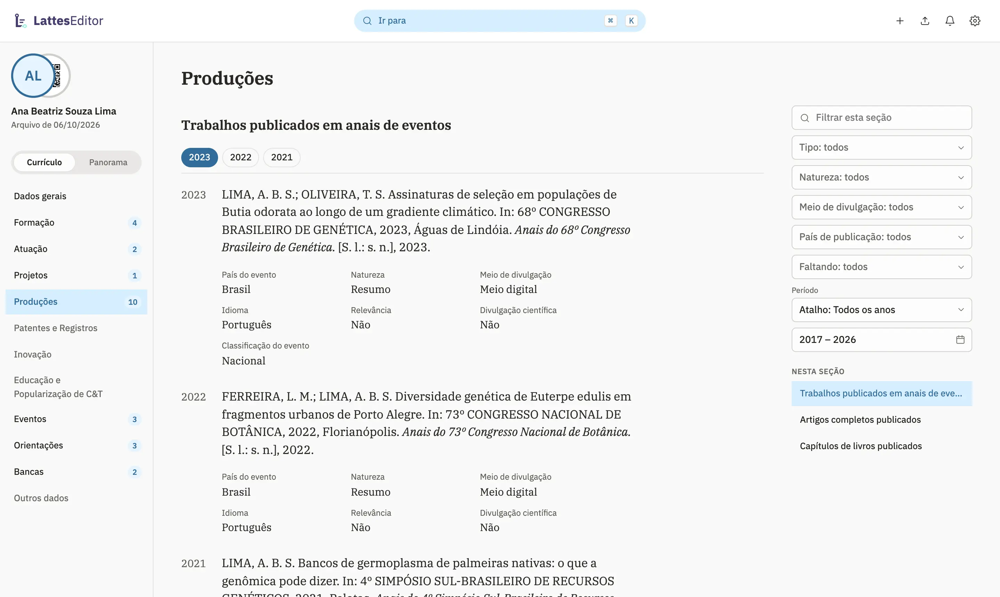

# LattesEditor

Um editor para o Currículo Lattes que roda no seu computador. O currículo
abre direto do Lattes, você edita com busca, atalhos e formulários que não se
perdem, e as mudanças voltam ao Lattes pela extensão ou pelo Importar. Página
do projeto: [rlueder.github.io/lattes-editor](https://rlueder.github.io/lattes-editor/).

## Baixar

Os instaladores ficam na
[página do último lançamento](https://github.com/rlueder/lattes-editor/releases/latest).

| Sistema     | Arquivo                                          |
| ----------- | ------------------------------------------------ |
| macOS       | `LattesEditor-macOS.dmg` (Apple Silicon e Intel) |
| Windows     | `LattesEditor-Windows-setup.exe`                 |
| Linux       | `LattesEditor-Linux.deb` (Debian, Ubuntu, Mint)  |
| Outro Linux | `LattesEditor-Linux.AppImage`                    |

No Linux, o app pede glibc 2.39 ou mais nova (Ubuntu 24.04, Debian 13, Mint
22). O instalador do Windows ainda não é assinado: na primeira abertura, o
SmartScreen avisa; abra os detalhes e escolha executar.

Para ler e gravar no Lattes, instale também a
[extensão para Chrome e Brave](https://chromewebstore.google.com/detail/kdebkpkdhgaeaaobcbgbckinocnlfbgg).
Sem ela, exporte o currículo no Lattes e solte o `CV_<id>.zip` na janela do
app.

## Privacidade

Não há servidor nem conta. O currículo fica no seu computador, cifrado. Saem
dele só o DOI, quando você pede a busca no Crossref, e o código do currículo,
para buscar a foto no CNPq. O que vai ao Lattes vai pela sua sessão, no seu
navegador. Detalhes na
[política de privacidade](https://rlueder.github.io/lattes-editor/privacidade.html).

## Documentação

- [`docs/README.md`](docs/README.md): o índice
- [`docs/arquitetura.md`](docs/arquitetura.md): como as peças se encaixam
- [`docs/desenvolvimento.md`](docs/desenvolvimento.md): rodar, testar e lançar
- [`ROADMAP.md`](ROADMAP.md) e [`CHANGELOG.md`](CHANGELOG.md)

## Licença

MIT. A fonte IBM Plex vem sob a SIL Open Font License
(`src/ui/fonts/LICENSE.txt`, `brand/construction/fonts/LICENSE.txt`).
