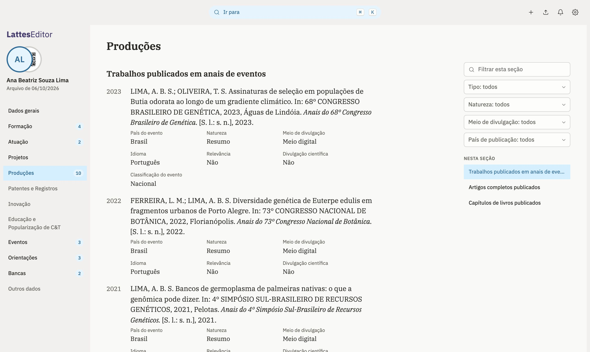
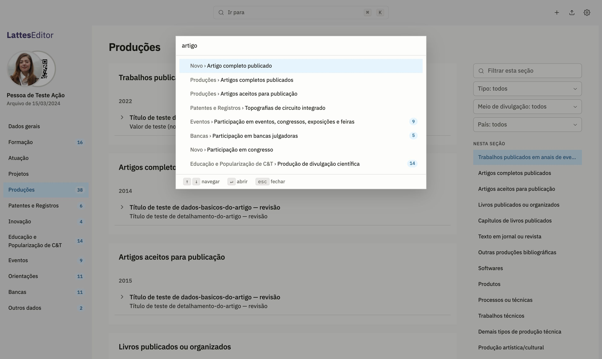
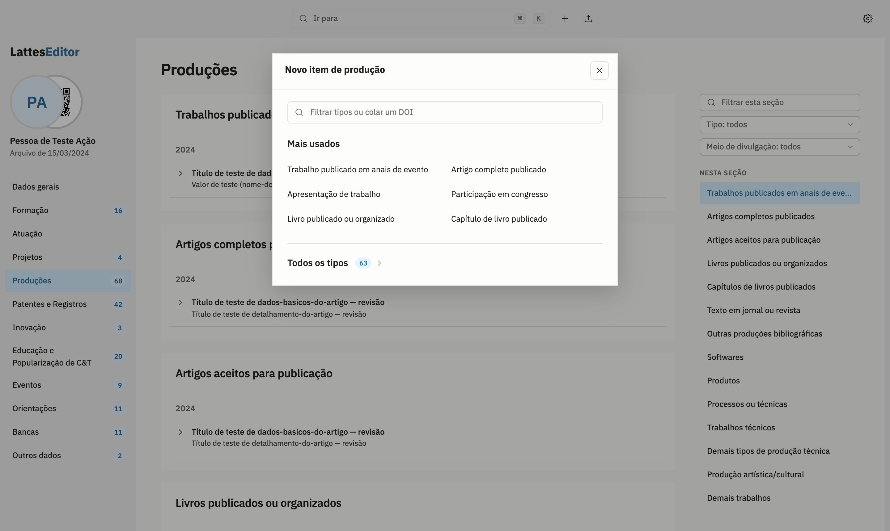
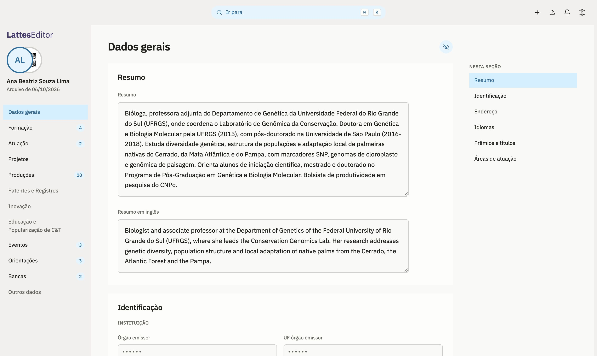

# LattesEditor

Um editor para o Currículo Lattes que roda no seu computador. Você exporta o
currículo no Lattes, edita aqui com busca, atalhos e formulários que não se
perdem, e leva as mudanças de volta ao Lattes. A página do projeto fica em
[rlueder.github.io/lattes-editor](https://rlueder.github.io/lattes-editor/).

<picture>
  <source media="(prefers-color-scheme: dark)" srcset="docs/img/producoes-escuro.jpg" />
  
</picture>

## Baixar

O editor é um app para macOS, Windows e Linux. Os instaladores ficam na
[página do último lançamento](https://github.com/rlueder/lattes-editor/releases/latest):

| Sistema     | Arquivo                                          |
| ----------- | ------------------------------------------------ |
| macOS       | `LattesEditor-macOS.dmg` (Apple Silicon e Intel) |
| Windows     | `LattesEditor-Windows-setup.exe`                 |
| Linux       | `LattesEditor-Linux.deb` (Debian, Ubuntu, Mint)  |
| Outro Linux | `LattesEditor-Linux.AppImage`                    |

No macOS, o app é assinado e notarizado pela Apple e abre sem aviso. O
instalador do Windows ainda não tem assinatura: o SmartScreen avisa na
primeira abertura; abra os detalhes do aviso e escolha executar.

Depois de instalado, o app se atualiza sozinho: ao abrir e de hora em hora,
confere se saiu versão nova e, se saiu, um aviso no canto oferece
"Atualizar" (o sino guarda a mesma oferta). O app baixa o pacote, confere a
assinatura e reinicia. No Linux, isso vale para o AppImage; o `.deb` se
atualiza baixando o novo.

No Linux, o `.deb` é pequeno porque usa o WebKitGTK do sistema, que o
gerenciador de pacotes instala junto. O AppImage roda em qualquer
distribuição sem instalar nada e por isso leva o WebKitGTK dentro, o que o
deixa dezenas de vezes maior.

## Como funciona

1. **Exporte do Lattes.** Ferramentas › Exportar baixa o `CV_<id>.zip`.
2. **Abra no app** e escolha o arquivo, ou solte-o na janela.
3. **Edite.** O menu lateral leva às seções; <kbd>⌘K</kbd> (<kbd>Ctrl</kbd>+<kbd>K</kbd>
   fora do Mac) acha qualquer seção, grupo ou tipo de item. Cada edição fica
   salva no app.
4. **Leve ao Lattes.** Produções novas entram pelo Importar do próprio
   Lattes, com o arquivo que o app gera. O resto vai pela extensão do conector
   ou, sem ela, campo a campo, com o valor antigo e o novo lado a lado.
   Depois, exporte de novo e use "Recarregar do Lattes": o que já chegou lá
   sai da lista. Cada exportação aberta vira uma versão, e o app diz o que
   mudou desde a anterior ("Versões do Lattes", no ⌘K), inclusive o que foi
   editado direto no Lattes.

<picture>
  <source media="(prefers-color-scheme: dark)" srcset="docs/img/ir-para-escuro.jpg" />
  
</picture>

Para cadastrar uma produção, use **+** ao lado da busca. Colar um DOI preenche
o formulário pelo Crossref.

<picture>
  <source media="(prefers-color-scheme: dark)" srcset="docs/img/novo-item-escuro.jpg" />
  
</picture>

Também dá para imprimir ou salvar em PDF nas regras da NBR 14724, com
referências na NBR 6023, e compartilhar o currículo por um código QR.

Para quem volta ao Lattes depois de muito tempo, o **Diagnóstico do
currículo** (no <kbd>⌘K</kbd>, ou pela faixa do cabeçalho quando o Lattes tem
pendências que o editor não conhece) mostra a data da última publicação, o
que mudou no Lattes desde a exportação (com a extensão, comparando os
títulos das produções e dos eventos) e o que vale conferir no currículo
inteiro: duplicatas, ISSN, DOI, datas e vínculos antigos ainda marcados como
atuais. Só aponta; nada muda sem você.

## Privacidade

Não há servidor nem conta. O currículo é lido e guardado no próprio
computador, e o arquivo salvo vai para o seu disco. Saem dele só a busca do
DOI no Crossref, quando você pede, e a foto do perfil, buscada no CNPq.

O que o app guarda entre uma sessão e outra (cópia de trabalho, histórico,
registro do que foi enviado ao Lattes e versões do Lattes) fica cifrado com
AES-GCM. A chave é
gerada no primeiro uso e mora no chaveiro do sistema: Keychain no macOS,
Gerenciador de Credenciais no Windows, Secret Service (GNOME Keyring ou
KWallet) no Linux. Sem chaveiro disponível, o app avisa e não guarda nada
naquela sessão, em vez de deixar o currículo legível no disco. Se a chave
some (chaveiro apagado), os dados guardados não podem mais ser lidos; o app
oferece começar de novo a partir de uma exportação do Lattes, e o registro
do enviado se perde. No `pnpm dev`, no navegador, vale uma chave fixa de
desenvolvimento, só para o currículo de exemplo.

Em Dados gerais, documentos, nascimento, filiação e endereço ficam
mascarados até você clicar no olho, ao lado do título.

<picture>
  <source media="(prefers-color-scheme: dark)" srcset="docs/img/dados-gerais-escuro.jpg" />
  
</picture>

## Extensão do conector (em teste)

A extensão para Brave e Chrome envia ao Lattes, na sua própria sessão, as
alterações que de outro jeito se copiam à mão. Cada uma é gravada, lida de
volta e conferida, e a fila para no primeiro problema. Nenhuma senha passa
pela extensão nem pelo app. Hoje ela leva o resumo e campos do vínculo de uma
atuação; os idiomas ainda estão em teste.

Com a extensão ligada e o Lattes aberto no navegador, o app abre o seu
currículo sozinho quando não há nenhum aberto, sem baixar nem escolher arquivo: a
extensão pede o mesmo ZIP do "Exportar" na sua sessão e o entrega ao app.
Se o Lattes tem alterações ainda não enviadas ao CNPq, o Exportar recusa, e
a tela inicial pede o envio antes. "Abrir do Lattes" na tela inicial faz o
mesmo a qualquer hora.

O app e a extensão conversam por mensagens nativas do navegador: ao abrir,
o app se registra no Chrome, no Brave, no Edge e no Chromium. Enquanto a
extensão não está na Chrome Web Store, instale assim:

1. Baixe `lattes-editor-extensao.zip` da página do lançamento e descompacte.
2. Em `brave://extensions` (ou `chrome://extensions`), ligue o "Modo do
   desenvolvedor" e use "Carregar sem compactação" na pasta. Extensão
   carregada assim não se atualiza sozinha: a cada versão nova do app, troque
   a pasta pela do zip novo e clique em recarregar.
3. No primeiro uso, o painel mostra o que a extensão lê e envia e pede um
   "ok"; sem ele, ela não toca no Lattes.
4. Com o currículo aberto no Lattes numa aba, "Levar ao Lattes" no app passa
   a oferecer o envio pela extensão.

O que a extensão lê e envia está na
[política de privacidade da extensão](https://rlueder.github.io/lattes-editor/privacidade.html).
Para gerar as imagens da página na Chrome Web Store: `pnpm build:extension`,
`pnpm dev` e `pnpm capture:store` (saem em `docs/img/loja/`).

O conector altera itens que já existem no Lattes. Criar itens novos por ele
(uma atuação com um vínculo, por enquanto) está escrito e testado contra um
Lattes simulado, mas desligado até um teste acompanhado no Lattes real
(`docs/lattes_internals.md`, seção 11).

O que o conector grava fica pendente no Lattes até você clicar em "Enviar ao
CNPq", e o Lattes não mostra nem descarta essas pendências. Por isso o app
guarda, no próprio computador, o registro do que foi gravado e conferido:
"Enviado ao Lattes", dentro de "Levar ao Lattes", lista cada alteração por
dia, com o valor de antes e o de depois. "Desfazer no Lattes" manda de volta
o valor de antes, com a mesma confirmação de qualquer envio, e a alteração
volta para a lista do que falta levar. O registro continua lá depois de
fechar o arquivo ou abrir outra exportação.

O cabeçalho resume esse caminho numa faixa: `Original · 3 alterações · 2 no
Lattes · publicado em 17/08/2026`. Com a extensão e o Lattes aberto, a data
da última publicação e as pendências vêm do próprio menu do Lattes; o passo
que pede ação fica em destaque, e cada contagem abre a lista dela. Sem essa
leitura, o sino ao lado das configurações diz por quê ("Lattes não
conectado", "Lattes fechado", "Extensão sem o seu ok", "Lattes aberto em
outro currículo") e o que fazer; o ponto no sino acende só com o que pede
ação.

App e extensão saem do mesmo lançamento, com o mesmo número de versão, mas
se atualizam separados: a extensão pela loja (ou à mão, quando carregada sem
compactação), o app pelo aviso de versão nova. No aperto de mão,
cada um anuncia o que sabe fazer (`src/bridge/compat.ts`). Quando um dos dois
está atrás, o sino do app mostra "Extensão desatualizada" ou "App
desatualizado", e o painel da extensão diz qual atualizar.

O CNPq não avisa quando muda o Lattes. Por isso a extensão confere sozinha,
só com leituras, o menu e um exemplar de cada formulário que o conector grava
contra o que ela espera (nomes, tipos e limites dos campos, nunca valores):
ao abrir o painel e quando o menu do Lattes carrega, no máximo a cada meia
hora com tudo certo. O painel só mostra a verificação quando acha um
problema, com o que mudou e "Verificar de novo". A mesma verificação roda
antes de cada envio, e uma mudança que quebra o conector para a fila antes de
gravar. O relatório pode ser copiado ou aberto como issue, sem nada do
currículo dentro.

## Desenvolvimento

```bash
pnpm install
pnpm desktop:dev          # o app, com recarga ao vivo e o selo DEV no ícone (precisa de Rust)
pnpm dev                  # só a página do editor, no navegador
pnpm dev:exemplo          # o editor já aberto com o currículo sintético completo
pnpm test                 # testes (pnpm test:coverage com o limite de 80%)
pnpm build:extension      # a extensão em dist-extension/
pnpm capture:screenshots  # refaz as imagens deste README
```

O app usa Tauri 2 e precisa do Rust e, no macOS, das ferramentas de linha de
comando do Xcode. As imagens em `docs/img/` e `site/img/` saem sempre do
currículo sintético em `fixtures/`, nunca de um real. Para testar com uma
exportação sua, ponha o `CV_<id>.zip` em `fixtures/real/`, que está no
`.gitignore`.

`pnpm dev:exemplo` abre o editor na porta 5199 com `fixtures/synthetic_full.xml`,
que preenche todas as seções. Cada porta tem o próprio armazenamento no
navegador, então o currículo aberto no `pnpm dev` (porta 5173) não é tocado.
Para recomeçar do exemplo, feche o arquivo no editor e recarregue a página.

Os scripts `pnpm gen:schema`, `pnpm gen:fixtures` e `pnpm validate:fixtures`
geram o modelo a partir do XSD do Lattes e validam as fixtures.

`node scripts/vigia-lattes.ts` confere, sem login, o que o CNPq expõe ao
público e de que o editor depende: o XSD (byte a byte contra o do
repositório), a página que o publica, a foto do perfil e a entrada do Lattes.
O workflow "Vigia do Lattes" roda isso toda segunda-feira e abre uma issue
com o rótulo `vigia-lattes` quando algo muda. O que fica atrás do login é
conferido pela extensão (ver acima).

## Lançamentos

Cada push na `main` passa pelo CI. Com ele verde, o semantic-release decide a
versão pelos commits (`feat` sobe a menor; `fix`, `perf` e `refactor`, a
correção), atualiza o `CHANGELOG.md`, cria a tag e publica a página do
lançamento. Em seguida o app é montado nos três sistemas e os instaladores
entram na mesma página, junto com os pacotes de atualização assinados e o
`latest.json` que o app confere (`.github/workflows/desktop-build.yml`). A
chave de atualização fica nos segredos `TAURI_SIGNING_PRIVATE_KEY` e
`TAURI_SIGNING_PRIVATE_KEY_PASSWORD`, e a pública em
`src-tauri/tauri.conf.json`. Sem a privada não há como publicar uma
atualização que o app aceite: guarde uma cópia fora do GitHub.

Para revisar o aviso sem lançar nada: `pnpm dev` e
`http://localhost:5173/?simular-atualizacao`.

## Documentação

- [`ROADMAP.md`](ROADMAP.md): o que vem a seguir
- [`CHANGELOG.md`](CHANGELOG.md): o que mudou
- [`docs/lattes_internals.md`](docs/lattes_internals.md): como o editor do
  Lattes funciona por dentro, base do conector
- [`docs/estilo_da_interface.md`](docs/estilo_da_interface.md): referência
  visual e regras de interface
- [`docs/lattes_implementation_guide.md`](docs/lattes_implementation_guide.md)
  e [`docs/lattes_product_requirements.md`](docs/lattes_product_requirements.md):
  decisões e pesquisa de produto
- [`docs/extensao_chrome_web_store.md`](docs/extensao_chrome_web_store.md):
  o que falta para publicar a extensão
- [`brand/`](brand/): o símbolo, a assinatura e os ícones de cada sistema,
  com a grade de construção e os scripts que os geram (`brand/LEIA-ME.txt`)
- [`AGENTS.md`](AGENTS.md): regras para quem contribui

## Licença

MIT. A fonte IBM Plex vem sob a SIL Open Font License, em
`src/ui/fonts/LICENSE.txt` e `brand/construction/fonts/LICENSE.txt`.
