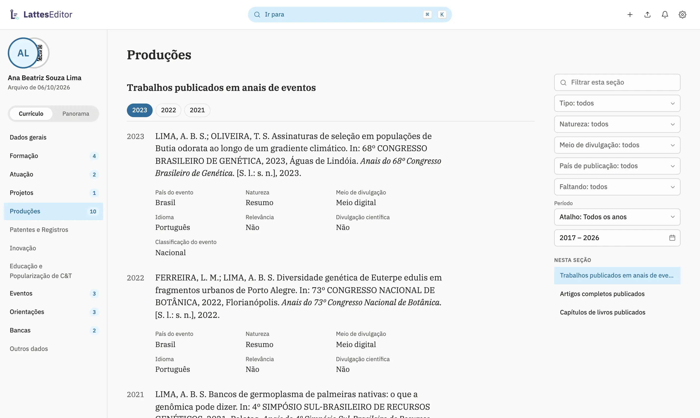
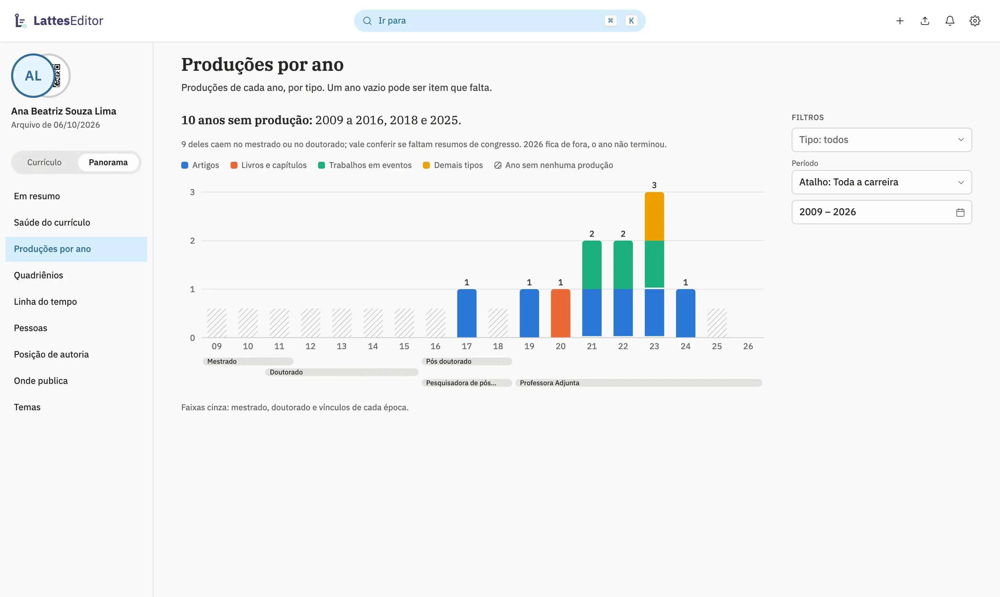
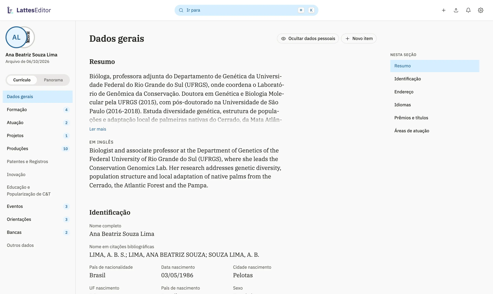

# LattesEditor

Um editor para o Currículo Lattes que roda no seu computador. O currículo
abre direto do Lattes, você edita com busca, atalhos e formulários que não se
perdem, e as mudanças voltam ao Lattes pela extensão ou pelo Importar. Página
do projeto: [rlueder.github.io/lattes-editor](https://rlueder.github.io/lattes-editor/).

## Baixar

Os instaladores ficam na
[página do último lançamento](https://github.com/rlueder/lattes-editor/releases/latest).

| Sistema     | Arquivo                                          |
| ----------- | ------------------------------------------------ |
| macOS       | `LattesEditor-macOS.dmg` (Apple Silicon e Intel) |
| Windows     | `LattesEditor-Windows-setup.exe`                 |
| Linux       | `LattesEditor-Linux.deb` (Debian, Ubuntu, Mint)  |
| Outro Linux | `LattesEditor-Linux.AppImage`                    |

No Linux, o app pede Ubuntu 24.04, Debian 13, Mint 22 ou outra distribuição com
glibc 2.39 ou mais nova.

No macOS, o app é assinado e notarizado pela Apple. No Windows, o instalador
ainda não tem assinatura: o SmartScreen avisa na primeira abertura; abra os
detalhes e escolha executar. O app confere se há versão nova ao abrir e a cada
15 minutos, e se atualiza com um clique.

## Como funciona

1. **Instale a extensão** no Chrome ou no Brave (abaixo) e entre no Lattes
   como sempre. Nenhuma senha passa por ela nem pelo app.
2. **Abra o app.** Ele pede ao Lattes, na sua sessão, a mesma exportação do
   menu Exportar e abre o currículo. Sem a extensão, exporte no Lattes
   (Ferramentas › Exportar) e solte o `CV_<id>.zip` na janela.
3. **Edite.** O menu lateral leva a cada seção; <kbd>⌘K</kbd>
   (<kbd>Ctrl</kbd>+<kbd>K</kbd> fora do Mac) acha seções, grupos e tipos de
   item. Os campos que no Lattes são listas (país, idioma, natureza, área do
   conhecimento, instituição, curso, agência) são listas aqui também. Uma
   seção vazia mostra uma ilustração na grade do logo. Cada edição fica
   salva no app.
4. **Envie ao Lattes.** O painel "Enviar ao Lattes" vai em três passos:
   revisar, gravar e publicar. Produções novas vão pelo Importar do próprio
   Lattes, num arquivo que o app gera. O resto vai pela extensão, que grava na
   sua sessão, lê cada formulário de volta e confere. O que ela ainda não
   grava fica no painel campo a campo, com o valor antigo ao lado do novo.

Para cadastrar um item, use **+** ao lado da busca. Colar um DOI preenche a
produção pelo Crossref. "Trazer itens de outro XML…", no ⚙, importa produções
de outra exportação ou de outro programa; cada item é comparado com o
currículo antes de entrar, e o app aponta a duplicata provável e o motivo.
Use o botão circular × para fechar o histórico ou um formulário.

Em pós-doutorado e livre-docência, a instituição também é escolhida pela
busca do Lattes. Esses formulários não têm curso; a agência aparece só no
pós-doutorado.

Raça ou cor, pessoa com deficiência, tipo de graduação, tipo de licença e categoria da patente têm listas de opções.
A disponibilidade de produtos, processos, relatórios de pesquisa e trabalhos
técnicos também é escolhida por lista, inclusive quando não foi informada.

Em Endereço, você pode editar e-mails, URLs das redes sociais e outras formas
de contato (MSN, WhatsApp, Telegram) já cadastradas, quando o formato da
exportação é reconhecido. Incluir ou remover contatos
continua no Lattes. A troca de URL mantém a privacidade que a rede já tinha.

O **Diagnóstico do currículo**, no ⚙, confere o currículo inteiro: campos
obrigatórios, valores fora das listas do Lattes, anos, autores, DOI, ISSN,
duplicatas e vínculos antigos ainda marcados como atuais. Só aponta; nada muda
sem você.

Cada exportação aberta vira uma versão, e o app diz o que mudou desde a
anterior, inclusive o que foi editado direto no Lattes. A primeira exportação
de cada currículo e uma cópia antes de cada envio ficam em
`Documentos/LattesEditor/Cópias de segurança`, e o app nunca as apaga.

Também dá para imprimir ou salvar em PDF nas regras da NBR 14724, com
referências na NBR 6023, e compartilhar o currículo por um código QR.

## Panorama

O currículo em números, calculados só com o XML aberto: produções por ano,
quadriênios da CAPES (com saída em CSV), linha do tempo da carreira, pessoas
(coautores, orientandos, orientadores e bancas), posição de autoria, onde
publica, temas e o que falta preencher. Um clique num número abre a seção já
filtrada por tipo, período ou campo que falta.

## Enviar ao Lattes

A extensão grava em segundo plano, confere cada alteração relendo o
formulário e para no primeiro problema. A cada 20 gravações ela faz uma pausa
para você olhar o Lattes e só segue com "Continuar" no editor. O histórico no
fim do painel guarda o valor antigo e o novo de cada gravação e deixa
desfazer.

Enquanto o app está aberto e ligado à extensão, a extensão abre uma página
pequena do Lattes a cada 20 minutos, na sua sessão, para ela não cair por
falta de uso. Com o app fechado, isso para.

O que o conector grava fica pendente no Lattes até "Enviar ao CNPq", e o
Lattes não mostra nem descarta essas pendências. Por isso o app guarda o
registro do que gravou. Uma gravação que não voltou conferida bloqueia o
"Enviar ao CNPq" do editor até você conferir o item no Lattes. O terceiro
passo mostra o que vai ser publicado e a declaração lida do CNPq. Confira os
dados e marque a declaração para publicar pelo app. Ela começa desmarcada a
cada abertura e não fica guardada. A extensão envia uma vez e confere o menu
do Lattes; se a confirmação se perder, o app pede para conferir antes de
tentar novamente.

## Privacidade

Não há servidor nem conta. O currículo é lido e guardado no próprio
computador, cifrado com AES-GCM, com a chave no chaveiro do sistema. Sem
chaveiro, o app avisa e não guarda nada naquela sessão. Saem do computador só
o DOI, quando você pede a busca no Crossref, e o código do currículo, para
buscar a foto no CNPq. O que vai ao Lattes vai pela sua própria sessão, no
seu navegador. Em Dados gerais, documentos, nascimento, filiação e endereço
ficam mascarados até você clicar no olho ao lado do título.

## Extensão do conector

1. Instale a extensão pela
   [Chrome Web Store](https://chromewebstore.google.com/detail/kdebkpkdhgaeaaobcbgbckinocnlfbgg). O Brave instala da mesma loja.
2. No primeiro uso, o painel mostra o que ela lê e envia e pede um "ok".

Quando uma leitura ou um envio não dá certo, o rodapé do painel guarda os
dez últimos erros com a aba do Lattes: a hora, o que estava sendo feito e o
motivo, sem nada do currículo.

A loja atualiza a extensão sozinha. O que ela lê e envia está na
[política de privacidade](https://rlueder.github.io/lattes-editor/privacidade.html).

## Documentação

- [`docs/README.md`](docs/README.md): o índice
- [`docs/arquitetura.md`](docs/arquitetura.md): como as peças se encaixam
- [`docs/desenvolvimento.md`](docs/desenvolvimento.md): rodar, testar e lançar
- [`ROADMAP.md`](ROADMAP.md) e [`CHANGELOG.md`](CHANGELOG.md)

## Licença

MIT. A fonte IBM Plex vem sob a SIL Open Font License
(`src/ui/fonts/LICENSE.txt`, `brand/construction/fonts/LICENSE.txt`).
