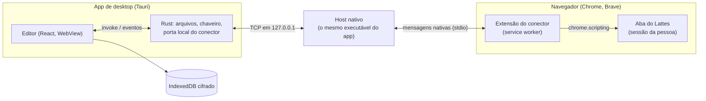

# Arquitetura

Como as peças do LattesEditor se encaixam, para quem vai mexer no código. O
detalhe de cada parte está nos arquivos citados; o que o Lattes faz por dentro
está em [`lattes_internals.md`](lattes_internals.md).

## Visão geral

O editor é uma página React que roda no WebView do sistema, dentro do app
Tauri. Ele nunca fala com o Lattes direto: quem fala é a extensão, de dentro
da aba em que a pessoa já está logada, com o cookie dela. O app e a extensão
se encontram pelo host de mensagens nativas, que é o próprio executável do app
chamado pelo navegador.

## O currículo: uma árvore XML, não JSON

O currículo carregado fica como uma árvore XML genérica e sem perda
(`src/model/xml.ts`): `XElement` com nome, atributos na ordem em que vieram e
filhos; `XText`, `XCData` e `XRaw` guardam texto, CDATA e o resto como estava.
Não há objetos tipados por item (nada de `Artigo { titulo, ano }`). Tudo
trabalha sobre essa árvore: formulários, diferenças, o arquivo do Importar, o
plano do conector e a validação.

O motivo é a ida e volta. Elementos que o editor não conhece, a ordem dos
atributos, o texto em Latin-1 (`src/model/latin1.ts`) e até o texto que o
próprio Lattes grava estragado (`src/model/mojibake.ts`) saem iguais ao que
entraram. O arquivo que volta ao Lattes só muda onde a pessoa mudou.

O que é JSON é o **modelo do schema**. `pnpm gen:schema`
(`scripts/gen-schema.ts`) lê o XSD oficial de 2022
(`schema/CurriculoLattes_12_09_2022.xsd`), aplica `schema/patch.json` (atributos
que as exportações reais trazem e o XSD não declara) e gera
`src/schema/lattes.json`. Para cada um dos 324 elementos, ele diz:

- os atributos, com obrigatoriedade, valor padrão e lista de valores (enum);
- os filhos, na ordem obrigatória do arquivo, com mínimo e máximo;
- se o elemento aceita texto.

A interface lê esse modelo para montar os campos e saber o que é obrigatório.
O serializador o usa para pôr cada filho novo no lugar certo
(`src/model/schema-order.ts`), e a validação, para conferir um item antes de ir
ao Lattes (`src/model/validate.ts`). Por cima dele ficam as listas que o
próprio Lattes oferece nos formulários (país, idioma, natureza de evento),
capturadas sem salvar nada: `src/schema/typed-choices.ts` e
`src/schema/listas-lattes.json` (ver [`campos_tipados.md`](campos_tipados.md)).
As listas grandes demais ou que dependem de uma escolha (áreas do
conhecimento, agências, instituições, cursos) não vêm no código: a extensão as
lê no Lattes, e o editor guarda uma cópia (`src/ui/live-lists.ts`).

## O que o app guarda

Tudo fica no IndexedDB do WebView (`src/model/store.ts`, com Dexie), cifrado
com AES-GCM (`src/model/seal.ts`). Em claro ficam só as chaves de busca: datas,
o identificador público do currículo e marcas como "manter". A chave é gerada no primeiro uso e mora no
chaveiro do sistema (`src-tauri/src/chave.rs`); sem chaveiro, o app não guarda
nada naquela sessão. São cinco tabelas:

| Tabela     | O que guarda                                                                                                                             |
| ---------- | ---------------------------------------------------------------------------------------------------------------------------------------- |
| `working`  | A cópia de trabalho: o XML atual, o XML como foi carregado (base das diferenças e do "descartar") e o próximo `SEQUENCIA-PRODUCAO` livre |
| `history`  | O histórico de alterações: cada ponto com o XML e uma nota, os marcados para não sair da lista                                           |
| `versions` | Cada exportação aberta, por currículo: a linha do tempo do Lattes                                                                        |
| `sent`     | O registro do que o conector gravou no Lattes, com o antes e o depois de cada campo                                                      |
| `lists`    | A última leitura das listas do Lattes feita pelo conector (áreas do conhecimento e agências), com a data (`src/model/list-cache.ts`)     |

As três primeiras guardam XML serializado; `sent` guarda as operações do
conector. As alterações a enviar não são guardadas: saem, a cada momento, da
diferença entre a cópia de trabalho e a exportação carregada
(`src/model/changes.ts`).

## Do editor ao Lattes

Cada alteração segue um de três caminhos (`src/import-export/send-routes.ts`),
que o painel "Enviar ao Lattes" mostra item por item:

- **Item novo de produção** vai pelo **Importar** do próprio Lattes, num arquivo
  gerado pelo editor (`src/import-export/import-file.ts`). Os módulos e anos
  que o passo 2 do Importar pede estão em `src/import-export/importable.ts`.
- **Alteração que o conector sabe gravar** vai **pela extensão**:
  `src/bridge/plan.ts` transforma a alteração numa operação de formulário, e
  `src/bridge/apply.ts` a aplica na aba do Lattes. Antes de gravar, confere
  que o formulário está como o editor espera; depois, lê de novo e confere que
  só os campos da operação mudaram. Formação, endereço e identificação têm as
  operações em `src/bridge/biographic.ts`, desligadas até o teste no Lattes
  real (`BIOGRAPHIC_OPS_ENABLED`); enquanto isso, seguem à mão.
- **Item removido no editor** pode ir pela extensão com
  `src/bridge/delete.ts`, que posta o formulário de edição do item com
  `f_ctr=E`, como o botão "Excluir" do Lattes, e confere lendo a lista de
  novo (o item sumiu, nada mais mudou), sem depender da resposta do Lattes.
  Hoje só idioma e vínculo, e desligado (`DELETE_ITEMS_ENABLED`) até um teste
  acompanhado; desligado, a remoção fica à mão. A atuação inteira e as
  formações ficam sempre à mão: a primeira apaga em cascata, e excluir uma
  formação pode tornar outra pública. Uma exclusão não tem "Desfazer no
  Lattes" no registro do enviado.
- **O resto** fica **à mão**, campo a campo, com o valor antigo e o novo lado a
  lado.

Formação acadêmica, atuação profissional, projeto e patente também se criam no
editor (`src/model/general-items.ts`, formulário em
`src/forms/GeneralItemForm.tsx`), mas nenhum módulo do Importar lê essas
seções. O item novo é uma alteração como as outras: o conector o inclui quando
souber (a inclusão de atuação existe em `src/bridge/create.ts`, desligada), e
fora isso ele vai à mão. Por isso "item novo de produção" quer dizer item com
`SEQUENCIA-PRODUCAO` nova **e** tipo que um módulo do Importar lê
(`isPendingImport`, em `src/model/production.ts`): a patente usa o contador
global, mas não vai pelo Importar. As sequências biográficas
(`SEQUENCIA-FORMACAO`, `SEQUENCIA-ATIVIDADE`, `SEQUENCIA-PROJETO`) ficam acima
da maior da cópia de trabalho e da exportação carregada. O projeto entra numa
`PARTICIPACAO-EM-PROJETO` nova, dentro da atuação escolhida no formulário.

Uma alteração num item de **participação em eventos** que já está no Lattes
pode ir pelo conector, no próprio formulário do evento
(`src/bridge/edit-items.ts`): a linha da lista se acha pelo
`SEQUENCIA-PRODUCAO`, e a operação confere antes que o formulário é de
ouvinte, do mesmo tipo de evento e com o mesmo ano ou nome. Vão título, ano,
país, home page, divulgação científica, título em inglês e nome do evento.
Ficam à mão os eventos de convidado e participante, a forma, o tipo, a
natureza, a cidade e o que o formulário não tem (idioma, palavras-chave,
áreas). O caminho está desligado (`EDIT_ITEMS_ENABLED` em `false`) até um
teste acompanhado num Lattes real; desligado, o evento segue à mão e o
contrato não confere o formulário.

A decisão de 13/10/2026 sobre duplicatas (só o que é novo vai pelo Importar;
alteração no lugar; exclusão pelo formulário) está no
[guia de implementação](lattes_implementation_guide.md), seção 1, e nos
tickets LAT-50, LAT-51 e LAT-49.

A inclusão de itens pelo conector está escrita e **desligada**
(`CREATE_ITEMS_ENABLED`, em `src/bridge/create.ts`) até um teste acompanhado
no Lattes real: atuação com o primeiro vínculo (`create.ts`), formação
acadêmica nos dez níveis do "Incluir novo item" (`create-formacao.ts`) e
projeto (`create-projeto.ts`), com o que as duas têm em comum em
`create-shared.ts` e o despacho em `create-items.ts`. Cada inclusão confere
antes (nada igual na lista, formulário em modo de inclusão, campos presentes),
acha instituição, curso e agência pelas buscas do próprio Lattes, e depois
relê a lista: exatamente um item novo, com os campos lidos de volta iguais aos
enviados. Desfazer uma inclusão não passa pelo conector; o registro do enviado
diz para excluir no Lattes.

### O caminho de uma mensagem

1. O editor chama `conector_send` (Rust), que escreve uma linha de JSON na
   ligação TCP com o host (`src-tauri/src/conector.rs`).
2. O app escuta numa porta local aleatória e grava a porta e um segredo, gerado
   a cada abertura, em `conector.txt`, na pasta de dados (só o dono lê). O host
   lê esse arquivo e se apresenta com o segredo; ligação sem ele é ignorada.
3. O host repassa a mensagem à extensão pelo stdio das mensagens nativas, e a
   resposta faz o caminho de volta.
4. O service worker da extensão (`extension/src/background.ts`) injeta o núcleo
   do conector na aba do menu do Lattes (`extension/src/lattes-runner.ts`), que
   faz `fetch` na mesma origem, com o cookie da sessão, e lê os formulários com
   `DOMParser`. Senha nenhuma passa por aqui.

As mensagens têm envelope e versão (`src/bridge/protocol.ts`). No aperto de
mão (`ola`), cada lado anuncia o que sabe fazer (`src/bridge/compat.ts`), e o
editor e o painel da extensão dizem qual dos dois está desatualizado. Ao
abrir, o app se registra como host nativo no Chrome, no Brave, no Edge e no
Chromium, com o ID da extensão autorizado.

No `pnpm dev`, sem o app, o editor roda no navegador e fala com a extensão
pelo `window.postMessage` da própria página, por um content script
(`extension/src/content.ts`), que só vale em `localhost`.

### O que a extensão faz sozinha

- **Abrir do Lattes** (`src/bridge/export.ts`): pede o mesmo ZIP do "Exportar"
  na sessão da pessoa e o entrega ao editor.
- **Estado do Lattes** (`src/bridge/lattes-status.ts`): lê do menu a data da
  última publicação e se há alteração pendente de envio ao CNPq.
- **Conferência do contrato** (`src/bridge/contract.ts`): só com leituras,
  compara o menu e um exemplar de cada formulário que o conector grava com o
  que ele espera (nomes, tipos e limites, nunca valores), e as listas dos
  campos tipados (`src/bridge/list-watch.ts`). Uma mudança que quebra o
  conector para a fila antes de gravar.
- **Foto do currículo** (`src/bridge/photo.ts`): troca a foto pela tela de
  envio do próprio Lattes e confere depois.
- **Listas do Lattes** (`src/bridge/lattes-lists.ts`): só com GET, nunca
  grava. Lê a tabela de áreas do conhecimento (o vetor `areaDP` do menu, lido
  como literal, sem `eval`) e a lista de agências de fomento quando o editor
  liga e a cópia guardada passou de um dia; busca instituição
  (`PRC_INST_FORM`) enquanto a pessoa digita; lê os cursos de uma instituição
  (`prc_curso_form`) quando ela pede. A conferência do contrato confere que a
  tabela de áreas e a lista de agências continuam lá.
- **Importar dos itens novos** (`src/bridge/importar.ts`, LAT-50), desligado
  por `IMPORT_ENABLED`. Envia um arquivo só com os itens novos
  (`buildMinimalImportFile`, em `src/import-export/import-file.ts`), confere
  o formulário do passo 2, marca só os módulos do arquivo e o ano do item mais
  antigo, confirma o passo 2 e para na resposta, sem confirmar o passo 3. No
  teste acompanhado de 14/10/2026 o Lattes recusou o arquivo mínimo, e um
  Confirmar do passo 3 com sucesso na tela não pôs o item no currículo
  (`lattes_internals.md`, seção 13), então a chave continua desligada. Uma solicitação
  pendente no Importar também para o fluxo; o conector nunca descarta nada.
  Enquanto a chave estiver desligada, o editor não mostra o botão e a extensão
  recusa o pedido; o "Baixar arquivo" com os passos à mão continua igual.

## Mapa do código

| Pasta                | O que tem                                                                                                 |
| -------------------- | --------------------------------------------------------------------------------------------------------- |
| `src/model/`         | Árvore XML, carga e gravação (ZIP e XML, Latin-1), diferenças, validação, banco cifrado                   |
| `src/schema/`        | Modelo gerado do XSD, tipos derivados, listas do Lattes                                                   |
| `src/ui/`            | A interface: seções, formulários de atributo, sino, ⌘K, temas, foto, primeiro uso                         |
| `src/forms/`         | Formulários de item novo: produção (autores, áreas, palavras-chave), formação, atuação, projeto e patente |
| `src/import-export/` | O painel "Enviar ao Lattes", o arquivo do Importar, o ZIP, o registro do enviado                          |
| `src/bridge/`        | O núcleo do conector, usado pela extensão e pelo editor: protocolo, plano, aplicação, leituras do Lattes  |
| `src/review/`        | Diagnóstico do currículo e o que mudou no Lattes desde a exportação                                       |
| `src/print/`         | Impressão e PDF (NBR 14724), referências na NBR 6023                                                      |
| `src/lookups/`       | Busca por DOI no Crossref                                                                                 |
| `src/desktop/`       | O que só existe no app: arquivos nativos, chave do chaveiro, atualização automática, links externos       |
| `src/labels/`        | Rótulos pt-BR de elementos, atributos e valores                                                           |
| `extension/`         | A extensão: service worker, painel, script na aba do Lattes, aviso de consentimento                       |
| `src-tauri/`         | O app Tauri em Rust: comandos, host nativo, chaveiro, configuração e ícones                               |
| `scripts/`           | Geradores (schema, fixtures, listas, inventário), montagem da extensão, capturas de tela, vigia do Lattes |
| `site/`              | A página do projeto e a política de privacidade da extensão (GitHub Pages)                                |
| `fixtures/`          | O currículo sintético dos testes e das imagens (`fixtures/real/` fica fora do git)                        |

## Canais e versões

O app publicado e o **LattesEditor Dev** saem do mesmo código. O Dev muda
nome, identificador, ícone, pasta de dados, chaveiro, host nativo
(`lattes_editor.conector_dev`) e a extensão autorizada, pela feature
`canal-dev` do Rust e por `src-tauri/tauri.canal-dev.conf.json`; por isso os
dois convivem na mesma máquina. Como cada um é montado e lançado está em
[`desenvolvimento.md`](desenvolvimento.md).
