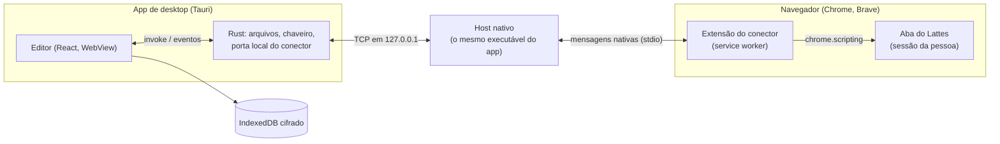

# Arquitetura

Como as peças do LattesEditor se encaixam, para quem vai mexer no código. O
detalhe de cada parte está nos arquivos citados; o que o Lattes faz por dentro
está em [`lattes_internals.md`](lattes_internals.md).

## Visão geral

O editor é uma página React que roda no WebView do sistema, dentro do app
Tauri. Ele nunca fala com o Lattes direto: quem fala é a extensão, de dentro
da aba em que a pessoa já está logada, com o cookie dela. O app e a extensão
se encontram pelo host de mensagens nativas, que é o próprio executável do app
chamado pelo navegador.

## O currículo: uma árvore XML, não JSON

O currículo carregado fica como uma árvore XML genérica e sem perda
(`src/model/xml.ts`): `XElement` com nome, atributos na ordem em que vieram e
filhos; `XText`, `XCData` e `XRaw` guardam texto, CDATA e o resto como estava.
Não há objetos tipados por item (nada de `Artigo { titulo, ano }`). Tudo
trabalha sobre essa árvore: formulários, diferenças, o arquivo do Importar, o
plano do conector e a validação.

O motivo é a ida e volta. Elementos que o editor não conhece, a ordem dos
atributos, o texto em Latin-1 (`src/model/latin1.ts`) e até o texto que o
próprio Lattes grava estragado (`src/model/mojibake.ts`) saem iguais ao que
entraram. O arquivo que volta ao Lattes só muda onde a pessoa mudou.

O que é JSON é o **modelo do schema**. `pnpm gen:schema`
(`scripts/gen-schema.ts`) lê o XSD oficial de 2022
(`schema/CurriculoLattes_12_09_2022.xsd`), aplica `schema/patch.json` (atributos
que as exportações reais trazem e o XSD não declara) e gera
`src/schema/lattes.json`. Para cada um dos 324 elementos, ele diz:

- os atributos, com obrigatoriedade, valor padrão e lista de valores (enum);
- os filhos, na ordem obrigatória do arquivo, com mínimo e máximo;
- se o elemento aceita texto.

A interface lê esse modelo para montar os campos e saber o que é obrigatório.
O serializador o usa para pôr cada filho novo no lugar certo
(`src/model/schema-order.ts`), e a validação, para conferir um item antes de ir
ao Lattes (`src/model/validate.ts`). A mesma conferência roda no currículo
inteiro, item por item, junto com a revisão de consistência, no diagnóstico
do currículo (`src/review/validation.ts`). Por cima dele ficam as listas que o
próprio Lattes oferece nos formulários (país, idioma, natureza de evento),
capturadas sem salvar nada: `src/schema/typed-choices.ts` e
`src/schema/listas-lattes.json` (ver [`campos_tipados.md`](campos_tipados.md)).
As listas grandes demais ou que dependem de uma escolha (áreas do
conhecimento, agências, instituições, cursos) não vêm no código: a extensão as
lê no Lattes, e o editor guarda uma cópia (`src/ui/live-lists.ts`).

Uma marca sim/não vem invertida na exportação: `FLAG-VINCULO-EMPREGATICIO`,
nos `VINCULOS` da atuação. Onde a tela do Lattes diz "Possui vínculo
empregatício: Sim", o XML traz `NAO`, e vice-versa (observado em 8 de 8
vínculos no censo LAT-55 e conferido na tela em 15/10/2026; a
`FLAG-DEDICACAO-EXCLUSIVA` não troca). O editor mostra e edita essa marca no
sentido da tela e grava no arquivo o valor invertido, para o arquivo manter a
convenção da exportação. A troca mora num lugar só (`flagAsShown` em
`src/ui/field-kind.ts`), que o interruptor, a prévia, a lista de alterações e
os filtros usam. Que o Importar leia o arquivo de volta com a mesma convenção
é inferido, não testado: só o caminho exportação → tela foi observado.

## O que o app guarda

Tudo, menos as cópias de segurança (abaixo), fica no IndexedDB do WebView (`src/model/store.ts`, com a estrutura em `src/model/database.ts`, com Dexie), cifrado
com AES-GCM (`src/model/seal.ts`). Em claro ficam só as chaves de busca: datas,
o identificador público do currículo e marcas como "manter". A chave é gerada no primeiro uso e mora no
chaveiro do sistema (`src-tauri/src/chave.rs`); sem chaveiro, o app não guarda
nada naquela sessão. São seis tabelas:

| Tabela         | O que guarda                                                                                                                             |
| -------------- | ---------------------------------------------------------------------------------------------------------------------------------------- |
| `working`      | A cópia de trabalho: o XML atual, o XML como foi carregado (base das diferenças e do "descartar") e o próximo `SEQUENCIA-PRODUCAO` livre |
| `history`      | O histórico de alterações: cada ponto com o XML e uma nota, os marcados para não sair da lista                                           |
| `historyNotes` | Notas cifradas dos pontos do histórico, separadas do XML para abrir a lista sem decifrar as cópias                                       |
| `versions`     | Cada exportação aberta, por currículo: a linha do tempo do Lattes                                                                        |
| `sent`         | O registro do que o conector gravou no Lattes, com o antes e o depois de cada campo                                                      |
| `lists`        | A última leitura das listas do Lattes feita pelo conector (áreas do conhecimento e agências), com a data (`src/model/list-cache.ts`)     |

`working`, `history` e `versions` guardam XML serializado; `sent` guarda as operações do
conector. As alterações a enviar não são guardadas: saem, a cada momento, da
diferença entre a cópia de trabalho e a exportação carregada
(`src/model/changes.ts`).

O autosave guarda as edições em ordem, mesmo quando uma cifra demora mais
que a seguinte. Fechar ou trocar o arquivo invalida a geração anterior,
incluindo timers e cifras em andamento (`src/ui/use-working-copy.ts`). A
rotação de `history` consulta só as chaves pelo índice de grupo e data, sem
ler os XMLs. Na versão 5 do banco, as notas antigas são copiadas uma vez para
`historyNotes`, um ponto por vez; no uso normal, a lista decifra só as notas,
e a restauração ou o download decifra o ponto escolhido. A comparação que
marca o arquivo como modificado também é calculada por revisão do documento,
sem serializar outra vez a cada troca de estado da interface.

### Cópias de segurança (LAT-59)

Tudo acima mora no armazenamento interno do WebView, e perder esse
armazenamento ou a chave do chaveiro leva tudo junto. Por isso as cópias de
segurança ficam fora dele, sem cifra, com os bytes que o Lattes entregou
(é o mesmo arquivo que o Exportar dá):

- **Ponto zero**: a primeira exportação de cada currículo (pelo
  `NUMERO-IDENTIFICADOR`), como `ponto-zero-<AAAA-MM-DD>.zip`. Só uma
  exportação que ninguém mexeu entra (`isBaselineCandidate`, em
  `src/model/backups.ts`): a que veio pelo conector, sempre; um ZIP aberto de
  um arquivo, só com o nome do Exportar (`CV_<id>.zip` ou `<id>.zip`, com o
  " (1)" de um download repetido), uma única entrada `<id>.xml` e a raiz
  `CURRICULO-VITAE` com `SISTEMA-ORIGEM-XML` e o mesmo
  `NUMERO-IDENTIFICADOR`; um XML solto, nunca. O que não passa abre igual,
  só não vira ponto zero. Se já existe um ponto zero daquele currículo, de
  qualquer data, nada é gravado.
- **Ponto de restauração**: antes da primeira gravação de cada rodada do
  conector, `restauracao-<AAAA-MM-DD-HHMM>.zip`, com `-2`, `-3` no mesmo
  minuto. O sidecar leva a contagem da fila por tipo de operação, sem valores.
  A primeira restauração também vale como ponto zero quando o currículo ainda
  não tem um.

Cada arquivo tem um `.json` ao lado com data, origem (`arquivo` ou
`conector`), tamanho, versão do app e o SHA-256 do arquivo
(`src/model/backups.ts`).

No app de desktop, a pasta é
`<Documentos>/LattesEditor/Cópias de segurança/<id>/`: no macOS,
`~/Documents`, que o Finder mostra como "Documentos"; no Windows, a pasta
Documentos; no Linux, a `XDG_DOCUMENTS_DIR`, ou a pasta pessoal sem ela.
Quem grava é o Rust (`src-tauri/src/copias.rs`), sempre com `create_new`,
que falha se o nome existe e nunca trunca; o ponto zero confere a pasta e
cria sob uma trava. Os comandos só criam, listam e mostram na pasta: não há
comando que apague, renomeie ou reescreva um arquivo dali. O identificador
só aceita dígitos e o nome é montado no Rust, então nada sai da pasta. O
ZIP vai do editor ao Rust cru, no corpo do `invoke` (um `Uint8Array`, que o
Rust lê como `InvokeBody::Raw`), e o identificador, a data e o sidecar em
uma linha vão em cabeçalhos (`x-lattes-id`, `x-stamp`, `x-sidecar`); o Rust
grava o sidecar formatado, com o nome final do arquivo. No
macOS, a primeira gravação pede acesso a Documentos
(`NSDocumentsFolderUsageDescription`, em `src-tauri/Info.plist`).

No navegador, sem acesso a pastas, as cópias ficam no IndexedDB, num banco à
parte, `lattes-editor-copias` (`src/model/backup-store.ts`), também em claro.
Nenhum "Limpar" do app (fechar o arquivo, apagar as versões, apagar o
registro do enviado, o recomeço depois de perder a chave) alcança esse banco,
e o módulo só tem `add`. A pessoa leva o arquivo para fora com "Baixar", e a
interface diz que, no navegador, a cópia mora dentro do navegador.

"Cópias de segurança", embaixo de ⚙ › Versões do Lattes
(`src/ui/BackupsSection.tsx`), mostra a pasta e lista os arquivos com a data,
com "Mostrar na pasta" no desktop e "Baixar" no navegador. Nada ali apaga.

O ponto de restauração segue `src/bridge/restore-point.ts`, chamado por
`src/ui/use-restore-point.ts` antes do `enviar`: o editor pede o ZIP à
extensão (`pedir-curriculo`, o mesmo do Abrir do Lattes), confere que o
`NUMERO-IDENTIFICADOR` de dentro do ZIP é o do currículo aberto e guarda.
Os pedidos levam o prefixo `restauracao-` no id (`ExportRequests`, no mesmo
arquivo); a resposta que chega depois do prazo de 30 segundos, ou depois de
a extensão desligar, é engolida, para um ZIP velho nunca virar abertura de
arquivo e substituir a cópia de trabalho.
Como o Exportar recusa com pendência (`lattes_internals.md`, seção 10), a
segunda rodada antes de "Enviar ao CNPq" nunca tem ponto novo: o app diz
por quê, mostra a cópia mais recente e pede "Gravar sem ponto de
restauração", numa linha do passo ② da janela de envio
(`src/import-export/SendSteps.tsx`), sem modal por cima. A cópia que não
grava (disco cheio, acesso negado a Documentos) também cai nessa pergunta.
Sessão caída, Lattes fechado, extensão sem resposta ou sessão de outro
currículo param a rodada, sem gravar nada. Nunca se grava sem um ponto novo
ou essa confirmação. Desfazer pelo registro do enviado passa pelo mesmo
caminho.

### Freio de escrita (LAT-59)

As regras estão em `src/bridge/write-brake.ts`, sem chrome nem React, e a
extensão roda a fila por elas (`runRound`, chamado por `run` em
`extension/src/background.ts`):

- **Quem começa.** Com a capacidade `gravar-pelo-editor` dos dois lados, o
  `enviar` do editor leva `start` e a extensão começa a rodada sem clique no
  painel; o "Continuar" da pausa também sai do editor, pela mensagem
  `continuar`. O estado da fila guarda `fromEditor`, e com ele o painel só
  acompanha: esconde "Aplicar todas" e os "Aplicar" de cada item e mostra o
  botão só para parar. A rodada pedida pelo editor espera até 60 s uma
  verificação em curso (a automática roda quando o menu do Lattes carrega);
  sem o "ok" do aviso de uso, ou com o conector ocupado em outra tarefa, a
  primeira da fila volta como `erro` com o motivo, seguida de `fim`, para o
  editor não ficar preso em "gravando". Um app sem a capacidade manda o
  `enviar` sem `start`, e a fila espera o "Aplicar todas" do painel, como
  antes.
- **Teto por rodada.** Cada rodada (o envio, o "Continuar" ou, com app
  antigo, o "Aplicar todas") grava no máximo `WRITES_PER_ROUND` (20)
  operações. Passou disso, a fila pausa: o estado da extensão guarda `pausa`
  com quantas gravou e quantas faltam, e o `fim` que vai ao editor leva a
  mesma pausa, que o "Enviar ao Lattes" mostra com o botão "Continuar"
  (`src/ui/use-write-brake.ts`). "Limpar fila" tira a pausa e avisa o
  editor.
- **Parada na primeira surpresa.** A fila para no primeiro resultado que não
  é conferido (divergente, erro, sessão caída), como já parava. Gravar e não
  ver o valor na releitura ("O Lattes não gravou"), ver outro campo mudar junto
  ou uma linha nova no lugar da alteração são `divergente`, e não `erro`: o
  envio chegou ao Lattes e algo ficou diferente do esperado. A inclusão que só
  não relê uma parte montada por script (inventores, equipe, disciplinas, o
  tipo do evento) volta `conferido`, com o pedido de conferir essa parte no
  registro do enviado. A falha que
  estoura no meio da operação (a aba fechou, a página mudou) e a resposta
  ausente ou fora do formato viram resultado `divergente` com "não dá para
  saber se gravou" (`checkedResult`, `unexpectedResult`): antes, a resposta
  ausente era `erro` ("não gravado"), e uma exceção deixava a fila marcada
  como correndo, sem `fim` para o editor. Agora o fim da rodada (estado,
  selo, `fim`, menu relido) roda num `finally`. Tudo o que voltou, conferido
  ou não, entra no registro do enviado como antes.
- **"Enviar ao CNPq" bloqueado.** Uma entrada `divergente` do registro do
  enviado bloqueia o botão do painel "Enviar ao CNPq" até se resolver
  (`openDivergences`): a mesma alteração (a mesma chave) volta mais tarde
  conferida, ou a pessoa clica em "Já conferi no Lattes", que grava
  `checkedAt` na linha do registro (`src/model/sent-checks.ts`), em claro
  como a hora do envio. O registro mora no IndexedDB por currículo, então
  reabrir o app não desbloqueia nada. Contam só as entradas ainda não
  publicadas, pela mesma janela de `unpublishedEntries`
  (`src/ui/status-strip.ts`); sem a leitura do menu do Lattes, conta o
  registro inteiro (`publishBlockers`, em
  `src/import-export/publish-view.ts`). Erro e sessão caída não bloqueiam.

### Orçamento de tráfego

`src/bridge/transport.ts` concentra os pedidos da extensão normal. Os valores
são uma política do editor, sem relação comprovada com limites do CNPq:

- pelo menos 750 ms entre pedidos, inclusive entre tarefas;
- no máximo 100 pedidos por tarefa e 80 numa janela de um minuto;
- prazo de 20 s por pedido e 150 s por tarefa;
- HTTP 403, 429 ou 503 impõe uma pausa de pelo menos um minuto, estendida por
  `Retry-After` quando ele informa mais tempo, em segundos ou como data.

Qualquer erro HTTP para a tarefa, sem repetição automática de POST. A pausa
fica no `chrome.storage.session` da extensão, vale para as abas deste navegador e sobrevive a um recarregamento da página. A instância
do transporte sobrevive à reinjeção do núcleo. A trava na aba impede que um
worker reiniciado sobreponha outra tarefa à que ainda roda; a trava em
`extension/src/session-task.ts` também impede outra injeção na mesma aba.
Espelho, exportação e buscas participam da exclusão mútua. O botão de parar
cancela o pedido atual e impede o próximo. Uma falha depois de iniciar um
POST volta divergente, pois o cancelamento não desfaz o que o servidor já recebeu.

A localização de produção (`production/locate.ts`) guarda só um índice de
títulos enquanto o HTML da lista não mudar. Cada item com o título procurado
é relido para conferir ano e natureza, preservando a recusa de homônimos
ambíguos e usando controles novos para gravar. A varredura inicial ainda
precisa ler a categoria inteira; ao atingir o orçamento, para antes de
gravar e mantém o índice parcial para uma tentativa posterior. São guardadas
no máximo oito listas; recarregar a aba descarta o índice.

A verificação do contrato deduplica os caminhos de leitura. A fila confere
só seus tipos, sem buscar todo o catálogo de listas, e pode aproveitar um
relatório aprovado de menos de 30 minutos, do mesmo currículo e com amostra
dos tipos necessários. Uma verificação parcial não substitui a completa do
vigia automático. A especificação dos formulários fica em
`src/bridge/contract-spec.ts` e o motor em `src/bridge/contract.ts`.

O censo e os itens de teste do canal Dev usam o caminho separado de
`extension/src/censo.ts`; esta política ainda não cobre esses procedimentos
manuais. O vigia público semanal faz cinco leituras, sem repetição automática,
por `scripts/vigia-lattes.ts`.

### Limites da abertura de ZIP

O leitor aceita no máximo 32 MiB comprimidos e 128 entradas. A seleção de
arquivos XML acontece no diretório central, antes da descompressão. A soma
de saída dos arquivos selecionados tem teto de 64 MiB, conferido tanto no
tamanho declarado quanto nos bytes que o fluxo realmente produz. Cabeçalhos
truncados e tamanhos incompatíveis são recusados com um erro de ZIP.

## Do editor ao Lattes

Cada alteração segue um de três caminhos (`src/import-export/send-routes.ts`),
que o painel "Enviar ao Lattes" mostra item por item:

- **Item novo de produção** vai pelo **Importar** do próprio Lattes, num arquivo
  gerado pelo editor (`src/import-export/import-file.ts`). Os módulos e anos
  que o passo 2 do Importar pede estão em `src/import-export/importable.ts`.
- **Alteração que o conector sabe gravar** vai **pela extensão**:
  `src/bridge/plan.ts` transforma a alteração numa operação de formulário, e
  `src/bridge/apply.ts` a aplica na aba do Lattes. Antes de gravar, confere
  que o formulário está como o editor espera; depois, lê de novo e confere que
  só os campos da operação mudaram. O "Possui vínculo empregatício" do Lattes
  é o inverso do `FLAG-VINCULO-EMPREGATICIO` da exportação, e a tradução dos
  dois sentidos fica em `src/bridge/vinculo-flag.ts`. Formação (também pós-doutorado e
  livre-docência), endereço, identificação e outras informações relevantes
  têm as operações em `src/bridge/biographic.ts`, com o mapa de campos em
  `formacao-edit.ts` e `dados-gerais-edit.ts`, as buscas de instituição,
  curso e agência em `formacao-lookups.ts` e as da instituição e do órgão do
  endereço profissional em `endereco-buscas.ts`, ligadas para o teste ao vivo
  (`BIOGRAPHIC_OPS_ENABLED` e `BIOGRAPHIC_FULL_ENABLED`, seção "Ações
  ligadas" abaixo).
- **Item removido no editor** pode ir pela extensão com
  `src/bridge/delete.ts`, que posta o formulário de edição do item com
  `f_ctr=E`, como o botão "Excluir" do Lattes, e confere lendo a lista de
  novo (o item sumiu, nada mais mudou), sem depender da resposta do Lattes.
  Hoje só idioma e vínculo, ligado para o teste ao vivo
  (`DELETE_ITEMS_ENABLED`); com a chave desligada, a remoção fica em "Não
  enviado". A atuação inteira
  e as formações não vão pela extensão: a primeira apaga em cascata, e excluir uma
  formação pode tornar outra pública. Uma exclusão não tem "Desfazer no
  Lattes" no registro do enviado.
- **O resto** fica em **"Não enviado"**, campo a campo, com o valor antigo e o
  novo lado a lado, até o editor saber levar; dá para descartar.

Formação acadêmica, atuação profissional, projeto e patente também se criam no
editor (`src/model/general-items.ts`, formulário em
`src/forms/GeneralItemForm.tsx`), mas nenhum módulo do Importar lê essas
seções. O item novo é uma alteração como as outras: o conector o inclui quando
souber (a inclusão pelo conector, abaixo), e fora isso fica em "Não enviado". Por isso "item novo de produção" quer dizer item com
`SEQUENCIA-PRODUCAO` nova **e** tipo que um módulo do Importar lê
(`isPendingImport`, em `src/model/production.ts`): a patente usa o contador
global, mas não vai pelo Importar. As sequências biográficas
(`SEQUENCIA-FORMACAO`, `SEQUENCIA-ATIVIDADE`, `SEQUENCIA-PROJETO`) ficam acima
da maior da cópia de trabalho e da exportação carregada. O projeto entra numa
`PARTICIPACAO-EM-PROJETO` nova, dentro da atuação escolhida no formulário.

Uma alteração num item de **participação em eventos** que já está no Lattes
pode ir pelo conector, no próprio formulário do evento
(`src/bridge/edit-items.ts`): a linha da lista se acha pelo
`SEQUENCIA-PRODUCAO`, e a operação confere antes que o formulário é de
ouvinte, do mesmo tipo de evento e com o mesmo ano, nome do evento e cidade,
qualquer que seja a parte alterada: o `f_seq` sozinho não identifica o item. Vão título, ano,
país, home page, divulgação científica, título em inglês e nome do evento.
Não vão pela extensão os eventos de convidado e participante, a forma, o tipo, a
natureza, a cidade e o que o formulário não tem (idioma, palavras-chave,
áreas). O caminho está ligado (`EDIT_OUVINTE_ENABLED`) desde o teste
acompanhado de 14/10/2026 no Lattes real, e o contrato confere o formulário de
eventos antes de cada fila. O app só manda essas operações a uma extensão que
anuncia a capacidade `alterar-evento` (`src/bridge/compat.ts`); com uma
extensão mais antiga, o evento fica em "Não enviado". Convidado, participante,
a forma, o tipo, a natureza e a cidade já têm caminho no mesmo arquivo, atrás
da chave `EDIT_EVENTO_ENABLED`, ligada para o teste ao vivo. Cada chave de
inclusão, exclusão e alteração tem uma capacidade da extensão (`GATED_EDITS`,
em `src/bridge/plan.ts`), que só entra em `BRIDGE_FEATURES` quando a chave
liga, e o app só planeja a operação para uma extensão que a anuncia.
Quando uma operação de evento não muda nada no formulário (a natureza, que só
se confere), o conector confere o "antes" e não envia; os outros tipos
sempre enviam. A extensão também confere as chaves da própria montagem
(`ApplyGates`, em `src/bridge/apply.ts`): uma operação de tipo desligado
nela para sem enviar.

Prêmios e formação complementar seguem o mesmo caminho em
`src/bridge/edit-lists.ts`, cada um com a própria chave. Como a
linha da lista não se acha pelo número, a operação abre o formulário de cada
linha e fica com a única cujos valores são os do item (`match`, comparado sem
acento nem caixa), antes da conferência estrita do "antes". Instituição e
curso da formação complementar vão pelas buscas da formação acadêmica
(`planLookups` em `formacao-edit.ts`, `resolveFormacao` em
`formacao-lookups.ts`), e a instituição e o órgão do endereço profissional
pelas janelas da página de endereço, a busca `PRC_INST_ATIV` e a janela de
órgãos `prc_orgao_cargo` (`src/bridge/endereco-buscas.ts`), os dois atrás de
`COMPL_ENDERECO_LOOKUPS_ENABLED`. `resolveOpLookups` junta essas buscas para
`apply.ts`.

A decisão de 13/10/2026 sobre duplicatas (só o que é novo vai pelo Importar;
alteração no lugar; exclusão pelo formulário) está no
[guia de implementação](lattes_implementation_guide.md), seção 1, e nos
tickets LAT-50, LAT-51 e LAT-49.

Antes de virar alteração, o que vem de fora passa por um pré-diff
(`src/review/dedup.ts`, LAT-45): cada item é comparado com as produções do
currículo por título, DOI ou ISBN, autores, ano, tipo e veículo, com pesos
declarados (título 45, identificador 15 e autores 10, como no CIÊNCIAVITAE;
ano 15, tipo 10 e veículo 5, escolha do editor) e o motivo de cada parte. O
mesmo DOI decide sozinho; títulos com menos da metade das palavras em comum
nunca viram candidato; dois DOIs diferentes ficam no máximo em "parecido".
Hoje passam por ele os itens de outro XML ("Trazer itens de outro XML…", no
⚙, com a revisão em `src/import-export/IncomingReview.tsx`: só entra o que a
pessoa marcar, como item novo) e o formulário de produção nova, inclusive o
preenchido pelo DOI, que avisa quando o item se parece com um do currículo.
Planilha, ORCID, OpenAlex e foto de certificado (LAT-43, LAT-8, LAT-10)
entram pelo mesmo `preDiff` quando existirem.

A inclusão de itens pelo conector (`CREATE_ITEMS_ENABLED`, em
`src/bridge/create.ts`) cobre a atuação com o primeiro vínculo (`create.ts`), formação
acadêmica nos dez níveis do "Incluir novo item" (`create-formacao.ts`) e
projeto (`create-projeto.ts`), com o que as duas têm em comum em
`create-shared.ts` e o despacho em `create-items.ts`. Cada inclusão confere
antes (nada igual na lista, formulário em modo de inclusão, campos presentes),
acha instituição, curso e agência pelas buscas do próprio Lattes, e depois
relê a lista: exatamente um item novo, com os campos lidos de volta iguais aos
enviados. Desfazer uma inclusão não passa pelo conector; o registro do enviado
diz para excluir no Lattes.

### Ações ligadas para o teste ao vivo

Desde o PR "ligar as ações do conector", todas as chaves estão ligadas, para o
dono testar no Lattes real, menos `PUBLISH_ENABLED` (o envio ao CNPq, LAT-54),
que continua desligada até um envio acompanhado. Cada uma tem a capacidade da extensão em
`BRIDGE_FEATURES`, e o app só manda a operação a uma extensão que a anuncia:
com uma extensão mais antiga, a alteração fica em "Não enviado" e o evento
novo fica no Importar. O release estável só leva isso se o dono gerar um.

| Ação                                                                                                                                               | Chave e capacidade                                               | O que o teste ao vivo ainda precisa mostrar                                                                                                                                                                                                                                                                                                             |
| -------------------------------------------------------------------------------------------------------------------------------------------------- | ---------------------------------------------------------------- | ------------------------------------------------------------------------------------------------------------------------------------------------------------------------------------------------------------------------------------------------------------------------------------------------------------------------------------------------------- |
| Inclusão de atuação, formação (dez níveis, pós-doutorado e livre-docência), idioma, prêmio, vínculo, cinco registros, atividade de ensino e evento | `CREATE_ITEMS_ENABLED`, `incluir-itens`                          | A primeira inclusão real de cada tipo. Registro e atividade voltam conferidos pelos outros campos, com o pedido de conferir inventores e disciplinas no Lattes, que não são relidos; o evento de quem apresenta, com o do tipo, que não volta na releitura. Patente, projeto e as atividades que pedem órgão seguem à mão (`docs/inclusao_por_tipo.md`) |
| Exclusão de idioma e vínculo                                                                                                                       | `DELETE_ITEMS_ENABLED`, `excluir-itens`                          | Que o item some da lista e nada mais muda (seção 15 de `lattes_internals.md`)                                                                                                                                                                                                                                                                           |
| Formação, endereço e identificação                                                                                                                 | `BIOGRAPHIC_OPS_ENABLED`, `alterar-dados-gerais`                 | O primeiro envio de cada um, com a releitura                                                                                                                                                                                                                                                                                                            |
| Formação pelas buscas de instituição, curso e agência, pós-doutorado, livre-docência e outras informações relevantes                               | `BIOGRAPHIC_FULL_ENABLED`, `alterar-dados-gerais-completo`       | Que o POST com os ocultos das buscas grava a instituição, o curso e a agência; as datas em DD/MM/AAAA e a cor ou raça na identificação (seção 19 de `lattes_internals.md`)                                                                                                                                                                              |
| Eventos de convidado e participante: forma, tipo, natureza e cidade                                                                                | `EDIT_EVENTO_ENABLED`, `alterar-evento-completo`                 | Como a edição de um convidado traz o tipo, que a página monta por script (seção 16)                                                                                                                                                                                                                                                                     |
| Prêmios e títulos                                                                                                                                  | `EDIT_PREMIO_ENABLED`, `alterar-premio`                          | Que a linha certa se acha pelos valores e o POST com U grava                                                                                                                                                                                                                                                                                            |
| Palavras-chave de trabalho técnico e de outra produção bibliográfica                                                                               | `EDIT_KEYWORDS_ENABLED`, `alterar-palavras-chave`                | Que o POST grave as palavras e mantenha autores, áreas e setores: a operação refaz as quatro grades como o `check()` da página (seção 16 de `lattes_internals.md`) e as relê depois                                                                                                                                                                     |
| Formação complementar                                                                                                                              | `EDIT_FORMACAO_COMPL_ENABLED`, `alterar-formacao-complementar`   | O que `FORM2` grava com `f_ctr` vazio e o passo depois do envio                                                                                                                                                                                                                                                                                         |
| Instituição e curso da formação complementar, instituição e órgão do endereço profissional pelas buscas                                            | `COMPL_ENDERECO_LOOKUPS_ENABLED`, `buscas-complementar-endereco` | Que `FORM2` e `PRC_ENDERECO` gravem os ocultos que as buscas escrevem, e se o `seleciona()` do endereço limpa o órgão (seção 18 de `lattes_internals.md`)                                                                                                                                                                                               |
| Importar dos itens novos                                                                                                                           | `IMPORT_ENABLED`, `importar`                                     | O arquivo mínimo foi recusado e um passo 3 com sucesso não pôs o item no currículo (seção 13): conferir o currículo depois de cada importação                                                                                                                                                                                                           |

### O caminho de uma mensagem

1. O editor chama `conector_send` (Rust), que escreve uma linha de JSON na
   ligação TCP com o host (`src-tauri/src/conector.rs`).
2. O app escuta numa porta local aleatória e grava a porta e um segredo, gerado
   a cada abertura, em `conector.txt`, na pasta de dados (só o dono lê). O host
   lê esse arquivo e se apresenta com o segredo; ligação sem ele é ignorada.
3. O host repassa a mensagem à extensão pelo stdio das mensagens nativas, e a
   resposta faz o caminho de volta.
4. O service worker da extensão (`extension/src/background.ts`) injeta o núcleo
   do conector na aba do menu do Lattes (`extension/src/lattes-runner.ts`), que
   faz `fetch` na mesma origem, com o cookie da sessão, e lê os formulários com
   `DOMParser`. Senha nenhuma passa por aqui.

As mensagens têm envelope e versão (`src/bridge/protocol.ts`). No aperto de
mão (`ola`), cada lado anuncia o que sabe fazer (`src/bridge/compat.ts`), e o
editor e o painel da extensão dizem qual dos dois está desatualizado. Ao
abrir, o app se registra como host nativo no Chrome, no Brave, no Edge e no
Chromium, com o ID da extensão autorizado.

No `pnpm dev`, sem o app, o editor roda no navegador e fala com a extensão
pelo `window.postMessage` da própria página, por um content script
(`extension/src/content.ts`), que só vale em `localhost`.

### O que a extensão faz sozinha

- **Abrir do Lattes** (`src/bridge/export.ts`): pede o mesmo ZIP do "Exportar"
  na sessão da pessoa e o entrega ao editor. O mesmo pedido serve ao
  "Recarregar do Lattes…" do ⚙ (`src/ui/use-lattes-reload.ts`, LAT-46), que
  só aceita o ZIP do currículo aberto, passa pela confirmação de sempre
  quando há itens novos não importados e deixa a falha no sino, com a
  escolha do arquivo exportado. Sem a extensão, o menu pede o arquivo. Com o
  Exportar bloqueado por pendência, a tela inicial oferece a última versão
  deste currículo guardada no app (`src/ui/use-stored-version.ts`), que abre
  como cópia de trabalho com o diagnóstico já comparando com a página de
  conferência; a página de conferência é texto, e não vira currículo
  editável. O que se manda depois a partir dessa versão não sobrescreve o
  que está pendente no Lattes: a alteração confere, antes do POST, os
  valores de antes dos campos que muda e a identidade do item no formulário
  lido agora (`src/bridge/apply.ts`), e para como "divergente" se não
  baterem; o resto do formulário vai como foi lido; a inclusão confere que
  não há item igual na lista. A mesma tela tem o link para o "Enviar ao CNPq", que libera o
  Exportar; publicado, o editor pede o currículo de novo.
- **Estado do Lattes** (`src/bridge/lattes-status.ts`): lê do menu a data da
  última publicação e se há alteração pendente de envio ao CNPq.
- **Conferência do contrato** (`src/bridge/contract.ts`): só com leituras,
  compara o menu e um exemplar de cada formulário que o conector grava com o
  que ele espera (nomes, tipos e limites, nunca valores), e as listas dos
  campos tipados (`src/bridge/list-watch.ts`). Uma mudança que quebra o
  conector para a fila antes de gravar.
- **Foto do currículo** (`src/bridge/photo.ts`): troca a foto pela tela de
  envio do próprio Lattes e confere depois.
- **Listas do Lattes** (`src/bridge/lattes-lists.ts`): só com GET, nunca
  grava. Lê a tabela de áreas do conhecimento (o vetor `areaDP` do menu, lido
  como literal, sem `eval`) e a lista de agências de fomento quando o editor
  liga e a cópia guardada passou de um dia; busca instituição
  (`PRC_INST_FORM`) enquanto a pessoa digita; lê os cursos de uma instituição
  (`prc_curso_form`) quando ela pede. A conferência do contrato confere que a
  tabela de áreas e a lista de agências continuam lá.
- **Importar dos itens novos** (`src/bridge/importar.ts`, LAT-50), ligado
  para o teste ao vivo por `IMPORT_ENABLED`. Envia um arquivo só com os itens novos
  (`buildMinimalImportFile`, em `src/import-export/import-file.ts`), confere
  o formulário do passo 2, marca só os módulos do arquivo e o ano do item mais
  antigo, confirma o passo 2 e para na resposta, sem confirmar o passo 3. No
  teste acompanhado de 14/10/2026 o Lattes recusou o arquivo mínimo, e um
  Confirmar do passo 3 com sucesso na tela não pôs o item no currículo
  (`lattes_internals.md`, seção 13), e por isso o teste ao vivo precisa
  conferir o currículo depois de cada importação. Uma solicitação
  pendente no Importar também para o fluxo; o conector nunca descarta nada.
  Com a chave desligada, o editor não mostra o botão e a extensão recusa o
  pedido; o "Baixar arquivo" com os passos à mão continua igual.
- **Enviar ao CNPq** (`src/bridge/publish.ts`, LAT-54), desligado por
  `PUBLISH_ENABLED`. O painel "Enviar ao CNPq"
  (`src/import-export/PublishPanel.tsx`), aberto pelo "Enviar ao Lattes"
  quando o Lattes tem pendência, mostra o que vai ser publicado (as gravações
  do editor desde a última publicação e a comparação de títulos com a
  página de conferência), quantos achados o diagnóstico do currículo tem e a declaração do CNPq
  lida da tela de envio, com o link do Termo de Uso. A caixa da declaração
  começa desmarcada a cada abertura e só a pessoa a marca. Ligado, o conector
  repete as consultas e o envio da tela e confere a publicação pelo menu
  (`lattes_internals.md`, seção 10). A tela e o envio passam por
  `src/ui/use-publish.ts` e, na extensão, por `extension/src/publish-run.ts`,
  que nunca roda junto com a fila, a foto ou o Importar. Desligado, o painel
  mostra a declaração como texto e manda a pessoa enviar pelo Lattes; em
  `pnpm dev`, `?publicar` na URL mostra a caixa e o botão, e a extensão
  continua recusando.

### O Lattes simulado

`scripts/lattes-simulado/` é um servidor local (`pnpm dev:lattes`) que imita o
editor web do Lattes com o currículo em memória, para testar o caminho todo
(editor, app, host nativo, extensão e núcleo do conector) sem um currículo de
verdade. Cada procedimento do Lattes é uma rota pelo nome, e cada formulário é
uma lista de campos ligados a atributos do XML: a mesma lista desenha a página
e grava o POST. A extensão só o enxerga no canal Dev: a escolha é feita na
montagem (`__CANAL_DEV__`, `extension/src/lattes-hosts.ts`), e a publicada não
leva o endereço nem a permissão de `localhost`. Os testes sobem o mesmo
servidor (`tests/helpers/lattes-simulado.ts`) e rodam contra ele o conector com
as chaves ligadas (`tests/lattes-simulado.test.ts`).

## Mapa do código

| Pasta                | O que tem                                                                                                                                         |
| -------------------- | ------------------------------------------------------------------------------------------------------------------------------------------------- |
| `src/model/`         | Árvore XML, carga e gravação (ZIP e XML, Latin-1), diferenças, validação, banco cifrado                                                           |
| `src/schema/`        | Modelo gerado do XSD, tipos derivados, listas do Lattes                                                                                           |
| `src/ui/`            | A interface: seções, formulários de atributo, sino, ⌘K, temas, foto, primeiro uso                                                                 |
| `src/forms/`         | Formulários de item novo: produção (autores, áreas, palavras-chave), formação, atuação, projeto e patente                                         |
| `src/import-export/` | O painel "Enviar ao Lattes", o arquivo do Importar, o ZIP, o registro do enviado                                                                  |
| `src/bridge/`        | O núcleo do conector, usado pela extensão e pelo editor: protocolo, plano, aplicação, leituras do Lattes                                          |
| `src/review/`        | Diagnóstico do currículo: a conferência do currículo inteiro (`validation.ts`) e o que mudou no Lattes desde a exportação                         |
| `src/print/`         | Impressão e PDF (NBR 14724), referências na NBR 6023                                                                                              |
| `src/panorama/`      | O Panorama: nove gráficos do currículo, só com o XML carregado; entra no editor por `index.ts` e pelo controle de modo                            |
| `src/lookups/`       | Busca por DOI no Crossref                                                                                                                         |
| `src/desktop/`       | O que só existe no app: arquivos nativos, chave do chaveiro, atualização automática, links externos                                               |
| `src/labels/`        | Rótulos pt-BR de elementos, atributos e valores                                                                                                   |
| `extension/`         | A extensão: service worker, painel, script na aba do Lattes, aviso de consentimento                                                               |
| `src-tauri/`         | O app Tauri em Rust: comandos, host nativo, chaveiro, configuração e ícones                                                                       |
| `scripts/`           | Geradores (schema, fixtures, listas, inventário), montagem da extensão, capturas de tela, vigia do Lattes, o Lattes simulado (`lattes-simulado/`) |
| `site/`              | A página do projeto e a política de privacidade da extensão (GitHub Pages)                                                                        |
| `fixtures/`          | O currículo sintético dos testes e das imagens (`fixtures/real/` fica fora do git)                                                                |

## Canais e versões

O app publicado e o **LattesEditor Dev** saem do mesmo código. O Dev muda
nome, identificador, ícone, pasta de dados, chaveiro, host nativo
(`lattes_editor.conector_dev`) e a extensão autorizada, pela feature
`canal-dev` do Rust e por `src-tauri/tauri.canal-dev.conf.json`; por isso os
dois convivem na mesma máquina. Como cada um é montado e lançado está em
[`desenvolvimento.md`](desenvolvimento.md).
