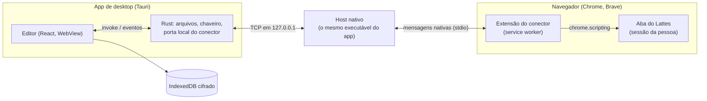

# Arquitetura

Como as peças do LattesEditor se encaixam, para quem vai mexer no código. O
que o Lattes faz por dentro está em [`lattes_internals.md`](lattes_internals.md).

## Visão geral

O editor é uma página React no WebView do sistema, dentro do app Tauri. Ele
nunca fala com o Lattes: quem fala é a extensão, de dentro da aba em que a
pessoa já está logada. O app e a extensão se encontram pelo host de mensagens
nativas, que é o próprio executável do app chamado pelo navegador.

## O currículo é uma árvore XML

O currículo carregado fica como uma árvore XML genérica (`src/model/xml.ts`):
`XElement` com nome, atributos na ordem em que vieram e filhos; `XText`,
`XCData` e `XRaw` guardam o resto como estava. Não há objetos tipados por
item. Formulários, diferenças, o arquivo do Importar, o plano do conector e a
validação trabalham sobre essa árvore, e por isso a ida e volta é exata:
elementos desconhecidos, ordem de atributos, Latin-1 (`src/model/latin1.ts`)
e até o texto que o Lattes grava estragado (`src/model/mojibake.ts`) saem
como entraram.

O **modelo do schema** é JSON. `pnpm gen:schema` lê o XSD de 2022
(`schema/CurriculoLattes_12_09_2022.xsd`), aplica `schema/patch.json`
(atributos que as exportações trazem e o XSD não declara) e gera
`src/schema/lattes.json`: para cada um dos 324 elementos, os atributos (com
obrigatoriedade, padrão e enum), os filhos na ordem do arquivo e se aceita
texto. A interface monta os campos a partir dele, o serializador põe cada
filho novo no lugar certo (`src/model/schema-order.ts`) e a validação confere
um item antes de ir ao Lattes (`src/model/validate.ts`) e o currículo inteiro
no diagnóstico (`src/review/validation.ts`).

Por cima do schema ficam as listas que o Lattes oferece nos formulários
(`src/schema/typed-choices.ts`, `src/schema/listas-lattes.json`, ver
[`campos_tipados.md`](campos_tipados.md)). As listas grandes ou dependentes de
uma escolha (áreas do conhecimento, agências, instituições, cursos) não vêm no
código: a extensão as lê no Lattes e o editor guarda uma cópia
(`src/ui/live-lists.ts`).

`FLAG-VINCULO-EMPREGATICIO` vem invertida na exportação (a tela diz "Sim" e
o XML traz `NAO`). O editor mostra a marca no sentido da tela e grava o
inverso, num lugar só: `flagAsShown` em `src/ui/field-kind.ts`
(`lattes_internals.md`, seção 5).

## O que o app guarda

Tudo, menos as cópias de segurança, fica no IndexedDB do WebView
(`src/model/store.ts`, `src/model/database.ts`, com Dexie), cifrado com
AES-GCM (`src/model/seal.ts`). Em claro ficam só as chaves de busca: datas, o
identificador público do currículo e marcas como "manter". A chave nasce no
primeiro uso e mora no chaveiro do sistema (`src-tauri/src/chave.rs`); sem
chaveiro, o app não guarda nada naquela sessão.

| Tabela         | O que guarda                                                                                                      |
| -------------- | ----------------------------------------------------------------------------------------------------------------- |
| `working`      | A cópia de trabalho: o XML atual, o XML como foi carregado (base das diferenças) e o próximo `SEQUENCIA-PRODUCAO` |
| `history`      | O histórico de alterações, cada ponto com o XML                                                                   |
| `historyNotes` | As notas dos pontos, separadas para abrir a lista sem decifrar os XMLs                                            |
| `versions`     | Cada exportação aberta, por currículo (até 24)                                                                    |
| `sent`         | O registro do que o conector gravou no Lattes, com o antes e o depois de cada campo                               |
| `lists`        | A última leitura das listas do Lattes (áreas e agências), com a data (`src/model/list-cache.ts`)                  |

As alterações a enviar não são guardadas: saem, a cada momento, da diferença
entre a cópia de trabalho e a exportação carregada (`src/model/changes.ts`).
O autosave guarda as edições em ordem mesmo quando uma cifra demora mais que
a seguinte; fechar ou trocar o arquivo invalida a geração anterior
(`src/ui/use-working-copy.ts`).

### Cópias de segurança

Ficam fora do banco, sem cifra, com os bytes que o Lattes entregou
(`src/model/backups.ts`):

- **Ponto zero**: a primeira exportação de cada currículo,
  `ponto-zero-<AAAA-MM-DD>.zip`. Só entra uma exportação intocada
  (`isBaselineCandidate`): a que veio pelo conector, ou um ZIP com o nome do
  Exportar (`CV_<id>.zip`), uma única entrada `<id>.xml` e o mesmo
  `NUMERO-IDENTIFICADOR`. Um XML solto nunca vira ponto zero.
- **Ponto de restauração**: antes da primeira gravação de cada rodada do
  conector, `restauracao-<AAAA-MM-DD-HHMM>.zip` (`src/bridge/restore-point.ts`,
  `src/ui/use-restore-point.ts`). O editor pede o ZIP à extensão, confere o
  identificador e guarda. Como o Exportar recusa com pendência, a segunda
  rodada antes de "Enviar ao CNPq" não tem ponto novo: o app mostra a cópia
  mais recente e pede "Gravar sem ponto de restauração", no passo ② da janela
  de envio. Sessão caída, extensão sem resposta ou sessão de outro currículo
  param a rodada sem gravar.

Cada arquivo tem um `.json` ao lado com data, origem, tamanho, versão do app
e SHA-256. No desktop a pasta é `<Documentos>/LattesEditor/Cópias de
segurança/<id>/`, gravada pelo Rust (`src-tauri/src/copias.rs`) sempre com
`create_new`: nenhum comando apaga, renomeia ou reescreve. No navegador, as
cópias ficam num banco à parte, `lattes-editor-copias`
(`src/model/backup-store.ts`), que nenhum "Limpar" do app alcança. "Cópias de
segurança", em ⚙ › Versões do Lattes (`src/ui/BackupsSection.tsx`), lista os
arquivos com "Mostrar na pasta" ou "Baixar".

### Limites da abertura de ZIP

O leitor aceita 32 MiB comprimidos e 128 entradas, escolhe os XMLs pelo
diretório central antes de descomprimir e limita a saída a 64 MiB, conferida
no tamanho declarado e nos bytes produzidos. Cabeçalho truncado ou tamanho
incompatível é erro de ZIP.

## Do editor ao Lattes

Cada alteração segue um de três caminhos (`src/import-export/send-routes.ts`),
que o painel "Enviar ao Lattes" mostra item por item:

- **Item novo de produção** vai pelo **Importar** do Lattes, num arquivo que o
  editor gera (`src/import-export/import-file.ts`, módulos em
  `importable.ts`). "Item novo de produção" é item com `SEQUENCIA-PRODUCAO`
  nova **e** tipo que um módulo do Importar lê (`isPendingImport`, em
  `src/model/production.ts`); a patente usa o contador global, mas não vai
  pelo Importar.
- **Alteração, inclusão ou exclusão que o conector sabe fazer** vai **pela
  extensão**: `src/bridge/plan.ts` transforma a alteração numa operação de
  formulário e `src/bridge/apply.ts` a aplica na aba do Lattes. Antes de
  gravar, confere que o formulário está como o editor espera (o "antes" de
  cada campo e a identidade do item); depois, relê e confere que só os campos
  da operação mudaram.
- **O resto** fica em **"Não enviado"**, campo a campo, com o valor antigo e o
  novo lado a lado, e o motivo.

Os módulos do conector, por assunto:

| Assunto                                                          | Arquivos em `src/bridge/`                                                                                |
| ---------------------------------------------------------------- | -------------------------------------------------------------------------------------------------------- |
| Formação, endereço, identificação, outras informações            | `biographic.ts`, `formacao-edit.ts`, `dados-gerais-edit.ts`, `formacao-lookups.ts`, `endereco-buscas.ts` |
| Eventos, prêmios, formação complementar                          | `edit-items.ts`, `edit-lists.ts`, `formacao-compl-steps.ts` (o segundo passo do `FORM2`)                 |
| Produções, orientações, bancas, projetos, patentes e registros   | `production/` (um alvo por tipo em `targets/`, buscas em `lookups.ts`, órgão em `organ.ts`)              |
| Atividades da atuação, áreas de atuação, dicionário de coautores | `edit-atividade.ts`, `areas-atuacao.ts`, `edit-citacao.ts`                                               |
| Inclusão                                                         | `create.ts` (atuação), `create-formacao.ts`, `create-projeto.ts`, `create-evento.ts`, `create-items.ts`  |
| Exclusão (idioma e vínculo)                                      | `delete.ts`, que posta o formulário com `f_ctr=E` e confere relendo a lista                              |
| Foto, Exportar, Importar, estado do Lattes, Enviar ao CNPq       | `photo.ts`, `export.ts`, `importar.ts`, `lattes-status.ts`, `publish.ts`                                 |

Os itens de prêmio e formação complementar não se acham pelo número: o
conector abre o formulário de cada linha da lista e fica com a única cujos
valores são os do item. Eventos se acham pelo `SEQUENCIA-PRODUCAO`, e a
operação confere antes ano, nome do evento e cidade, porque o `f_seq` sozinho
não identifica o item.

Antes de virar alteração, o que vem de fora passa por um pré-diff
(`src/review/dedup.ts`): cada item é comparado com as produções do currículo
por título (peso 45), DOI ou ISBN (15), autores (10), ano (15), tipo (10) e
veículo (5), com o motivo de cada parte. O mesmo DOI decide sozinho. Passam
por ele "Trazer itens de outro XML…" (`src/import-export/IncomingReview.tsx`)
e o formulário de produção nova, inclusive o preenchido pelo DOI.

### Chaves e capacidades

Cada família de operação tem uma chave no código e uma capacidade que a
extensão anuncia no aperto de mão (`GATED_EDITS` em `src/bridge/plan-gates.ts`,
`BRIDGE_FEATURES` em `src/bridge/compat.ts`). O app só planeja a operação
para uma extensão que anuncia a capacidade; com uma extensão antiga, a
alteração fica em "Não enviado". A extensão também confere as chaves na
própria montagem (`ApplyGates`, em `apply-gates.ts`).

| Chave                            | Capacidade                      | Estado                                                                                                      |
| -------------------------------- | ------------------------------- | ----------------------------------------------------------------------------------------------------------- |
| `CREATE_ITEMS_ENABLED`           | `incluir-itens`                 | Ligada                                                                                                      |
| `DELETE_ITEMS_ENABLED`           | `excluir-itens`                 | Ligada (idioma e vínculo)                                                                                   |
| `BIOGRAPHIC_OPS_ENABLED`         | `alterar-dados-gerais`          | Ligada                                                                                                      |
| `BIOGRAPHIC_FULL_ENABLED`        | `alterar-dados-gerais-completo` | Ligada                                                                                                      |
| `EDIT_OUVINTE_ENABLED`           | `alterar-evento`                | Ligada, com envio acompanhado em 14/10/2026                                                                 |
| `EDIT_EVENTO_ENABLED`            | `alterar-evento-completo`       | Ligada                                                                                                      |
| `EDIT_PREMIO_ENABLED`            | `alterar-premio`                | Ligada                                                                                                      |
| `EDIT_FORMACAO_COMPL_ENABLED`    | `alterar-formacao-complementar` | Ligada                                                                                                      |
| `EDIT_PRODUCTION_ENABLED`        | `alterar-producao`              | Ligada                                                                                                      |
| `PRODUCTION_LOOKUPS_ENABLED`     | `buscas-producao`               | Ligada                                                                                                      |
| `EDIT_AREAS_ENABLED`             | `alterar-areas-atuacao`         | Ligada                                                                                                      |
| `EDIT_ATIVIDADES_ENABLED`        | `alterar-atividades`            | Ligada                                                                                                      |
| `EDIT_CITACOES_ENABLED`          | `alterar-citacoes`              | Ligada                                                                                                      |
| `IMPORT_ENABLED`                 | `importar`                      | Ligada; conferir o currículo depois de cada importação (`lattes_internals.md`, seção 13)                    |
| `COMPL_LOOKUPS_ENABLED`          | `buscas-complementar`           | Ligada sem envio acompanhado da troca: o curso testado não tinha como ser desfeito (`lattes_internals.md`)  |
| `COMPL_ENDERECO_LOOKUPS_ENABLED` | `buscas-complementar-endereco`  | Desligada: o endereço profissional não tinha caso reversível                                                |
| `INSTITUTION_HOLDERS_ENABLED`    | `titular-instituicao`           | Ligada: depositante instituição pela busca; a gravação pela página e a exportação foram vistas (27/10/2026) |
| `PROJECT_ORGAN_ENABLED`          | `orgao-projeto`                 | Desligada: o Lattes recebeu o órgão novo e manteve o antigo (18/10/2026)                                    |
| `PUBLISH_ENABLED`                | `publicar-cnpq`                 | Ligada com declaração por tentativa; validação acompanhada do app ao CNPq pendente antes do lançamento      |

Fica à mão, com o motivo na tela (`src/bridge/atuacao-by-hand.ts` e os
`fieldAbsent` de cada alvo): o que o formulário do Lattes não tem (nome do
pai e da mãe, tipo do vínculo, a própria citação item a item, nomes em
inglês de vários formulários, e a natureza das orientações e bancas em que
o elemento do XML é o próprio tipo do item); trocar a instituição de uma atuação (a tela
não a tem: inclui-se outra atuação); o órgão de um projeto; mais de um
depositante de patente ou mais de uma instituição titular; incluir, tirar ou trocar
financiadores, produções ou orientações ligadas a um projeto. A natureza de
um financiador que já está vai pela linha dele na grade
(`src/bridge/production/financiador.ts`), só entre Auxílio Financeiro e
Bolsa. O título e o tipo de uma produção ligada ficam só para ler: a
exportação os copia da própria produção.
`node scripts/cobertura-conector.ts` mede quantos campos do editor vão pelo
conector, com o motivo do que falta. A medição testa o planejamento com dados
sintéticos, não comprova gravações no Lattes real. As porcentagens são
truncadas em uma casa decimal para não mostrar 100% onde ainda há lacunas.
Ela também não esgota todas as opções e combinações de valores de cada campo.

### Freio de escrita

As regras estão em `src/bridge/write-brake.ts`, e a extensão roda a fila por
elas (`runRound`, em `extension/src/background.ts`):

- O `enviar` do editor leva `start`, e a extensão começa a rodada sem clique
  no painel; o "Continuar" da pausa também sai do editor. O painel só
  acompanha e mostra o botão de parar.
- Cada rodada grava no máximo `WRITES_PER_ROUND` (20) operações. Passou
  disso, a fila pausa e o editor mostra "Continuar"
  (`src/ui/use-write-brake.ts`).
- A fila para no primeiro resultado que não é conferido. Gravar e não ver o
  valor na releitura, ver outro campo mudar junto ou uma linha nova no lugar
  da alteração são `divergente`; a resposta ausente ou a falha no meio da
  operação também, com "não dá para saber se gravou". O fim da rodada roda
  num `finally`, e tudo o que voltou entra no registro do enviado.
- Uma entrada `divergente` bloqueia o "Enviar ao CNPq" do editor até a mesma
  alteração voltar conferida ou a pessoa clicar em "Já conferi no Lattes"
  (`src/model/sent-checks.ts`). Erro e sessão caída não bloqueiam.

### Orçamento de tráfego

`src/bridge/transport.ts` concentra os pedidos da extensão. Os valores são
uma política do editor, sem relação comprovada com limites do CNPq: pelo
menos 750 ms entre pedidos; no máximo 100 pedidos por tarefa e 80 por minuto;
prazo de 20 s por pedido e 150 s por tarefa; HTTP 403, 429 ou 503 impõe uma
pausa de um minuto, estendida por `Retry-After` até uma hora. Qualquer erro
HTTP para a tarefa, sem repetição automática de POST. A pausa fica no
`chrome.storage.session` e sobrevive a um recarregamento. Uma trava na aba
(`extension/src/session-task.ts`) impede duas tarefas ao mesmo tempo; o botão
de parar cancela o pedido atual, e uma falha depois de iniciar um POST volta
divergente.

A localização de produção (`production/locate.ts`) guarda um índice de
títulos por lista enquanto o HTML não mudar (no máximo oito listas) e relê
cada item candidato para conferir ano e natureza. A conferência do contrato
(`src/bridge/contract.ts`, especificação em `contract-spec.ts`) confere só os
tipos da fila e pode aproveitar um relatório de menos de 30 minutos do mesmo
currículo. O censo e os itens de teste Dev usam o mesmo transporte, por uma
ponte própria (`extension/src/dev-traffic-host.ts`, Web Lock em
`src/bridge/page-task.ts`); os detalhes estão em
[`desenvolvimento.md`](desenvolvimento.md#tráfego-do-censo-dev).

### O caminho de uma mensagem

1. O editor chama `conector_send` (Rust), que escreve uma linha de JSON na
   ligação TCP com o host (`src-tauri/src/conector.rs`).
2. O app escuta numa porta local aleatória e grava porta e segredo, gerados a
   cada abertura, em `conector.txt`, na pasta de dados. O host lê o arquivo e
   se apresenta com o segredo; ligação sem ele é ignorada.
3. O host repassa a mensagem à extensão pelo stdio das mensagens nativas.
4. O service worker (`extension/src/background.ts`) injeta o núcleo do
   conector na aba do menu do Lattes (`extension/src/lattes-runner.ts`), que
   faz `fetch` na mesma origem, com o cookie da sessão, e lê os formulários
   com `DOMParser`.

As mensagens têm envelope e versão (`src/bridge/protocol.ts`). No aperto de
mão (`ola`), cada lado anuncia o que sabe fazer (`src/bridge/compat.ts`), e o
editor e o painel dizem qual dos dois está desatualizado. Ao abrir, o app se
registra como host nativo no Chrome, no Brave, no Edge e no Chromium.
O host estável autoriza a extensão carregada sem compactação e o item
`kdebkpkdhgaeaaobcbgbckinocnlfbgg` da Chrome Web Store. O host Dev autoriza
só a extensão Dev; os canais não compartilham essa autorização.

No `pnpm dev`, sem o app, o editor fala com a extensão pelo
`window.postMessage` da página, por um content script
(`extension/src/content.ts`) que só vale em `localhost`.

### O que a extensão faz sozinha

- **Abrir do Lattes** (`src/bridge/export.ts`): pede o ZIP do Exportar na
  sessão da pessoa. O mesmo pedido serve ao "Recarregar do Lattes…"
  (`src/ui/use-lattes-reload.ts`). Com o Exportar bloqueado por pendência, o
  passo 3 da tela inicial é o "Enviar ao CNPq…", e o currículo abre depois
  do envio; a última versão guardada (`src/ui/use-stored-version.ts`) fica
  como a outra saída, com o diagnóstico comparando com a página de
  conferência.
- **Estado do Lattes** (`src/bridge/lattes-status.ts`): lê do menu a data da
  última publicação e se há pendência.
- **Sessão viva** (`src/bridge/keepalive.ts`, `extension/src/keepalive-run.ts`):
  com o app ligado, o aviso aceito e a aba do menu aberta, o alarme de cada
  minuto da extensão pede `pkg_linhapesq.lista` a cada 20 minutos, pelo mesmo
  transporte das leituras, e nunca com a aba em uso. Se a sessão caiu, para e
  o app relê a sessão; o menu carregado de novo recomeça a contagem.
- **Conferência do contrato** (`src/bridge/contract.ts`): só com leituras,
  compara o menu, um exemplar de cada formulário e as listas dos campos
  tipados (`list-watch.ts`) com o que o conector espera. Uma mudança que
  quebra o conector para a fila antes de gravar.
- **Foto** (`src/bridge/photo.ts`): troca a foto pela tela do próprio Lattes.
- **Listas** (`src/bridge/lattes-lists.ts`): só com GET. Áreas do conhecimento
  (o vetor `areaDP` do menu, lido como literal) e agências quando a cópia
  passou de um dia; instituições enquanto a pessoa digita; cursos de uma
  instituição quando ela pede. Pós-doutorado e livre-docência usam a busca
  de instituição da lista AP, sem curso; só pós-doutorado oferece agência.
  `src/ui/live-production-pairs.ts` liga as buscas de orientações e bancas à
  especificação do conector, conforme a natureza do item.
  `src/schema/availability.ts` mantém os códigos de disponibilidade e sua
  conversão para o select dos formulários técnicos, inclusive o vazio.
  `src/schema/license-types.ts` compartilha os tipos de licença entre a
  lista da interface e o planejador.
  `src/model/contact-edit.ts` localiza trechos de e-mail, URL e outra forma
  de contato em contatos existentes e troca só o valor, sem reconstruir IDs, rótulos ou separadores.
  `src/ui/ContactFields.tsx` oferece a edição; formatos desconhecidos e redes
  repetidas ficam somente para leitura. O envio preserva a privacidade da
  linha existente e recusa uma troca de URL ambígua entre redes repetidas.
  A releitura compara também os IDs e a privacidade das redes; uma mudança
  inesperada volta como divergência, mesmo que a URL nova tenha gravado.
  Numa outra forma de contato só muda o contato: a linha de
  `f_dados_grid_contatos` mantém id, tipo e privacidade.
- **Importar** (`src/bridge/importar.ts`): envia um arquivo só com os itens
  novos, marca os módulos e o ano e para na resposta do passo 2.
- **Enviar ao CNPq** (`src/bridge/publish.ts`, `src/import-export/PublishPanel.tsx`):
  o painel mostra o que vai ser publicado e a declaração lida da tela de
  envio; a caixa começa desmarcada a cada abertura. O pedido exige a mesma
  declaração que foi marcada; uma nova leitura faz o aceite deixar de valer
  já na renderização, sem esperar um efeito. O núcleo confere essa mesma
  declaração na releitura, a sessão do currículo aberto confirmada pelo menu atual e as consultas de
  raça ou cor e e-mail antes de um único envio. Pedidos malformados são
  recusados antes de qualquer consulta. A ativação está coberta no simulado;
  falta a validação acompanhada do app ao CNPq antes do lançamento.
  `enviar-cnpq` permite ler a tela, inclusive com extensão antiga; o botão
  exige a capacidade de escrita `publicar-cnpq` e a conexão ativa. Sem ela,
  o painel pede para atualizar a extensão, sem tentar publicar.
  A prévia de desenvolvimento não permite enviar, mesmo com a declaração
  de exemplo marcada.
  `src/bridge/publish-status.ts` reúne as mensagens, a checagem de ocupação
  e a data local usada na confirmação da publicação.
  Se a resposta do pedido de publicação se perde, o núcleo ainda confere o
  menu. Só repete leituras, nunca o pedido de publicação; sem confirmação,
  devolve `nao-confirmado` com `sent: true` e mantém o botão bloqueado.

### O Lattes simulado

`scripts/lattes-simulado/` (`pnpm dev:lattes`) imita o editor web do Lattes
com o currículo em memória, para testar editor, app, host, extensão e núcleo
de ponta a ponta. A extensão só o enxerga no canal Dev (`__CANAL_DEV__`,
`extension/src/lattes-hosts.ts`). Os testes sobem o mesmo servidor
(`tests/helpers/lattes-simulado.ts`). O que cada procedimento faz e de onde
veio está em [`../scripts/lattes-simulado/README.md`](../scripts/lattes-simulado/README.md).

## Mapa do código

| Pasta                | O que tem                                                                                          |
| -------------------- | -------------------------------------------------------------------------------------------------- |
| `src/model/`         | Árvore XML, carga e gravação (ZIP e XML, Latin-1), diferenças, validação, banco cifrado            |
| `src/schema/`        | Modelo gerado do XSD, tipos derivados, listas do Lattes                                            |
| `src/ui/`            | A interface: seções, formulários de atributo, sino, ⌘K, temas, foto, primeiro uso                  |
| `src/forms/`         | Formulários de item novo                                                                           |
| `src/import-export/` | O painel "Enviar ao Lattes", o arquivo do Importar, o ZIP, o registro do enviado                   |
| `src/bridge/`        | O núcleo do conector, usado pela extensão e pelo editor: protocolo, plano, aplicação, leituras     |
| `src/review/`        | Diagnóstico do currículo e o que mudou no Lattes desde a exportação                                |
| `src/census/`        | O censo dos formulários e os itens de teste (`docs/lattes-formularios/`)                           |
| `src/print/`         | Impressão e PDF (NBR 14724), referências na NBR 6023                                               |
| `src/panorama/`      | Os nove gráficos do currículo                                                                      |
| `src/lookups/`       | Busca por DOI no Crossref                                                                          |
| `src/desktop/`       | O que só existe no app: arquivos nativos, chaveiro, atualização, links externos                    |
| `src/labels/`        | Rótulos pt-BR de elementos, atributos e valores                                                    |
| `extension/`         | A extensão: service worker, painel, script na aba do Lattes, aviso de consentimento                |
| `src-tauri/`         | O app Tauri em Rust: comandos, host nativo, chaveiro, configuração e ícones                        |
| `scripts/`           | Geradores, montagem da extensão, capturas, vigia do Lattes, cobertura do conector, Lattes simulado |
| `site/`              | A página do projeto e a política de privacidade (GitHub Pages)                                     |
| `fixtures/`          | Os currículos sintéticos dos testes e das imagens (`fixtures/real/` fica fora do git)              |

## Canais e versões

O app publicado e o **LattesEditor Dev** saem do mesmo código. O Dev muda
nome, identificador, ícone, pasta de dados, chaveiro, host nativo
(`lattes_editor.conector_dev`) e a extensão autorizada, pela feature
`canal-dev` do Rust e por `src-tauri/tauri.canal-dev.conf.json`; por isso os
dois convivem na mesma máquina. Como cada um é montado e lançado está em
[`desenvolvimento.md`](desenvolvimento.md).
