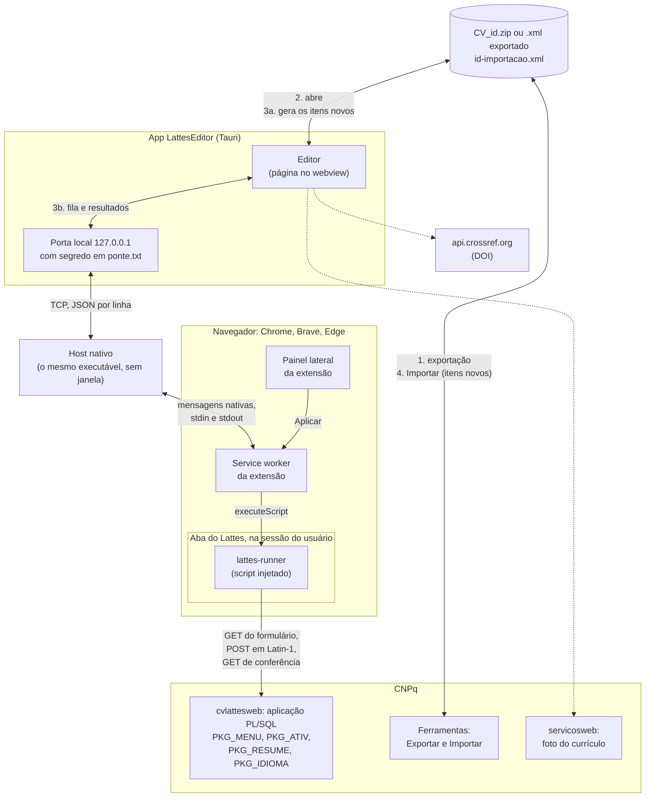

# Como o editor do Currículo Lattes funciona por dentro

Notas de reconhecimento do editor web do Lattes (`wwws.cnpq.br/cvlattesweb`),
para quem for escrever a ponte com o navegador ou só tiver curiosidade. Tudo
aqui foi observado numa sessão logada do próprio dono do currículo, só com
leitura: as páginas de formulário foram baixadas por GET e analisadas, nenhum
formulário foi enviado.

Datas das observações: 10/10/2026 (primeiro reconhecimento, ver
`lattes_editor_reconnaissance.md`) e 11/10/2026 (formulários de edição, este
documento).

Cada afirmação vem marcada como **observado** (visto no HTML, nos scripts ou
no comportamento do servidor) ou **inferido** (conclusão a partir do que foi
observado, ainda não confirmada).

## Visão geral: os componentes

O caminho de uma alteração, do Lattes ao editor e de volta. Há dois retornos:
itens novos vão pelo Importar do próprio Lattes, num arquivo que o editor gera
(3a); o resto vai pela extensão, que grava nos formulários do Lattes na sessão
do próprio usuário (3b). O app nunca fala com o Lattes direto.



- **Editor** (`src/`): lê a exportação, guarda a cópia de trabalho e planeja
  as operações que a extensão sabe levar (`src/bridge/plan.ts`).
- **Porta local e host nativo** (`src-tauri/src/ponte.rs`): o navegador só
  inicia programas registrados, então o próprio executável do app, chamado
  com a origem da extensão, faz o papel de host e repassa as mensagens ao app
  aberto. O segredo impede que outro usuário da máquina se ligue à porta.
- **Extensão** (`extension/`): o service worker guarda a fila; o envio só
  começa por um clique no painel. O `lattes-runner` roda dentro da aba do
  Lattes e faz, para cada operação, o que a seção 6 descreve: acha o
  formulário pelos links do próprio Lattes, confere que ele está como o
  editor espera, envia e lê de volta (`src/bridge/apply.ts`).
- **Lattes** (seções 1 a 5): a aplicação PL/SQL que recebe os formulários.
  Exportar e Importar são as únicas portas oficiais para arquivos.
- Em linha tracejada, o que sai do app sem passar pela extensão: a foto do
  perfil e a busca do DOI, só quando pedidas.

## 1. Uma aplicação PL/SQL servida pela web

Toda URL do editor tem a forma

```
/cvlattesweb/PACOTE.procedimento?f_cod=…&f_outro=…
```

por exemplo `pkg_ativ.lista`, `PKG_ATIV.VINCULOS`, `pkg_formacao.form`,
`prc_endereco`. **Observado.**

Esse é o desenho de uma aplicação escrita em PL/SQL, a linguagem de
procedimentos do banco Oracle, servida por um gateway que transforma cada
requisição HTTP numa chamada de procedimento armazenado: o caminho escolhe o
pacote e o procedimento, e cada parâmetro da URL ou do formulário vira um
argumento com o mesmo nome. A página HTML é escrita pelo próprio
procedimento, linha a linha. **Inferido** a partir dos nomes e do
comportamento abaixo; é o modelo do gateway PL/SQL da Oracle (o antigo
mod_plsql e seus sucessores), comum em sistemas de governo do fim dos anos 90
e começo dos 2000.

Duas consequências aparecem no uso:

- **A assinatura manda.** Chamar `pkg_formacao.lista` sem `f_tipo` devolve
  HTTP 404: para o gateway, não existe procedimento com aquela lista de
  argumentos. **Observado** (10/10/2026).
- **Maiúsculas não importam no servidor.** O mesmo formulário mistura
  `f_status` e `F_STATUS`, `f_texto` e `F_TEXTO`, e as URLs alternam
  `PKG_ATIV` e `pkg_ativ`. Identificadores PL/SQL não distinguem caixa, então
  o servidor trata tudo igual. **Observado** (a mistura); **inferido** (a
  causa).

### O prefixo `f_`

Todo parâmetro começa com `f_` (`f_cod`, `f_seq`, `f_ano_ini`,
`f_tipo_privacidade`). **Observado.** O mais provável é uma convenção de
nomes para separar argumentos que vêm do formulário de variáveis internas do
procedimento. **Inferido.**

## 2. `f_ctr`: um procedimento, várias operações

O procedimento que desenha o formulário é o mesmo que recebe o envio dele.
O formulário de vínculo, por exemplo, é aberto por GET em
`PKG_ATIV.vinculos` e postado para `PKG_ATIV.VINCULOS`. **Observado.**

O que diz ao procedimento o que fazer é um campo oculto, `f_ctr` (de
"controle", **inferido**), com uma letra:

| `f_ctr`   | Onde apareceu                                                                            | Significado                                             |
| --------- | ---------------------------------------------------------------------------------------- | ------------------------------------------------------- |
| `I`       | formulário de item novo (atividade em `pkg_ativ.cargo`, 10/10/2026)                      | incluir, **observado**                                  |
| `U`       | formulário de item existente: vínculo, formação, idioma, resumo, endereço, identificação | atualizar, **observado** (envio de 11/10/2026, seção 6) |
| `A`       | código da tela de Formação (10/10/2026)                                                  | alterar, **inferido**                                   |
| `E`, `E2` | função `dele` da lista de atuações; código da Formação                                   | excluir, **inferido**                                   |
| `V`       | botão de voltar/cancelar (10/10/2026)                                                    | voltar sem salvar, **observado**                        |

É o padrão de "despachante" de aplicações CRUD feitas sobre procedimentos:
em vez de uma URL por operação, um procedimento por tela, com um `if` no
começo que olha o código de controle. O mesmo GET sem `f_seq` mostra o
formulário vazio (inclusão); com `f_seq` mostra o registro (alteração).
**Observado** no vínculo (`f_seq_hist`) e na formação (`f_seq`).

## 3. Identificadores

Dois códigos circulam, e os dois devem ser tratados como segredo em logs:

- **O da sessão**: 32 caracteres hexadecimais em `PKG_MENU.menu?f_cod=…`.
  Muda a cada login. **Observado.**
- **O do currículo**: 10 caracteres, usado em `f_cod` por todas as chamadas
  internas. **Observado.**

A exportação XML não traz o código de 10 caracteres, só o identificador
público de 16 dígitos (`NUMERO-IDENTIFICADOR`). Os dois se ligam por
redirecionamento: `lattes.cnpq.br/<16 dígitos>` responde 302 para
`buscatextual.cnpq.br/buscatextual/cv?id=<16 dígitos>`, que responde 302
para `visualizacv.do?metodo=apresentar&id=<10 caracteres>`. **Observado**
(11/10/2026). A foto do currículo sai de
`servicosweb.cnpq.br/wspessoa/servletrecuperafoto?tipo=1&id=<10 caracteres>`;
com o identificador de 16 dígitos o mesmo endereço responde uma imagem
vazia. **Observado.**

Cada linha de uma lista é identificada por números de sequência que batem
com os do XML exportado: `f_seq_ativ` com `SEQUENCIA-ATIVIDADE`,
`f_seq_hist` com `SEQUENCIA-HISTORICO`, `f_seq` da formação com
`SEQUENCIA-FORMACAO`. Conferido na atuação em 11/10/2026: a atividade com
`SEQUENCIA-ATIVIDADE="5"` no XML é a única linha com `f_seq_ativ=5` na lista
do Lattes, na mesma instituição. **Observado** para a atuação; nas outras
telas continua inferido.

O código da instituição não é igual dos dois lados: o XML traz
`CODIGO-INSTITUICAO="001000000998"` e o link do Lattes traz
`f_codinst=D001000000998`, com uma letra na frente. **Observado**; o que a
letra significa não se sabe.

## 4. Telas

O editor é uma página só (`PKG_MENU.menu`) com camadas modais em `iframe`
(`modalCV1` a `modalCV3`): lista, formulário, busca de instituição.
**Observado** (10/10/2026). Cada formulário:

- valida no navegador com uma função `check()` que junta mensagens num
  vetor e as mostra com `alert()`;
- salva com `enviar()`, que faz `submit()` do formulário inteiro: um POST
  clássico, que recarrega o `iframe`;
- não tem token CSRF; o que amarra o envio à sessão é o cookie e o `f_cod`.

**Observado.** Se o servidor repete as validações de `check()`, não se sabe.

## 5. Formulários de edição (11/10/2026)

Nomes, tipos e limites lidos do HTML. Campos ocultos de controle (`f_cod`,
chaves, `*_old`) aparecem no fim de cada lista.

### Vínculo de uma atuação: `GN_ATIV_VINC`, POST `PKG_ATIV.VINCULOS`

Aberto por GET `PKG_ATIV.vinculos` com `f_cod`, `f_codinst`, `f_seq_ativ` e
`f_seq_hist` (sem `f_seq_hist`, abre um vínculo novo).

| Campo                                                                        | Tipo                              | XML (`VINCULOS`)                                                                       |
| ---------------------------------------------------------------------------- | --------------------------------- | -------------------------------------------------------------------------------------- |
| `f_vinc`                                                                     | texto 30                          | `TIPO-DE-VINCULO` / `OUTRO-VINCULO-INFORMADO` (o formulário guarda o rótulo; ver nota) |
| `f_stavinc`                                                                  | lista: vazio, `0`, `1`            | `FLAG-VINCULO-EMPREGATICIO` (`1` = sim, `0` = não)                                     |
| `f_enqua`                                                                    | texto 45                          | `OUTRO-ENQUADRAMENTO-FUNCIONAL-INFORMADO`                                              |
| `f_enqua_en`                                                                 | texto 45                          | `OUTRO-ENQUADRAMENTO-FUNCIONAL-INFORMADO-INGLES`                                       |
| `f_carga`                                                                    | texto 3                           | `CARGA-HORARIA-SEMANAL`                                                                |
| `f_regime`                                                                   | caixa, valor `3`                  | `FLAG-DEDICACAO-EXCLUSIVA` (marcada = sim)                                             |
| `f_mes_ini`, `f_ano_ini`                                                     | texto 2, 4                        | `MES-INICIO`, `ANO-INICIO`                                                             |
| `f_status`                                                                   | rádio `S` = Atual, `N` = Anterior | atual quando `ANO-FIM` é vazio                                                         |
| `f_mes_fim`, `f_ano_fim`                                                     | texto 2, 4                        | `MES-FIM`, `ANO-FIM`                                                                   |
| `f_outras_inf`                                                               | área 3950                         | `OUTRAS-INFORMACOES`                                                                   |
| `f_outras_inf_en`                                                            | área 2000                         | `OUTRAS-INFORMACOES-INGLES`                                                            |
| `f_tipo_privacidade`                                                         | lista `1` público, `2` privado    | sem correspondente no XML                                                              |
| `f_ctr` (`U`), `f_vinculo`, `f_cod`, `f_codinst`, `f_seq_ativ`, `f_seq_hist` | ocultos                           |                                                                                        |

Nota sobre o tipo de vínculo: `check()` copia o texto de `f_vinc` para o
oculto `f_vinculo` antes de enviar, e o texto vem de uma lista em
`dominio()` (Servidor público, Celetista, Professor visitante, Bolsista,
Outro). Como esse texto vira o código `TIPO-DE-VINCULO` do XML não foi
visto. **Lacuna.**

Regras de `check()` (mensagens do próprio Lattes): tipo do vínculo e início
obrigatórios; fim obrigatório quando o status é Anterior e proibido quando é
Atual; início antes do fim; nenhuma data no futuro; início não anterior ao
nascimento.

### Formação acadêmica: `GN_FORMACAO2`, POST `pkg_formacao.FORM`

Aberto por GET `pkg_formacao.form` com `f_cod`, `f_seq` e `f_tipo` (`FA`).
Mesmos campos do formulário de inclusão descrito no reconhecimento de
10/10/2026, com `f_ctr=U`, `f_seq` preenchido e `f_nivel` com o código do
nível (`3` = mestrado). `F_STATUS` usa `N` em andamento, `S` concluído, `I`
incompleto (rótulos lidos em 10/10/2026), que correspondem a
`STATUS-DO-CURSO` `EM_ANDAMENTO`, `CONCLUIDO`, `INCOMPLETO`.

### Idioma: `GN_IDIOMA`, POST `PKG_IDIOMA.FORM`

| Campo                                            | Tipo                                        | XML (`IDIOMA`)                                                                                   |
| ------------------------------------------------ | ------------------------------------------- | ------------------------------------------------------------------------------------------------ |
| `F_COD_IDIOMA`                                   | lista de idiomas                            | `IDIOMA`                                                                                         |
| `F_LE`, `F_CONVERSA`, `F_ESCREVE`, `F_COMPR`     | rádio `P` pouco, `R` razoavelmente, `B` bem | `PROFICIENCIA-DE-LEITURA`, `-FALA`, `-ESCRITA`, `-COMPREENSAO` (`POUCO`, `RAZOAVELMENTE`, `BEM`) |
| `FC_LE`, `FC_CONVERSA`, `FC_ESCREVE`, `FC_COMPR` | caixas, valor `on`                          | habilitam cada proficiência; `check()` exige ao menos uma marcada                                |
| `f_tipo_privacidade`                             | lista `1`/`2`                               |                                                                                                  |
| `f_ctr` (`U`), `f_cod`, `f_seq`                  | ocultos                                     |                                                                                                  |

A exportação não traz número de sequência do idioma. A ponte abre cada link
`pkg_idioma.form` da lista que tem `f_seq` (o que não tem é o de idioma novo)
e escolhe o único cujo `F_COD_IDIOMA` é o código do XML. `NAO_INFORMADO` no
XML corresponde à caixa desmarcada e nenhum rádio.

### Códigos de nível (11/10/2026)

Lidos nos formulários, sem gravar nada:

- Formação complementar (`pkg_formacao_compl.form`), lista `f_nivel`: `F`
  curso de curta duração, `8` extensão universitária, `E` MBA, `Y` outros.
  É o `NIVEL` do XML nesses itens.
- Mestrado (`pkg_formacao.form`, `f_nivel` 3): rádio `f_tpo_doutorado`, `N`
  normal e `S` sanduíche. É o `TIPO-MESTRADO` do XML.
- Formação acadêmica: `f_nivel` vem oculto no formulário (3 no mestrado, 1 na
  graduação, 7 no curso técnico, conforme a exportação); o nível é o próprio
  tipo do item.
- `NIVEL-CURSO="OT"` da tabela de cursos: sentido não encontrado. O XSD tem
  `OT` e `OUTRO` como valores distintos.

### Resumo: `RES`, POST `PKG_RESUME.FORM`

`F_TEXTO` (4000) e `F_TEXTO_EN` (4000), correspondentes a
`TEXTO-RESUMO-CV-RH` e `TEXTO-RESUMO-CV-RH-EN`; ocultos `f_resume_auto`,
`f_resume_auto_en`, `f_cod`, `f_ret`, `f_ctr` (`U`).

### Endereço: `GN_ENDERECO`, POST `PRC_ENDERECO`

Um formulário para os dois endereços: sufixo `_r` residencial, `_i`
institucional. `f_pais_*`, `f_cep_*` (15), `f_rua_*` (180), `f_bairro_*`
(255), `f_munic_*` (45), `f_estado_*` (10), `f_ddd_*`, `f_fone_*`,
`f_ramal_*`, `f_fax_*`, `f_caixa_*`, `f_ddd_cel_*`, `f_fone_cel_*`,
`f_homepage_*` (250); `f_inst` (75) e `f_orgao` do institucional;
`f_email_i`, `f_email_r` (70); `f_end_corr` (rádio, endereço de
correspondência); privacidade por bloco (`f_priv_residencial`,
`f_priv_profissional`, `f_priv_email_*`); `f_ctr` (`U`). Os contatos
eletrônicos e redes sociais vão em grades serializadas nos ocultos
`f_dados_grid` e `f_dados_grid_contatos` (formato não lido). **Lacuna.**

### Identificação: `GN_IDENT`, POST `PRC_IDENT`

Aberto por GET `prc_ident` com `f_cod` e `f_pcd`. Nome (`f_nome` 60), nome
social, nome em citações (oculto), nacionalidade e país, CPF (oculto: não se
edita), sexo, raça ou cor, nascimento (país, UF, cidade, data), RG, passaporte,
nomes dos pais (ocultos), pessoa com deficiência (`f_pcd_r` e caixas
`f_pcd`), e uma lista de privacidade por grupo de dados.

A nacionalidade não se escolhe: o oculto `f_nacionalidade` recebe `B` ou `E`
pelo JavaScript da página, e as validações tratam `B` como brasileira (exige
CPF e RG) e `E` como estrangeira. É o `NACIONALIDADE` do XML. Os grupos de
privacidade são foto, nacionalidade, raça ou cor, nascimento, identidade,
passaporte e deficiência (`f_priv_*`, `1` público, `2` privado).
**Observado** (11/10/2026).

## 6. Primeiro envio (11/10/2026)

Um POST montado fora do formulário, com a autorização do dono do
currículo, para ver se o caminho direto funciona:

1. GET do formulário do vínculo e leitura de todos os campos que o
   navegador enviaria (os desabilitados não vão; `f_vinc` está desabilitado,
   então `f_vinculo` recebe o texto dele, como faz `check()`).
2. POST para `PKG_ATIV.VINCULOS` com os mesmos campos e só
   `f_outras_inf_en` trocado por um marcador, corpo codificado em Latin-1.
3. Novo GET do formulário: só `f_outras_inf_en` mudou.
4. Segundo POST devolvendo o valor original (vazio) e novo GET: formulário
   idêntico ao de antes.

A resposta do POST não é uma página: é um trecho de JavaScript que manda o
`iframe` pai (`modalCV2`) voltar para a grade da atuação e abre
`pkg_aviso_pendencia.inicio`, o aviso de pendências do currículo.
**Observado.** Os dois envios contam como atualização do currículo, então a
data de "última atualização" no Lattes passa a ser a do teste.

## 7. Sessão

A sessão do editor cai em poucos minutos (3 a 12 nos testes de 10/10/2026)
e passa a responder com a página de `pkg_sec.logon`. Em 11/10/2026, com a
aba aberta pelo próprio usuário, a sessão aguentou todas as leituras deste
documento. **Observado.** Abrir um segundo editor do mesmo currículo parece
derrubar o primeiro. **Inferido.**

## 8. O que ainda não se sabe

- Se o servidor revalida o que `check()` valida.
- Como `f_vinc` vira `TIPO-DE-VINCULO`, e o formato das grades de contato
  do endereço.
- O formulário de edição de uma atividade existente (`pkg_ativ.cargo` com
  `f_seq_funcao`, montado por JavaScript na grade da atuação).
- A requisição do Exportar que devolve o ZIP, e se a sessão cai depois
  dela. Só aparece com o currículo sem alterações pendentes (seção 10).

## 9. Vigia: saber quando o CNPq mudou algo

O CNPq não publica roadmap, changelog nem notas de versão da Plataforma
Lattes (procurado em 12/10/2026: o portal gov.br do CNPq, o Portal Memória e
a página do Extrator só trazem notícias gerais e o aviso de que o XSD foi
"atualizado em 12/09/2022"; o feed de notícias do Portal Memória parou em
2015). A única maneira de saber que algo mudou é olhar.

Duas vigias, uma para cada lado do login:

- **Público, no CI.** `scripts/vigia-lattes.ts` roda toda segunda-feira
  (`.github/workflows/vigia-lattes.yml`) e confere o XSD byte a byte contra
  `schema/CurriculoLattes_12_09_2022.xsd`, o texto "atualizado em" e o link
  na página do Extrator, a foto do perfil (`servletrecuperafoto`) e a
  entrada do Lattes. Falhou, abre ou comenta uma issue `vigia-lattes`.
- **Atrás do login, na extensão.** `src/bridge/contract.ts` guarda o que a
  ponte espera encontrar: os procedimentos linkados no menu
  (`pkg_ativ.lista`, `pkg_idioma.lista`, `pkg_resume.`) e, para cada
  formulário que ela grava (seção 5), o nome, o POST e os campos com tipo e
  limite. "Verificar o Lattes" no painel percorre os mesmos links que a
  gravação percorre, só com GET, lê um exemplar de cada formulário e compara.
  A mesma verificação roda antes de cada fila; campo sumido, tipo trocado,
  formulário ou link que não existe mais e `f_ctr` fora de `U` param a fila
  antes do primeiro POST. Se a conferência nem chega a ler (aba que não
  responde, erro de rede), a fila também para; e para se a fila tem operação
  num formulário de que o Lattes não mostrou exemplar, porque a ponte só
  altera o que já existe. Campo novo e limite diferente só avisam, porque a
  ponte reenvia o formulário inteiro como o leu.

O contrato foi escrito a partir das tabelas da seção 5 (11/10/2026), não de
uma captura automática. A primeira verificação num Lattes real, em
12/10/2026, voltou "como o esperado" para o menu e os três formulários, ou
seja, as tabelas estavam certas em nome, tipo e limite. Quando o relatório
apontar diferença, o contrato é corrigido junto com a tabela desta seção.

O relatório da verificação só tem nomes de campos e de procedimentos, a data
e a versão da extensão. Nenhum valor do currículo entra nele, para que possa
ser colado numa issue pública.

## 10. Exportar e alterações pendentes (12/10/2026)

O menu abre só com o cookie: `PKG_MENU.menu` sem `f_cod` mostra o currículo
de quem está logado, e o login passa pelo Keycloak de `login.cnpq.br`.
**Observado.**

O topo do menu mostra "Última atualização: <data>" e "Última publicação:
<data>", e a lista de avisos traz "Existem alterações realizadas em seu
currículo que ainda não foram enviadas ao CNPq" enquanto houver pendência.
**Observado.** A extensão lê os dois do menu que já está na aba, sem
requisição nova (`src/bridge/lattes-status.ts`). Que o aviso some depois de
"Enviar ao CNPq" é **inferido**; o menu aberto na aba também só muda quando
é recarregado, então depois de uma fila o estado pode estar defasado.

"Exportar", no menu secundário, chama
`modalCV1.setarUrl('pkg_impcv.get_arquivo?f_cod=<10 caracteres>', true)`:
um GET que carrega a tela do Exportar num `iframe` modal. **Observado.**

Com alterações ainda não enviadas ao CNPq, essa tela abre com um `alert()`
("Existem alterações realizadas no currículo que só serão aceitas quando
enviadas ao CNPq em definitivo") e não exporta. O `alert()` trava a aba até
alguém clicar em OK, inclusive para a automação do navegador. **Observado.**
Um `fetch` da mesma URL não roda o script da página, então não trava; a
ponte pode ler o HTML e reconhecer o aviso.

Não há como descartar alterações pendentes. A tela de envio
(`pkg_publicar.mostrar_cv`, aberta pelo "Enviar" e pelo aviso de pendências)
só tem "Enviar ao CNPq" (formulário `publicar`, POST `pkg_publicar.enviar`,
com a concordância no `f_chk`) e "Cancelar", que fecha a tela. Nenhuma das
nove ferramentas do menu secundário desfaz alterações. Os textos com "serão
descartadas" no código da página são o aviso genérico de sair de um
formulário sem gravar. **Observado.**

Consequência para a ponte: tudo o que ela grava deixa o currículo com
pendência até a pessoa enviar ao CNPq, e até lá o Exportar recusa. Abrir do
Lattes pela ponte precisa reconhecer esse estado e pedir o envio antes; não
adianta tentar de novo.

A versão atual do currículo, com o que ainda não foi enviado, sai de
`pkg_publicar.cv_espelho?f_cod=<10 caracteres>&f_idioma=1`, o link "Versão em
Português" da tela de envio (a função `portugues()` monta o endereço com
`f_idioma=1`). Abre só com o cookie e não pede código de segurança, ao
contrário do currículo público em `buscatextual.cnpq.br`. O texto segue a
ordem das seções do currículo; produções e eventos vêm em listas numeradas
("1. AUTOR; AUTOR. Título, 2005."), com o subtítulo da lista logo antes do
item 1 e linhas de detalhe depois de cada item; a página termina com "Totais
de produção" e o aviso "Este arquivo não foi gerado a partir do Currículo
Lattes validado e disponível publicamente". **Observado** pelo texto da
página; as tags que formam essas linhas são **inferidas**. O diagnóstico do
editor lê essa página (`src/bridge/espelho.ts`).

## 11. Inclusão (LAT-24, 13/10/2026)

O que a ponte usaria para criar uma atuação profissional nova, e de onde
vem cada parte. Nada disso foi enviado a um Lattes real; o código está em
`src/bridge/create.ts`, desligado.

- **Observado** (reconhecimento de 10/10/2026, seção 4.1 e 4.3): o
  formulário `GN_ATIV`, aberto por `PKG_ATIV.inclui` a partir da lista de
  atuações, com `f_ctr=I` e POST para `PKG_ATIV.INCLUI`; os campos e
  limites da tabela da seção 4.1; a busca de instituição por POST para
  `PRC_INST_FORM`, cuja resposta traz `seleciona('<código>','<nome>')`; e a
  regra de que o código vai em `f_cod_inst` quando começa com V e em
  `f_cod_inst2` nos outros casos.
- **Inferido**: os valores de `F_COD` (o `f_cod` do formulário) e
  `F_NIVEL` (vazio) na busca feita fora do seletor; o texto de `f_vinc` para
  cada `TIPO-DE-VINCULO` (dos rótulos do combo; com
  `OUTRO-VINCULO-INFORMADO`, vale o texto livre); `f_vinculo` igual a
  `f_vinc`, como o `check()` faz na alteração; a resposta do POST de
  inclusão; e que a atuação nova aparece na lista com um `f_seq_ativ` novo,
  que a ponte lê de volta e devolve como `SEQUENCIA-ATIVIDADE`.
- **Travas**: recusa se a lista já tem atuação na mesma instituição (seria
  duplicata), exige exatamente um resultado da busca com o código do XML,
  confere os limites, e depois do envio exige exatamente uma atuação nova
  dessa instituição, com o vínculo lido de volta igual ao enviado.
- **Desfazer**: excluir pela ponte não está mapeado para a atuação (o
  `f_ctr=E` só apareceu no código da Formação). Um item criado fica no
  registro do enviado sem "Desfazer no Lattes", com a orientação de excluir
  à mão.
- **Número do item**: a cópia de trabalho guarda o número que o editor deu.
  Até a ponte reconciliar com o `SEQUENCIA-ATIVIDADE` que o Lattes devolve,
  o caminho é recarregar a exportação antes de alterar esse item pela ponte.
- **Fora por enquanto**: Formação (o curso só entra pela busca de cursos,
  não mapeada), Projetos e Patentes (formulários de inclusão não lidos).
