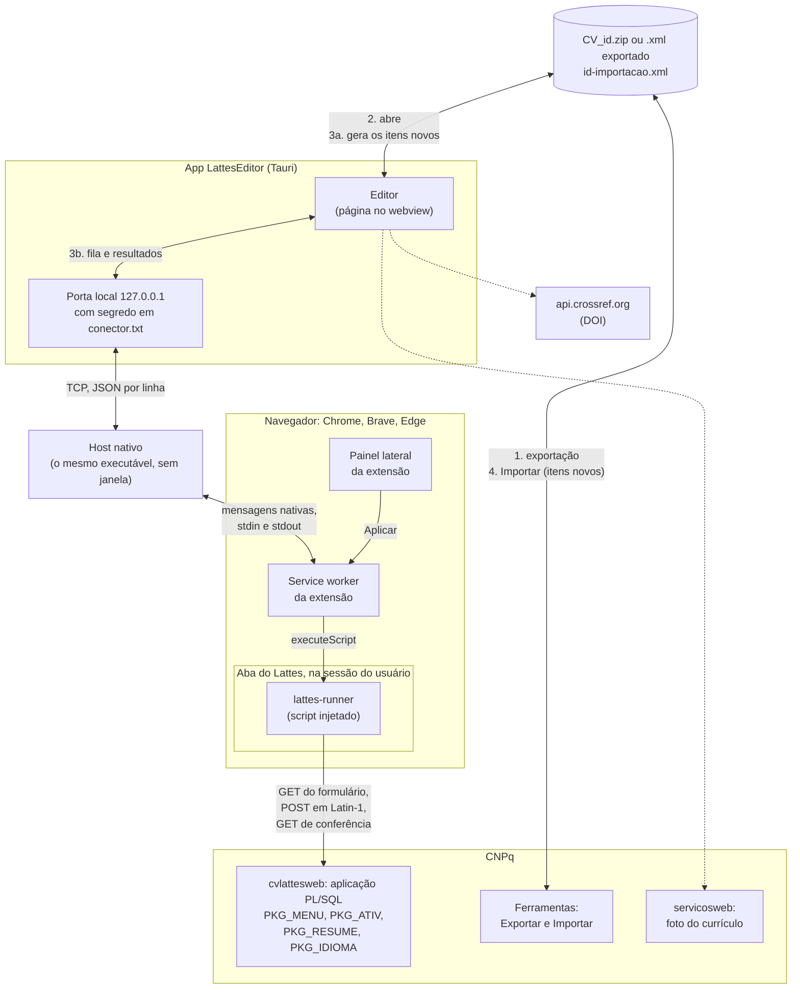

# Como o editor do Currículo Lattes funciona por dentro

Notas de reconhecimento do editor web do Lattes (`wwws.cnpq.br/cvlattesweb`),
para quem for escrever o conector com o navegador ou só tiver curiosidade. Tudo
aqui foi observado numa sessão logada do próprio dono do currículo, só com
leitura: as páginas de formulário foram baixadas por GET e analisadas, nenhum
formulário foi enviado.

Datas das observações: 10/10/2026 (primeiro reconhecimento, ver
`lattes_editor_reconnaissance.md`), 11/10/2026 (formulários de edição, este
documento) e as datas indicadas nas seções seguintes; as seções 16 a 18
(edição de produções, inclusão e buscas) são de 14/10/2026.

Cada afirmação vem marcada como **observado** (visto no HTML, nos scripts ou
no comportamento do servidor) ou **inferido** (conclusão a partir do que foi
observado, ainda não confirmada).

## Visão geral: os componentes

O caminho de uma alteração, do Lattes ao editor e de volta. Há dois retornos:
itens novos vão pelo Importar do próprio Lattes, num arquivo que o editor gera
(3a); o resto vai pela extensão, que grava nos formulários do Lattes na sessão
do próprio usuário (3b). O app nunca fala com o Lattes direto.



- **Editor** (`src/`): lê a exportação, guarda a cópia de trabalho e planeja
  as operações que a extensão sabe levar (`src/bridge/plan.ts`).
- **Porta local e host nativo** (`src-tauri/src/conector.rs`): o navegador só
  inicia programas registrados, então o próprio executável do app, chamado
  com a origem da extensão, faz o papel de host e repassa as mensagens ao app
  aberto. O segredo impede que outro usuário da máquina se ligue à porta.
- **Extensão** (`extension/`): o service worker guarda a fila; o envio só
  começa por um clique no painel. O `lattes-runner` roda dentro da aba do
  Lattes e faz, para cada operação, o que a seção 6 descreve: acha o
  formulário pelos links do próprio Lattes, confere que ele está como o
  editor espera, envia e lê de volta (`src/bridge/apply.ts`).
- **Lattes** (seções 1 a 5): a aplicação PL/SQL que recebe os formulários.
  Exportar e Importar são as únicas portas oficiais para arquivos.
- Em linha tracejada, o que sai do app sem passar pela extensão: a foto do
  perfil e a busca do DOI, só quando pedidas.

## 1. Uma aplicação PL/SQL servida pela web

Toda URL do editor tem a forma

```
/cvlattesweb/PACOTE.procedimento?f_cod=…&f_outro=…
```

por exemplo `pkg_ativ.lista`, `PKG_ATIV.VINCULOS`, `pkg_formacao.form`,
`prc_endereco`. **Observado.**

Esse é o desenho de uma aplicação escrita em PL/SQL, a linguagem de
procedimentos do banco Oracle, servida por um gateway que transforma cada
requisição HTTP numa chamada de procedimento armazenado: o caminho escolhe o
pacote e o procedimento, e cada parâmetro da URL ou do formulário vira um
argumento com o mesmo nome. A página HTML é escrita pelo próprio
procedimento, linha a linha. **Inferido** a partir dos nomes e do
comportamento abaixo; é o modelo do gateway PL/SQL da Oracle (o antigo
mod_plsql e seus sucessores), comum em sistemas de governo do fim dos anos 90
e começo dos 2000.

Duas consequências aparecem no uso:

- **A assinatura manda.** Chamar `pkg_formacao.lista` sem `f_tipo` devolve
  HTTP 404: para o gateway, não existe procedimento com aquela lista de
  argumentos. **Observado** (10/10/2026).
- **Maiúsculas não importam no servidor.** O mesmo formulário mistura
  `f_status` e `F_STATUS`, `f_texto` e `F_TEXTO`, e as URLs alternam
  `PKG_ATIV` e `pkg_ativ`. Identificadores PL/SQL não distinguem caixa, então
  o servidor trata tudo igual. **Observado** (a mistura); **inferido** (a
  causa).

### O prefixo `f_`

Todo parâmetro começa com `f_` (`f_cod`, `f_seq`, `f_ano_ini`,
`f_tipo_privacidade`). **Observado.** O mais provável é uma convenção de
nomes para separar argumentos que vêm do formulário de variáveis internas do
procedimento. **Inferido.**

## 2. `f_ctr`: um procedimento, várias operações

O procedimento que desenha o formulário é o mesmo que recebe o envio dele.
O formulário de vínculo, por exemplo, é aberto por GET em
`PKG_ATIV.vinculos` e postado para `PKG_ATIV.VINCULOS`. **Observado.**

O que diz ao procedimento o que fazer é um campo oculto, `f_ctr` (de
"controle", **inferido**), com uma letra:

| `f_ctr`   | Onde apareceu                                                                            | Significado                                             |
| --------- | ---------------------------------------------------------------------------------------- | ------------------------------------------------------- |
| `I`       | formulário de item novo (atividade em `pkg_ativ.cargo`, 10/10/2026)                      | incluir, **observado**                                  |
| `U`       | formulário de item existente: vínculo, formação, idioma, resumo, endereço, identificação | atualizar, **observado** (envio de 11/10/2026, seção 6) |
| `A`       | código da tela de Formação (10/10/2026)                                                  | alterar, **inferido**                                   |
| `E`, `E2` | função `dele` da lista de atuações; código da Formação                                   | excluir, **inferido**                                   |
| `V`       | botão de voltar/cancelar (10/10/2026)                                                    | voltar sem salvar, **observado**                        |

É o padrão de "despachante" de aplicações CRUD feitas sobre procedimentos:
em vez de uma URL por operação, um procedimento por tela, com um `if` no
começo que olha o código de controle. O mesmo GET sem `f_seq` mostra o
formulário vazio (inclusão); com `f_seq` mostra o registro (alteração).
**Observado** no vínculo (`f_seq_hist`) e na formação (`f_seq`).

## 3. Identificadores

Dois códigos circulam, e os dois devem ser tratados como segredo em logs:

- **O da sessão**: 32 caracteres hexadecimais em `PKG_MENU.menu?f_cod=…`.
  Muda a cada login. **Observado.**
- **O do currículo**: 10 caracteres, usado em `f_cod` por todas as chamadas
  internas. **Observado.**

A exportação XML não traz o código de 10 caracteres, só o identificador
público de 16 dígitos (`NUMERO-IDENTIFICADOR`). Os dois se ligam por
redirecionamento: `lattes.cnpq.br/<16 dígitos>` responde 302 para
`buscatextual.cnpq.br/buscatextual/cv?id=<16 dígitos>`, que responde 302
para `visualizacv.do?metodo=apresentar&id=<10 caracteres>`. **Observado**
(11/10/2026). A foto do currículo sai de
`servicosweb.cnpq.br/wspessoa/servletrecuperafoto?tipo=1&id=<10 caracteres>`;
com o identificador de 16 dígitos o mesmo endereço responde uma imagem
vazia. **Observado.**

Cada linha de uma lista é identificada por números de sequência que batem
com os do XML exportado: `f_seq_ativ` com `SEQUENCIA-ATIVIDADE`,
`f_seq_hist` com `SEQUENCIA-HISTORICO`, `f_seq` da formação com
`SEQUENCIA-FORMACAO`. Conferido na atuação em 11/10/2026: a atividade com
`SEQUENCIA-ATIVIDADE="5"` no XML é a única linha com `f_seq_ativ=5` na lista
do Lattes, na mesma instituição. **Observado** para a atuação; nas outras
telas continua inferido.

O código da instituição não é igual dos dois lados: o XML traz
`CODIGO-INSTITUICAO="001000000998"` e o link do Lattes traz
`f_codinst=D001000000998`, com uma letra na frente. **Observado**; o que a
letra significa não se sabe.

## 4. Telas

O editor é uma página só (`PKG_MENU.menu`) com camadas modais em `iframe`
(`modalCV1` a `modalCV3`): lista, formulário, busca de instituição.
**Observado** (10/10/2026). Cada formulário:

- valida no navegador com uma função `check()` que junta mensagens num
  vetor e as mostra com `alert()`;
- salva com `enviar()`, que faz `submit()` do formulário inteiro: um POST
  clássico, que recarrega o `iframe`;
- não tem token CSRF; o que amarra o envio à sessão é o cookie e o `f_cod`.

**Observado.** Se o servidor repete as validações de `check()`, não se sabe.

## 5. Formulários de edição (11/10/2026)

Nomes, tipos e limites lidos do HTML. Campos ocultos de controle (`f_cod`,
chaves, `*_old`) aparecem no fim de cada lista.

### Vínculo de uma atuação: `GN_ATIV_VINC`, POST `PKG_ATIV.VINCULOS`

Aberto por GET `PKG_ATIV.vinculos` com `f_cod`, `f_codinst`, `f_seq_ativ` e
`f_seq_hist` (sem `f_seq_hist`, abre um vínculo novo).

| Campo                                                                        | Tipo                              | XML (`VINCULOS`)                                                                                |
| ---------------------------------------------------------------------------- | --------------------------------- | ----------------------------------------------------------------------------------------------- |
| `f_vinc`                                                                     | texto 30                          | `TIPO-DE-VINCULO` / `OUTRO-VINCULO-INFORMADO` (o formulário guarda o rótulo; ver nota)          |
| `f_stavinc`                                                                  | lista: vazio, `0`, `1`            | `FLAG-VINCULO-EMPREGATICIO`, **invertido**: `1` (Sim) sai `NAO`, `0` (Não) sai `SIM` (ver nota) |
| `f_enqua`                                                                    | texto 45                          | `OUTRO-ENQUADRAMENTO-FUNCIONAL-INFORMADO`                                                       |
| `f_enqua_en`                                                                 | texto 45                          | `OUTRO-ENQUADRAMENTO-FUNCIONAL-INFORMADO-INGLES`                                                |
| `f_carga`                                                                    | texto 3                           | `CARGA-HORARIA-SEMANAL`                                                                         |
| `f_regime`                                                                   | caixa, valor `3`                  | `FLAG-DEDICACAO-EXCLUSIVA` (marcada = sim)                                                      |
| `f_mes_ini`, `f_ano_ini`                                                     | texto 2, 4                        | `MES-INICIO`, `ANO-INICIO`                                                                      |
| `f_status`                                                                   | rádio `S` = Atual, `N` = Anterior | atual quando `ANO-FIM` é vazio                                                                  |
| `f_mes_fim`, `f_ano_fim`                                                     | texto 2, 4                        | `MES-FIM`, `ANO-FIM`                                                                            |
| `f_outras_inf`                                                               | área 3950                         | `OUTRAS-INFORMACOES`                                                                            |
| `f_outras_inf_en`                                                            | área 2000                         | `OUTRAS-INFORMACOES-INGLES`                                                                     |
| `f_tipo_privacidade`                                                         | lista `1` público, `2` privado    | sem correspondente no XML                                                                       |
| `f_ctr` (`U`), `f_vinculo`, `f_cod`, `f_codinst`, `f_seq_ativ`, `f_seq_hist` | ocultos                           |                                                                                                 |

**Invertido, observado em 15/10/2026.** O `f_stavinc` ("Possui vínculo
empregatício") é o contrário de `FLAG-VINCULO-EMPREGATICIO` na exportação. A
passada de edição do censo (seção 20) casou os 8 vínculos do dono do
currículo com `f_stavinc` `0` ↔ `SIM` e `1` ↔ `NAO`, e a tela confirmou um
deles: o Lattes mostra "Sim" (`f_stavinc=1`, `selected` no HTML) e a
exportação, lida também pelo editor, traz `NAO`. Até 15/10/2026 esta tabela
dizia `1` = sim: a conferência do "antes" falharia em toda alteração desse
campo e, se passasse, a gravação trocaria o valor real da pessoa. A
dedicação exclusiva não inverte: `f_regime` desmarcado no Lattes sai `NAO`.
Por que o Lattes grava assim não se sabe. O conector traduz os dois
sentidos em `src/bridge/vinculo-flag.ts`, e o Lattes simulado usa um mapa
literal próprio, para que um confira o outro.

Nota sobre o tipo de vínculo: `check()` copia o texto de `f_vinc` para o
oculto `f_vinculo` antes de enviar, e o texto vem de uma lista em
`dominio()` (Servidor público, Celetista, Professor visitante, Bolsista,
Outro). Como esse texto vira o código `TIPO-DE-VINCULO` do XML não foi
visto. **Lacuna.**

Regras de `check()` (mensagens do próprio Lattes): tipo do vínculo e início
obrigatórios; fim obrigatório quando o status é Anterior e proibido quando é
Atual; início antes do fim; nenhuma data no futuro; início não anterior ao
nascimento.

### Formação acadêmica: `GN_FORMACAO2`, POST `pkg_formacao.FORM`

Aberto por GET `pkg_formacao.form` com `f_cod`, `f_seq` e `f_tipo` (`FA`).
Mesmos campos do formulário de inclusão descrito no reconhecimento de
10/10/2026, com `f_ctr=U`, `f_seq` preenchido e `f_nivel` com o código do
nível (`3` = mestrado). `F_STATUS` usa `N` em andamento, `S` concluído, `I`
incompleto (rótulos lidos em 10/10/2026), que correspondem a
`STATUS-DO-CURSO` `EM_ANDAMENTO`, `CONCLUIDO`, `INCOMPLETO`.

### Idioma: `GN_IDIOMA`, POST `PKG_IDIOMA.FORM`

| Campo                                            | Tipo                                        | XML (`IDIOMA`)                                                                                   |
| ------------------------------------------------ | ------------------------------------------- | ------------------------------------------------------------------------------------------------ |
| `F_COD_IDIOMA`                                   | lista de idiomas                            | `IDIOMA`                                                                                         |
| `F_LE`, `F_CONVERSA`, `F_ESCREVE`, `F_COMPR`     | rádio `P` pouco, `R` razoavelmente, `B` bem | `PROFICIENCIA-DE-LEITURA`, `-FALA`, `-ESCRITA`, `-COMPREENSAO` (`POUCO`, `RAZOAVELMENTE`, `BEM`) |
| `FC_LE`, `FC_CONVERSA`, `FC_ESCREVE`, `FC_COMPR` | caixas, valor `on`                          | habilitam cada proficiência; `check()` exige ao menos uma marcada                                |
| `f_tipo_privacidade`                             | lista `1`/`2`                               |                                                                                                  |
| `f_ctr` (`U`), `f_cod`, `f_seq`                  | ocultos                                     |                                                                                                  |

A exportação não traz número de sequência do idioma. O conector abre cada link
`pkg_idioma.form` da lista que tem `f_seq` (o que não tem é o de idioma novo)
e escolhe o único cujo `F_COD_IDIOMA` é o código do XML. `NAO_INFORMADO` no
XML corresponde à caixa desmarcada e nenhum rádio.

### Códigos de nível (11/10/2026)

Lidos nos formulários, sem gravar nada:

- Formação complementar (`pkg_formacao_compl.form`), lista `f_nivel`: `F`
  curso de curta duração, `8` extensão universitária, `E` MBA, `Y` outros.
  É o `NIVEL` do XML nesses itens.
- Mestrado (`pkg_formacao.form`, `f_nivel` 3): rádio `f_tpo_doutorado`, `N`
  normal e `S` sanduíche. É o `TIPO-MESTRADO` do XML.
- Formação acadêmica: `f_nivel` vem oculto no formulário (3 no mestrado, 1 na
  graduação, 7 no curso técnico, conforme a exportação); o nível é o próprio
  tipo do item.
- Pós-doutorado e livre-docência (`pkg_formacao.form` com `f_tipo=AP`, lido
  em 15/10/2026): `f_nivel` 5 é pós-doutorado e 6 livre-docência. O
  formulário de inclusão do pós-doutorado mostra só instituição, rádio
  `F_STATUS` do status do curso (`N` em andamento, `S` concluído, `I`
  incompleto), início e conclusão (ano), rádio `F_BOLSA`, agência financiadora
  e áreas. Título do trabalho (`f_titulo`), ano e mês de obtenção
  (`f_ano_obten`, `f_mes_obten`), orientador e curso vão ocultos. Status do
  estágio, título em inglês e nome do curso em inglês não aparecem. O valor de
  `F_STATUS` no XML não foi conferido numa exportação.
- `NIVEL-CURSO="OT"` da tabela de cursos: sentido não encontrado. O XSD tem
  `OT` e `OUTRO` como valores distintos.

### Resumo: `RES`, POST `PKG_RESUME.FORM`

`F_TEXTO` (4000) e `F_TEXTO_EN` (4000), correspondentes a
`TEXTO-RESUMO-CV-RH` e `TEXTO-RESUMO-CV-RH-EN`; ocultos `f_resume_auto`,
`f_resume_auto_en`, `f_cod`, `f_ret`, `f_ctr` (`U`).

### Endereço: `GN_ENDERECO`, POST `PRC_ENDERECO`

Um formulário para os dois endereços: sufixo `_r` residencial, `_i`
institucional. `f_pais_*`, `f_cep_*` (15), `f_rua_*` (180), `f_bairro_*`
(255), `f_munic_*` (45), `f_estado_*` (10), `f_ddd_*`, `f_fone_*`,
`f_ramal_*`, `f_fax_*`, `f_caixa_*`, `f_ddd_cel_*`, `f_fone_cel_*`,
`f_homepage_*` (250); `f_inst` (75) e `f_orgao` do institucional;
`f_email_i`, `f_email_r` (70); `f_end_corr` (rádio, endereço de
correspondência); privacidade por bloco (`f_priv_residencial`,
`f_priv_profissional`, `f_priv_email_*`); `f_ctr` (`U`). Os contatos
eletrônicos e redes sociais vão em grades serializadas nos ocultos
`f_dados_grid` e `f_dados_grid_contatos` (formato não lido). **Lacuna.**

### Identificação: `GN_IDENT`, POST `PRC_IDENT`

Aberto por GET `prc_ident` com `f_cod` e `f_pcd`. Nome (`f_nome` 60), nome
social, nome em citações (oculto), nacionalidade e país, CPF (oculto: não se
edita), sexo, raça ou cor, nascimento (país, UF, cidade, data), RG, passaporte,
nomes dos pais (ocultos), pessoa com deficiência (`f_pcd_r` e caixas
`f_pcd`), e uma lista de privacidade por grupo de dados.

A nacionalidade não se escolhe: o oculto `f_nacionalidade` recebe `B` ou `E`
pelo JavaScript da página, e as validações tratam `B` como brasileira (exige
CPF e RG) e `E` como estrangeira. É o `NACIONALIDADE` do XML. Os grupos de
privacidade são foto, nacionalidade, raça ou cor, nascimento, identidade,
passaporte e deficiência (`f_priv_*`, `1` público, `2` privado).
**Observado** (11/10/2026).

## 6. Primeiro envio (11/10/2026)

Um POST montado fora do formulário, com a autorização do dono do
currículo, para ver se o caminho direto funciona:

1. GET do formulário do vínculo e leitura de todos os campos que o
   navegador enviaria (os desabilitados não vão; `f_vinc` está desabilitado,
   então `f_vinculo` recebe o texto dele, como faz `check()`).
2. POST para `PKG_ATIV.VINCULOS` com os mesmos campos e só
   `f_outras_inf_en` trocado por um marcador, corpo codificado em Latin-1.
3. Novo GET do formulário: só `f_outras_inf_en` mudou.
4. Segundo POST devolvendo o valor original (vazio) e novo GET: formulário
   idêntico ao de antes.

A resposta do POST não é uma página: é um trecho de JavaScript que manda o
`iframe` pai (`modalCV2`) voltar para a grade da atuação e abre
`pkg_aviso_pendencia.inicio`, o aviso de pendências do currículo.
**Observado.** Os dois envios contam como atualização do currículo, então a
data de "última atualização" no Lattes passa a ser a do teste.

## 7. Sessão

A sessão do editor cai em poucos minutos (3 a 12 nos testes de 10/10/2026)
e passa a responder com a página de `pkg_sec.logon`. Em 11/10/2026, com a
aba aberta pelo próprio usuário, a sessão aguentou todas as leituras deste
documento. **Observado.** Abrir um segundo editor do mesmo currículo parece
derrubar o primeiro. **Inferido.**

A aba não percebe que a sessão venceu: o menu já carregado continua na tela, e
só o próximo pedido mostra que acabou. Com a sessão vencida, cada página do
`cvlattesweb` (`pkg_idioma.lista`, `pkg_impcv.get_arquivo`,
`prc_midias_sociais`, entre outras) responde só com um script que redireciona
ao login, sem formulário nenhum. **Observado** em 14/10/2026:

```html
<script>
  location = 'pkg_sec.logon?f_cod=ini';
</script>
```

O `fetch` da extensão não roda esse script, então quem lê a resposta precisa
reconhecer o redirecionamento no HTML (`isLogonPage`, em
`src/bridge/lattes-html.ts`). Sem cookie nenhum, o `PKG_MENU.menu` responde
outra coisa: um `alert("Problemas na autenticação")` antes de mandar para
`lattes.cnpq.br`. **Observado**, com um user-agent de navegador; com o do
`curl`, o Lattes devolve uma página dizendo que o navegador não é suportado.

## 8. O que ainda não se sabe

- Se o servidor revalida o que `check()` valida.
- Como `f_vinc` vira `TIPO-DE-VINCULO`, e o formato das grades de contato
  do endereço.
- O formulário de edição de uma atividade existente (`pkg_ativ.cargo` com
  `f_seq_funcao`, montado por JavaScript na grade da atuação).
- Se o POST do Exportar funciona sem o GET da tela antes (seção 12).
- Por que um item confirmado no passo 3 do Importar some (seção 13, item 8).

## 9. Vigia: saber quando o CNPq mudou algo

O CNPq não publica roadmap, changelog nem notas de versão da Plataforma
Lattes (procurado em 12/10/2026: o portal gov.br do CNPq, o Portal Memória e
a página do Extrator só trazem notícias gerais e o aviso de que o XSD foi
"atualizado em 12/09/2022"; o feed de notícias do Portal Memória parou em
2015). A única maneira de saber que algo mudou é olhar.

Duas vigias, uma para cada lado do login:

- **Público, no CI.** `scripts/vigia-lattes.ts` roda toda segunda-feira
  (`.github/workflows/vigia-lattes.yml`) e confere o XSD byte a byte contra
  `schema/CurriculoLattes_12_09_2022.xsd`, o texto "atualizado em" e o link
  na página do Extrator, a foto do perfil (`servletrecuperafoto`) e a
  entrada do Lattes. Falhou, abre ou comenta uma issue `vigia-lattes`.
- **Atrás do login, na extensão.** `src/bridge/contract.ts` guarda o que o
  conector espera encontrar: os procedimentos linkados no menu
  (`pkg_ativ.lista`, `pkg_idioma.lista`, `pkg_resume.`) e, para cada
  formulário que ela grava (seção 5), o nome, o POST e os campos com tipo e
  limite. A verificação percorre os mesmos links que a gravação percorre, só
  com GET, lê um exemplar de cada formulário e compara. Roda sozinha ao abrir
  o painel e quando o menu do Lattes carrega, três segundos depois, com uma
  segunda tentativa cinco segundos depois se a leitura falhar (a primeira,
  logo no carregamento, falhava em 13/10/2026). Repete a cada meia hora com
  tudo certo e a cada minuto com problema (`shouldAutoVerify`), e o painel só a
  mostra quando há problema, com "Verificar de novo".
  A mesma verificação roda antes de cada fila; campo sumido, tipo trocado,
  formulário ou link que não existe mais e `f_ctr` fora de `U` param a fila
  antes do primeiro POST. Se a conferência nem chega a ler (aba que não
  responde, erro de rede), a fila também para; e para se a fila tem operação
  num formulário de que o Lattes não mostrou exemplar, porque o conector só
  altera o que já existe. Campo novo e limite diferente só avisam, porque o
  conector reenvia o formulário inteiro como o leu.

O contrato foi escrito a partir das tabelas da seção 5 (11/10/2026), não de
uma captura automática. A primeira verificação num Lattes real, em
12/10/2026, voltou "como o esperado" para o menu e os três formulários, ou
seja, as tabelas estavam certas em nome, tipo e limite. Quando o relatório
apontar diferença, o contrato é corrigido junto com a tabela desta seção.

O relatório da verificação só tem nomes de campos e de procedimentos, a data
e a versão da extensão. Nenhum valor do currículo entra nele, para que possa
ser colado numa issue pública.

## 10. Exportar e alterações pendentes (12/10/2026)

O menu abre só com o cookie: `PKG_MENU.menu` sem `f_cod` mostra o currículo
de quem está logado, e o login passa pelo Keycloak de `login.cnpq.br`.
**Observado.**

O topo do menu mostra "Última atualização: <data>" e "Última publicação:
<data>", e a lista de avisos traz "Existem alterações realizadas em seu
currículo que ainda não foram enviadas ao CNPq" enquanto houver pendência.
**Observado.** A extensão lê os dois do menu que já está na aba, sem
requisição nova (`src/bridge/lattes-status.ts`). O menu aberto na aba só
muda quando é recarregado, então depois de uma fila o estado pode estar
defasado. Que o aviso some depois de "Enviar ao CNPq" foi **observado** em
14/10/2026 (abaixo).

"Exportar", no menu secundário, chama
`modalCV1.setarUrl('pkg_impcv.get_arquivo?f_cod=<10 caracteres>', true)`:
um GET que carrega a tela do Exportar num `iframe` modal. **Observado.**

Com alterações ainda não enviadas ao CNPq, essa tela abre com um `alert()`
("Existem alterações realizadas no currículo que só serão aceitas quando
enviadas ao CNPq em definitivo") e não exporta. O `alert()` trava a aba até
alguém clicar em OK, inclusive para a automação do navegador. **Observado.**
Um `fetch` da mesma URL não roda o script da página, então não trava; o
conector pode ler o HTML e reconhecer o aviso.

Não há como descartar alterações pendentes. A tela de envio
(`pkg_publicar.mostrar_cv`, aberta pelo "Enviar" e pelo aviso de pendências)
só tem "Enviar ao CNPq" (formulário `publicar`, POST `pkg_publicar.enviar`,
com a concordância no `f_chk`) e "Cancelar", que fecha a tela. Nenhuma das
nove ferramentas do menu secundário desfaz alterações. Os textos com "serão
descartadas" no código da página são o aviso genérico de sair de um
formulário sem gravar. **Observado.**

Consequência para o conector: tudo o que ele grava deixa o currículo com
pendência até a pessoa enviar ao CNPq, e até lá o Exportar recusa. Abrir do
Lattes pelo conector precisa reconhecer esse estado e pedir o envio antes; não
adianta tentar de novo. A edição e a exclusão de um evento pelo formulário
acendem a pendência (seção 16, 14/10/2026). **Observado.**

O Exportar entrega a versão publicada, não a de trabalho: um item que entrou
pelo Importar, que não acende a pendência, não aparece numa exportação feita
logo depois (seção 13, 14/10/2026). **Observado.**

**Enviar ao CNPq** (14/10/2026, feito pela pessoa, com a página observada só
lendo). **Observado.**

- A tela é `pkg_publicar.mostrar_cv?f_cod=…`, aberta no modal. O formulário
  `publicar` declara só `f_chk` (a declaração); o `enviar()` da página monta
  o resto.
- Antes do envio, a página faz três POSTs ajax:
  `pkg_publicar.racapreenchida_raca_cor` com `f_cod`, que responde
  `{"status": true}`, e `pkg_util.existe_email_cadastrado` com `f_email` e
  `f_cod`, uma vez para o e-mail de contato e outra para o alternativo
  (vazio), que responde `{"existe":false ,"mensagem":"Email não encontrado"}`.
- O envio é um **GET** para `pkg_publicar.enviar` com `f_chk=1`,
  `f_idioma=1` (português; `2` seria inglês, **inferido**), `f_chk_en=1`
  (autoriza a versão em inglês), `f_email_contato`, `f_email_alternativo`,
  `f_cod` e `f_ctr=U`. Levou cerca de 18 segundos.
- A resposta é uma página com o `alert("O currículo foi enviado para
publicação.")`, que trava a aba até alguém clicar em OK (um `fetch` não roda
  o script). A página traz também um `enviar()` que navegaria para
  `pkg_publicar.salvar` com os mesmos campos menos `f_chk`; quando ele é
  chamado não foi visto.
- Depois, o menu mostra "Última atualização" e "Última publicação" na data do
  dia, sem o aviso de pendência, e o Exportar volta a exportar.

A versão atual do currículo, com o que ainda não foi enviado, sai de
`pkg_publicar.cv_espelho?f_cod=<10 caracteres>&f_idioma=1`, o link "Versão em
Português" da tela de envio (a função `portugues()` monta o endereço com
`f_idioma=1`). Abre só com o cookie e não pede código de segurança, ao
contrário do currículo público em `buscatextual.cnpq.br`. O texto segue a
ordem das seções do currículo; produções e eventos vêm em listas numeradas
("1. AUTOR; AUTOR. Título, 2005."), com o subtítulo da lista logo antes do
item 1 e linhas de detalhe depois de cada item; a página termina com "Totais
de produção" e o aviso "Este arquivo não foi gerado a partir do Currículo
Lattes validado e disponível publicamente". **Observado** pelo texto da
página; as tags que formam essas linhas são **inferidas**. O diagnóstico do
editor lê essa página (`src/bridge/espelho.ts`).

## 11. Inclusão (LAT-24, 13/10/2026)

O que o conector usaria para criar uma atuação profissional nova, e de onde
vem cada parte. Nada disso foi enviado a um Lattes real; o código está em
`src/bridge/create.ts`, desligado.

- **Observado** (reconhecimento de 10/10/2026, seção 4.1 e 4.3): o
  formulário `GN_ATIV`, aberto por `PKG_ATIV.inclui` a partir da lista de
  atuações, com `f_ctr=I` e POST para `PKG_ATIV.INCLUI`; os campos e
  limites da tabela da seção 4.1; a busca de instituição por POST para
  `PRC_INST_FORM`, cuja resposta traz `seleciona('<código>','<nome>')`; e a
  regra de que o código vai em `f_cod_inst` quando começa com V e em
  `f_cod_inst2` nos outros casos.
- **Inferido**: os valores de `F_COD` (o `f_cod` do formulário) e
  `F_NIVEL` (vazio) na busca feita fora do seletor; o texto de `f_vinc` para
  cada `TIPO-DE-VINCULO` (dos rótulos do combo; com
  `OUTRO-VINCULO-INFORMADO`, vale o texto livre); `f_vinculo` igual a
  `f_vinc`, como o `check()` faz na alteração; a resposta do POST de
  inclusão; e que a atuação nova aparece na lista com um `f_seq_ativ` novo,
  que o conector lê de volta e devolve como `SEQUENCIA-ATIVIDADE`.
- **Travas**: recusa se a lista já tem atuação na mesma instituição (seria
  duplicata), exige exatamente um resultado da busca com o código do XML,
  confere os limites, e depois do envio exige exatamente uma atuação nova
  dessa instituição, com o vínculo lido de volta igual ao enviado.
- **Desfazer**: excluir pelo conector não está mapeado para a atuação (o
  `f_ctr=E` só apareceu no código da Formação). Um item criado fica no
  registro do enviado sem "Desfazer no Lattes", com a orientação de excluir
  à mão.
- **Número do item**: a cópia de trabalho guarda o número que o editor deu.
  Até o conector reconciliar com o `SEQUENCIA-ATIVIDADE` que o Lattes devolve,
  o caminho é recarregar a exportação antes de alterar esse item pelo conector.
- **Formação e projeto** (LAT-52): depois do mapa das seções 17 e 18, as
  inclusões estão em `src/bridge/create-formacao.ts` e
  `src/bridge/create-projeto.ts`, atrás da mesma chave, também sem envio
  real. A patente continua fora: a consulta `verifica_cadastrado` e o
  formulário com `f_ctr=R` não foram observados.

## 12. Exportar pelo conector (LAT-22, 13/10/2026)

Com o currículo sem pendências (publicado no mesmo dia), a exportação em
XML são duas requisições, as mesmas que a tela faz. **Observado.**

1. `GET pkg_impcv.get_arquivo?f_cod=<10 caracteres>` devolve a tela do
   Exportar: o formulário `PKG_IMP` (POST para `PKG_IMPCV.get_arquivo`), com
   o rádio `f_tpo_arq` (`1` RTF, marcado por padrão; `3` XML) e os ocultos
   `f_cod` e `f_ctr`. O link "Confirmar" chama `check()`, que põe
   `f_ctr = "G"` e envia o formulário; "Cancelar" usa `f_ctr = "V"`.
2. `POST PKG_IMPCV.get_arquivo` com `f_tpo_arq=3`, `f_cod` e `f_ctr=G`
   responde `200`, `application/zip`, `Content-Disposition: attachment;
filename="CV_<16 dígitos>.zip"`, em menos de meio segundo. O ZIP tem uma
   única entrada, `<16 dígitos>.xml`, comprimida com deflate. É o mesmo
   arquivo do download pelo navegador.

A sessão continuou de pé: o menu respondeu logo depois e cinco minutos
depois do POST. **Observado** uma vez; a queda de 10/10/2026, cerca de três
minutos depois de abrir o Exportar, segue sem causa conhecida.

O POST só funciona em `/cvlattesweb/PKG_IMPCV.get_arquivo`: feito a partir de
uma página em `/curriculoweb/`, o `fetch` falha com "Failed to fetch"
(14/10/2026). **Observado.** O editor responde nas duas bases; a causa da
falha (redirecionamento ou CORS) é **inferida**.

Se o POST sem o GET da tela antes também funciona não foi testado. O conector
faz os dois, e o GET ainda serve para reconhecer, sem `alert()`, a sessão
caída e a pendência (seção 10). O caminho está em `src/bridge/export.ts`.

## 13. Importar pelo conector: passos 1 e 2 (13/10/2026)

O menu leva ao Importar por `pkg_importa_xml.inicio?f_cod=<10 caracteres>`.
**Observado.**

**Passo 1.** A tela tem o formulário `fl`, POST multipart para
`pkg_importa_xml.inicio`, com o arquivo em `file` e os ocultos `f_cod`,
`f_ctr=I` e `f_ret` (vazio). O botão "Enviar" chama `check()`, que só confere
se há arquivo e se o nome termina em `.xml`, e então envia o formulário.
**Observado.**

O teste enviou um arquivo gerado pelo próprio caminho do editor
(`buildImportFile`, a opção 2: o currículo inteiro mais o item novo), com
uma participação em congresso nova: NATUREZA "Congresso", PAIS "Alemanha",
IDIOMA "Inglês", FORMA-PARTICIPACAO "Participante", TIPO-PARTICIPACAO
"Apresentação oral". O POST feito de dentro da página, com `FormData` e o
cookie da sessão, foi aceito como o do botão. **Observado.**

**Passo 2.** A resposta ao passo 1 é a tela de seleção, o formulário
`pkg_imp_xml`, POST (urlencoded) para `pkg_importa_xml.mostra_modulos`, com:
**Observado.**

- `f_cod`, `f_solic` (o número da solicitação criada pelo passo 1) e
  `f_ctr` (vazio até a ação);
- uma caixa `f_chkp` por módulo, com o valor na ordem da tela: 1 Artigos
  completos publicados, 2 Artigos aceitos, 3 Livros e capítulos, 4 Trabalhos
  em anais, 5 Texto em jornal ou revista, 6 Apresentação de Trabalho, 7
  Outras produções bibliográficas, 8 Softwares, 9 Produtos, 10 Processos, 11
  Trabalhos técnicos, 12 Outras produções técnicas, 13 Produção
  artística/cultural, 14 Orientações e Supervisões, 15 Demais Trabalhos, 16
  Eventos, 17 Bancas (e `f_all`, "Selecionar todos");
- `f_ano_prod`, "Produção C&T a partir de", com os anos 2026, 2007, 2006,
  2005 e 2004 e 2026 marcado. Que a lista são os anos das produções do
  arquivo, e o padrão o mais recente, é **inferido**;
- "Confirmar" (`enviar()`): exige ao menos um módulo marcado, põe
  `f_ctr=I` e envia; "Descartar" (`excluir()`): pede confirmação, põe
  `f_ctr=D` e envia.

O passo 2 não mostra os itens: ver como o Lattes trata os valores do item
(e a "lista vermelha" do passo seguinte) pede o Confirmar, que o teste não
fez. Se "Participante", "Apresentação oral", "Alemanha" e "Inglês" entram
como estão continua **inferido**.

O passo 1 cria uma solicitação de importação no servidor, que fica pendente:
a tela diz "Existe solicitação de Importação de XML pendente", e reabrir o
Importar leva direto ao passo 2 dela. Nada muda no currículo: depois do
passo 1, o menu seguiu sem o aviso de alterações não enviadas ao CNPq e com a
mesma "Última atualização". **Observado.** A solicitação do teste ficou
pendente, à espera de Confirmar ou Descartar.

Consequência para o conector: os passos 1 e 2 cabem em dois POSTs de dentro
da aba do Lattes, como o Exportar (seção 12), com os módulos marcados pelo
que o arquivo traz (`ImportFile.modules`) e o ano a partir do item novo mais
antigo. O que vem depois do Confirmar (passo 3 e o resultado) ainda precisa
ser observado com a pessoa acompanhando.

**No conector (14/10/2026, desligado).** `src/bridge/importar.ts` faz os
passos 1 e 2 com o arquivo da opção 1 (`buildMinimalImportFile`) e para na
resposta do Confirmar do passo 2, sem nenhum POST a mais, devolvendo só a
forma da página (formulários, campos, botões). Fica atrás de
`IMPORT_ENABLED = false`; o teste acompanhado abaixo mostrou que a chave não
pode ser ligada como está.

**Teste acompanhado (14/10/2026), a partir da aba do menu.** **Observado.**

1. Arquivo mínimo com `DADOS-GERAIS` só com `NOME-COMPLETO`,
   `NOME-EM-CITACOES-BIBLIOGRAFICAS`, `NACIONALIDADE` e
   `PERMISSAO-DE-DIVULGACAO` (o que o XSD exige), e de novo com `SEXO`
   acrescentado (o DTD `schema/LMPLCurriculo.DTD` tem `SEXO #REQUIRED`; o XSD
   não): o passo 1 responde com o alerta "Erro. Não foi possível processar o
   arquivo enviado. Certifique-se que o mesmo esteja de acordo com o DTD do
   Curriculo Lattes." Nenhuma solicitação é criada. O Lattes confere o
   arquivo contra o DTD, não contra o XSD.
2. O mesmo arquivo mínimo, mas com **todos** os atributos do `DADOS-GERAIS`
   da exportação real (CPF, nascimento, RG, filiação, `ORCID-ID`, `PCD` e o
   resto), passa da conferência do DTD e cai noutro alerta: "O arquivo
   enviado para importação não contém produções científicas.", quando o único
   item novo é uma `PARTICIPACAO-EM-CONGRESSO` em `DADOS-COMPLEMENTARES`.
   Qual atributo faltava no caso 1 não foi isolado.
3. Opção 2 (a exportação inteira mais o evento, `SEQUENCIA-PRODUCAO` 34): o
   passo 2 vem como mapeado acima (formulário `pkg_imp_xml`, as 17 `f_chkp`
   marcadas, anos 2026, 2007, 2006, 2005 e 2004). Confirmado com `f_chkp=16`
   e `f_ano_prod=2026`, vem o **passo 3**: formulário `pkg_imp_xml`, POST
   para `pkg_importa_xml.mostra_lista_prod`, com `f_cod`, `f_solic`,
   `f_sq=dummy`, `f_ctr`, `f_chkp` (`dummy` e os módulos escolhidos),
   `f_all` e uma caixa `f_sq` por item, todas marcadas. O valor de `f_sq` é
   um id do servidor (20 no teste), **não** o nosso `SEQUENCIA-PRODUCAO`.
   Cada linha tem `<b class="quadrado verde">` ou `<b class="quadrado
vermelho">`; o único item veio verde. `enviar()` exige ao menos um `f_sq`
   marcado e põe `f_ctr=I`; `excluir()` pede confirmação e põe `f_ctr=D`.
4. O Confirmar do passo 3 (POST para `mostra_lista_prod` com `f_ctr=I` e
   `f_sq=20`) responde com
   `caixaMsg.exibir({titulo:'Sucesso',conteudo:'A operação foi realizada com sucesso! !',classe:'ok'})`
   (o texto é esse, com o espaço e o segundo "!"), e a solicitação é
   consumida (o Importar volta ao passo 1).
   Mesmo assim, passados mais de 3 minutos, o item **não** está em
   `pkg_evento.lista` nem em `cv_espelho`. A mensagem de sucesso não quer
   dizer que o item entrou.
5. "Descartar" no passo 2 (POST para `mostra_modulos` com `f_ctr=D`) volta
   ao passo 1 e encerra a solicitação.
6. O Confirmar feito pela própria tela manda os mesmos campos que o POST
   montado de dentro da página: os dois foram comparados campo a campo nos
   passos 2 e 3. A diferença entre o envio do conector e o do navegador não
   explica o item que não entrou. O formulário do passo 2 tem, nesta ordem,
   `f_cod`, `f_solic`, um `f_chkp` oculto com `dummy`, `f_ctr`, `f_all`, as
   caixas `f_chkp` de 1 a 17 e `f_ano_prod`. O envio do navegador no passo 2
   foi `f_cod`, `f_solic`, `f_chkp=dummy`, `f_ctr=I`, `f_chkp=16`,
   `f_ano_prod=2026`, sem `f_all`; no passo 3, `f_cod`, `f_solic`,
   `f_sq=dummy`, `f_ctr=I`, `f_chkp=dummy`, `f_chkp=16`, `f_all=on`,
   `f_sq=20`. **Observado.** O conector manda o passo 2 com os mesmos campos,
   na mesma ordem.
7. No passo 3, o verde e o vermelho comparam pelo título: os eventos de
   ouvinte sem título aparecem como "Produção sem título", todos verdes,
   embora já estejam no currículo. O filtro de ano do passo 2 limita a
   lista do passo 3.
8. Um evento montado à mão (Participante, Apresentação oral, `IDIOMA`
   Português, `TITULO` preenchido, **sem** `PARTICIPANTE-DE-EVENTOS-CONGRESSOS`)
   recebeu o "sucesso" e não entrou, duas vezes, uma delas pela tela. Uma
   cópia de um evento de ouvinte que já estava no currículo, com o
   `PARTICIPANTE-DE-EVENTOS-CONGRESSOS` da própria pessoa e `IDIOMA` vazio,
   só com o nome e o título trocados, entrou. Que o item sem a própria
   pessoa entre os participantes seja descartado em silêncio é **inferido**:
   a causa não foi isolada.
9. Cada importação confirmada gasta um `SEQUENCIA-PRODUCAO`, mesmo a que
   some: o item que entrou ficou com `f_seq=36`, e 34 e 35 foram das duas que
   não entraram (o máximo anterior era 33). O arquivo trazia 34: o número é
   o do servidor, não o do arquivo, e é ele o `f_seq` do formulário de
   edição.
10. O item que entrou não acende o aviso de alterações não enviadas ao CNPq,
    aparece na lista e em `cv_espelho`, e **não** aparece no Exportar: o
    Exportar entrega a versão publicada (seção 10).

Consequências:

- A conferência de uma importação é pela lista ou por `cv_espelho`, nunca
  por uma exportação nova: o Exportar entrega a versão publicada (seção 10),
  e que o item apareça nele depois do envio ao CNPq é **inferido**. A
  mensagem de sucesso não vale como conferência. Isso corrige o plano do
  guia (seção 1) de conferir por uma exportação.
- O arquivo mínimo, como o guia o descreve, não passa. Para passar do DTD
  ele precisou de todos os atributos de `DADOS-GERAIS`, inclusive dados
  pessoais, e ainda assim um arquivo só com evento foi recusado como sem
  produções científicas.
- Um evento importado precisa levar a própria pessoa entre os
  participantes (**inferido** do item 8).

O conector reconhece os dois alertas do passo 1 e para com o motivo
`arquivo`, sem solicitação criada.

## 14. Foto do currículo (13/10/2026)

A foto do menu é trocada pela janela "Enviar sua foto" (`fotoWin`, um
`$.win` do jQuery no próprio menu), que carrega
`prc_upload_foto?f_cod=<10 caracteres>&f_ret=MENU` e tem os botões "Salvar"
(`checkFoto()`) e "Excluir" (`excluirFoto()`). **Observado.**

O conteúdo é o formulário `fl`, POST multipart para `PRC_UPLOAD_FOTO`, com
`file` (aceita `image/jpg,image/jpeg`), `f_cod`, `f_ctr` e `f_ret=MENU`. A
tela pede "uma imagem no formato JPEG com tamanho de até 70kB". **Observado.**

- `checkFoto()` põe `f_ctr=I`, recusa nome sem `.JPG` ou `.JPEG` e chama
  `enviarFoto()`; `excluirFoto()` põe `f_ctr=E` e chama a mesma função.
- `enviarFoto()` envia por `ajaxSubmit` (jQuery Form) e, se a resposta trouxer
  `success`, recarrega a imagem de `pkg_util_img.show_foto?v_cod=...&ts=...`;
  senão, mostra `message`. Que a resposta seja um objeto com `success` e
  `message` é **inferido** do código: nenhum envio foi feito.
- Não há recorte nem passo de confirmação.

Se trocar a foto deixa o currículo com alteração pendente de envio ao CNPq
não foi testado.

Consequência para o editor: trocar a foto pelo conector é um POST multipart
de dentro da aba do Lattes, com a imagem já em JPEG de até 70 kB. O editor
precisa reduzir e comprimir a imagem antes (canvas), e a extensão precisa de
uma mensagem nova para levar os bytes até a aba.

## 15. Exclusão (LAT-49, 13/10/2026)

Como cada seção do Lattes exclui um item, lido sem excluir nada: só GETs das
listas do menu e dos formulários de edição que as linhas da lista abrem, e
leitura do HTML e do JavaScript deles. Nenhum botão de excluir foi clicado e
nenhum `confirm()` foi respondido. Antes e depois, o menu seguiu sem o aviso
de alterações não enviadas ao CNPq e com "Última atualização: 13/10/2026".

**Observado**: as 90 listas do menu (27 procedimentos distintos, os outros
variam só no tipo, como `f_cod_tipo`) não têm controle de exclusão nas
linhas. A exclusão fica sempre no formulário de edição do item, num botão
"Excluir" (`<span class="botao excluir">`, link com `onclick="del(); return false;"`).
Só 8 listas têm item neste currículo; nas outras 82 há apenas os links de
inclusão, sem `f_seq`, e a exclusão delas não pôde ser lida.

O padrão comum, **observado** no código das 8:

```js
function del() {
  if (confirm('\n\nDeseja realmente excluir esta produção?\n\n')) {
    fecha(); // nem todos chamam
    dc.f_ctr.value = 'E';
    enviar(); // ou dc.submit()
  }
}
```

`dc` é o formulário da tela, o mesmo da alteração: POST para o próprio
procedimento (seção 2) com `f_ctr` trocado de `U` para `E` e os campos do
item como estão, entre eles `f_cod` e `f_seq`. Na participação em eventos, o
POST com todos os campos do formulário e `f_ctr=E` exclui: a resposta é a
mesma da alteração (seção 16), a linha sai da lista na hora (de 7 para 6) e
some de `cv_espelho`, e a pendência continua acesa (14/10/2026, num item de
teste). **Observado.** Nas outras telas, que o servidor exclua e o que ele
responde seguem **inferidos**. Também é **inferido** que o POST de exclusão
aceite só `f_ctr`, `f_cod` e `f_seq`, sem os outros campos do formulário.

| Módulo (lista)                                                                | Onde fica a exclusão                             | Requisição                                                                                                            | Parâmetros                                                                                | Texto do confirm                                                                                                                                 |
| ----------------------------------------------------------------------------- | ------------------------------------------------ | --------------------------------------------------------------------------------------------------------------------- | ----------------------------------------------------------------------------------------- | ------------------------------------------------------------------------------------------------------------------------------------------------ |
| Idiomas (`pkg_idioma.lista`)                                                  | formulário `pkg_idioma.form`                     | POST `PKG_IDIOMA.FORM` (`GN_IDIOMA`), por `dc.submit()`                                                               | `f_ctr=E`, `f_cod`, `f_seq`                                                               | "Você realmente deseja excluir este Idioma?"                                                                                                     |
| Prêmios e títulos (`pkg_premio.lista`)                                        | formulário `pkg_premio.form`                     | POST `pkg_premio.form` (`GN_PREMIO`)                                                                                  | `f_ctr=E`, `f_cod`, `f_seq`                                                               | "Você realmente deseja excluir este Prêmio/Titulo?"                                                                                              |
| Formação acadêmica/titulação (`pkg_formacao.lista`)                           | formulário `pkg_formacao.form`                   | POST `pkg_formacao.FORM` (`GN_FORMACAO2`); antes, às vezes, POST ajax `PKG_FORMACAO.SETA_ULTIMO_PUBLICO`              | `f_ctr=E`, `f_cod`, `f_seq`, `f_tipo` (FA); no ajax, `f_cod`, `f_seq`, `f_tipo`, `f_op=E` | "Deseja realmente excluir esta formação acadêmica?"                                                                                              |
| Formação complementar (`pkg_formacao_compl.lista`)                            | formulário `PKG_FORMACAO_COMPL.form`             | POST `PKG_FORMACAO_COMPL.FORM2` (`GN_FORMACAO2`); antes, às vezes, POST ajax `PKG_FORMACAO_COMPL.SETA_ULTIMO_PUBLICO` | `f_ctr=E`, `f_cod`, `f_seq`, `f_tipo`; no ajax, `f_cod`, `f_seq`, `f_op=E`                | "Você realmente deseja excluir esta formação acadêmica?"                                                                                         |
| Atuação profissional, vínculo (`pkg_ativ.lista` > `PKG_ATIV.cargos_vinculos`) | formulário `PKG_ATIV.vinculos`                   | POST `PKG_ATIV.VINCULOS` (`GN_ATIV_VINC`)                                                                             | `f_ctr=E`, `f_cod`, `f_codinst`, `f_seq_ativ`, `f_seq_hist`                               | "Deseja realmente excluir este vínculo?"                                                                                                         |
| Atuação profissional, a atuação inteira                                       | tela `PKG_ATIV.cargos_vinculos`, função `dele()` | **GET** `pkg_ativ.form` por `location=`                                                                               | `f_cod`, `f_seq_ativ`, `f_ctr=E2`                                                         | dois em seguida: "Esta operação apagará: Todas as atividades; Vínculos; Projetos; Linhas de pesquisa. Deseja continuar?" e "Confirmar exclusão?" |
| Trabalhos técnicos (`pkg_relatorio.lista`)                                    | formulário `pkg_relatorio.form`                  | POST `PKG_RELATORIO.FORM` (`GN_RELATORIO`)                                                                            | `f_ctr=E`, `f_cod`, `f_seq`                                                               | "Deseja realmente excluir esta produção?"                                                                                                        |
| Produção técnica, Editoração (`prc_tec_demais_lista`, `f_cod_tipo=2D`)        | formulário `prc_tec_edit`                        | POST `PRC_TEC_EDIT` (`GN_TEC`)                                                                                        | `f_ctr=E`, `f_cod`, `f_seq`                                                               | "Deseja realmente excluir esta produção?"                                                                                                        |
| Participação em eventos (`pkg_evento.lista`)                                  | formulário `PKG_EVENTO.form`                     | POST `PKG_EVENTO.FORM` (`GN_TEC`)                                                                                     | `f_ctr=E`, `f_cod`, `f_seq`                                                               | "Deseja realmente excluir esta produção?"                                                                                                        |

Os textos dos `confirm()` estão sem as quebras de linha do original. Vários
formulários guardam, comentada, uma versão antiga do texto ("Você realmente
deseja excluir esta produção?"); a tabela traz a que está ativa.

Pontos fora do padrão, todos **observados** no código:

- **Atuação inteira por GET.** Excluir a atuação (a instituição, com tudo o
  que pende dela) não é um POST: a função `dele()` da tela de cargos e
  vínculos navega para `pkg_ativ.form` com `f_ctr=E2` na URL, depois de dois
  `confirm()`. O primeiro avisa que a exclusão leva junto atividades,
  vínculos, projetos e linhas de pesquisa. É o `E2` que a seção 2 já citava.
  Isso corrige o "Desfazer" da seção 11: a exclusão da atuação está mapeada,
  mas apaga em cascata, e o conector não deve usá-la para desfazer uma
  inclusão sem que a pessoa veja esse aviso.
- **Formação mexe na visibilidade antes de excluir.** Nas duas formações,
  quando `contPriv` é `"0"` (**inferido**: nenhuma outra formação pública), o
  `del()` faz antes um POST síncrono para `SETA_ULTIMO_PUBLICO` com
  `f_op=E`. A resposta `SETOU` vira o alerta "É necessário que pelo menos
  uma formação acadêmica tenha visibilidade Público. Sua última formação
  acadêmica concluída foi alterada para Público."; `ULTIMO` segue sem aviso;
  outra resposta mostra "Ocorreu um erro!" e para. Ou seja, excluir uma
  formação pode tornar pública outra.
- **Formação complementar posta para `FORM2`**, não para o procedimento que
  desenha a tela, e o `f_ctr` do formulário vem sem valor (nas outras vem
  `U`).
- **`enviar()` varia pouco**: em Idiomas o `del()` chama `dc.submit()` direto;
  nas outras, `enviar()`, que fecha a janela (`fecha()`) e faz `dc.submit()`.
  Prêmios não tem `fecha()`.

Consequência para o conector: na maioria das seções, excluir é o mesmo POST
da alteração com `f_ctr=E`, a partir de um formulário de edição carregado
por GET (que traz `f_cod` e `f_seq`). As duas formações e a atuação inteira
pedem tratamento próprio. A resposta do servidor e a pendência foram vistas
na exclusão de um evento (acima); nas outras telas, ainda só com a pessoa
acompanhando, num item de teste.

O conector já tem a exclusão do idioma e do vínculo em
`src/bridge/delete.ts`, desligada (`DELETE_ITEMS_ENABLED = false`). Ela posta
o formulário inteiro, como o `del()`, só com `f_ctr=E`, e não lê a resposta:
confere relendo a lista e exigindo que só a linha do item tenha sumido. A
atuação inteira e as duas formações ficam fora pelos motivos acima.

## 16. Edição de produções existentes (LAT-51, 14/10/2026)

Lido só com GET, de dentro da aba do menu: as listas do menu e os
formulários que as linhas abrem. Nada foi enviado. Os campos de controle
(`f_cod`, `f_seq`, `f_ctr`) aparecem no fim de cada tabela. Os itens
existentes neste currículo, além de idioma e formação (seção 5), estão em
participação em eventos, trabalhos técnicos, editoração e prêmios; o resto
das listas de produção está vazio e só mostra o link de inclusão (seção 17).

### Participação em eventos: `GN_TEC`, POST `PKG_EVENTO.FORM`

A lista é `pkg_evento.lista?f_cod=…` (no `modalCV1`). Cada linha da tabela
tem `onclick="self.parent.modalCV2.setarUrl('PKG_EVENTO.form?f_cod=…&F_STA_DIVULGACAO_CIENTIFICA=&f_seq=N',true)"`;
o "Incluir novo item" é o mesmo endereço sem `f_seq`. Na edição o oculto
`f_ctr` vem `U`; na inclusão, `I`. Os campos são os mesmos nas duas.
**Observado.**

| Campo                                  | Tipo                                                                                                                                              | XML (`DADOS-BASICOS-DA-PARTICIPACAO-EM-*`, `DETALHAMENTO-*`)            |
| -------------------------------------- | ------------------------------------------------------------------------------------------------------------------------------------------------- | ----------------------------------------------------------------------- |
| `F_FORMA`                              | rádio `38` Convidado, `39` Participante, `40` Ouvinte                                                                                             | `FORMA-PARTICIPACAO` (**inferido**)                                     |
| `F_TPO`                                | lista vazia no HTML, montada por `montaTipoApres()` ao clicar em `F_FORMA`; o valor de cada opção é o próprio rótulo                              | `TIPO-PARTICIPACAO` (**inferido**)                                      |
| `f_nme_evento`                         | texto 400                                                                                                                                         | `NOME-DO-EVENTO`                                                        |
| `f_ano`                                | texto 4                                                                                                                                           | `ANO`                                                                   |
| `f_classif`                            | rádio `I` Internacional, `N` Nacional, `R` Regional, `L` Local                                                                                    | sem atributo correspondente no XSD                                      |
| `F_COD_PROD`                           | lista `A31` Congresso, `A32` Seminário, `A33` Simpósio, `A34` Oficina, `A35` Encontro, `A36` Olimpíada, `A37` Feira, `A38` Exposição, `A39` Outra | o elemento: `PARTICIPACAO-EM-CONGRESSO`, `-SEMINARIO`, … (**inferido**) |
| `f_cidade`                             | texto 255                                                                                                                                         | `CIDADE-DO-EVENTO` (**inferido**)                                       |
| `f_pais`                               | lista de 244 países, código de 3 letras (`BRA` Brasil, `RFA` Alemanha, `EUA` Estados Unidos)                                                      | `PAIS`                                                                  |
| `f_homepage`                           | texto 250                                                                                                                                         | `HOME-PAGE-DO-TRABALHO`                                                 |
| `f_titulo`                             | texto 255                                                                                                                                         | `TITULO`                                                                |
| `F_STA_DIVULGACAO_CIENTIFICA`          | rádio `S` sim, `N` não                                                                                                                            | `FLAG-DIVULGACAO-CIENTIFICA`                                            |
| `f_titulo_en`                          | texto 400                                                                                                                                         | `TITULO-INGLES`                                                         |
| `f_tipo_privacidade`                   | lista `1` Público, `2` Privado                                                                                                                    |                                                                         |
| `f_ctr` (`U` ou `I`), `f_cod`, `f_seq` | ocultos                                                                                                                                           |                                                                         |

As opções de `F_TPO`, lidas em `montaTipoApres()`: com Convidado,
Conferencista, Simposista, Moderador, Avaliador e Homenageado; com
Participante, "Poster / Painel", "Apresentação oral" e "Outras formas"; com
Ouvinte, só a opção vazia. Como a lista nasce vazia e só ganha opções no
clique, quem grava fora da página precisa mandar o texto do rótulo direto em
`F_TPO`. Os seis eventos deste currículo são de ouvinte, então não se viu
como a edição de um convidado ou participante marca a opção já gravada.
**Lacuna.**

**Alteração enviada** (14/10/2026, num evento de ouvinte de teste). O POST
para `PKG_EVENTO.FORM` com todos os campos do formulário como vieram, só
`f_titulo` trocado, `F_TPO` vazio e `f_ctr=U`, responde com um script que
chama `checkPublicacao()` e
`caixaMsg.exibir({titulo:'Sucesso',conteudo:'A operação foi realizada com sucesso! !',classe:'ok'})`,
a mesma caixa do Confirmar do Importar (seção 13). O conector não lê esse
texto: confere relendo o formulário. Relido, só `f_titulo` mudou. Depois da alteração, o menu passa a
mostrar a pendência e o Exportar recusa. O `f_seq` desse formulário é o
`SEQUENCIA-PRODUCAO` que o servidor deu ao item (seção 13, item 9).
**Observado.**

**No conector (15/10/2026, ligado).** Com esse teste, a alteração de eventos
de ouvinte passou a ir pela extensão (`src/bridge/edit-items.ts`, chave
`EDIT_OUVINTE_ENABLED`), e o formulário `GN_TEC` e a lista `pkg_evento.lista`
entraram no contrato fixo. Só o evento cuja `FORMA-PARTICIPACAO` é "Ouvinte";
convidado e participante ficam à mão, porque a marcação do `F_TPO` já gravado
não foi vista. Campos que vão: título, ano, país, home page, divulgação
científica, título em inglês e nome do evento. A correspondência de `F_FORMA`
e `F_COD_PROD` com a forma e o elemento do XML continua **inferida**, e por
isso os dois entram na conferência do "antes": se não baterem, nada é
enviado. Desde 15/10/2026, a conferência leva também o ano, o nome do evento e
a cidade, qualquer que seja a parte alterada: o `f_seq` de 3 de 8 trabalhos
técnicos do censo de 15/10/2026 não era o `SEQUENCIA-PRODUCAO` do item
(`lattes-formularios/censo-2026-10-15.json`, ligação `f_seq` do
`trabalho-tecnico`), e com só
a forma, a natureza e o ano um congresso podia ser gravado no lugar de outro
do mesmo ano. A exclusão de evento (`f_ctr=E`, seção 15) segue fora do conector.

**Convidado, participante, forma, tipo, natureza e cidade (LAT-58, 15/10/2026,
desligado).** Escritos atrás da chave `EDIT_EVENTO_ENABLED`, desligada até um
teste acompanhado, e cobertos no Lattes simulado. O que cada um usa:

- `f_cidade` ↔ `CIDADE-DO-EVENTO` e `F_FORMA` ↔ `FORMA-PARTICIPACAO`,
  **observados** na passada de edição do censo (seção 20). Só a opção 40 foi
  vista com o valor do XML ("Ouvinte"); que 38 e 39 gravem "Convidado" e
  "Participante" vem do rótulo do rádio, **inferido**.
- A natureza é o rótulo da opção de `F_COD_PROD` (**observado** no censo, nos
  congressos e encontros). Ela segue o elemento do XML, e o editor não a deixa
  trocar; o conector só confere que o Lattes tem a opção do elemento e não
  envia nada quando é só isso.
- `F_TPO` leva o texto do tipo (o valor de cada opção é o rótulo). Como a
  edição de um convidado ou participante marca o tipo gravado continua sendo
  **lacuna**: por isso o tipo vai sempre na conferência do "antes". Se a
  página não mostrar o tipo gravado, nada é enviado, em vez de mandar `F_TPO`
  vazio e apagar o tipo.
- As regras do `check()` valem antes de enviar: convidado e participante
  pedem tipo da lista da forma e título; ouvinte não tem tipo.

No teste acompanhado, num evento de teste de convidado: abrir o formulário
pela lista e ver se o tipo gravado vem marcado no HTML (se não vier, a
operação para em "Tipo de participação" e é isso que precisa ser ajustado);
trocar título e cidade e conferir a releitura; trocar a forma de ouvinte para
participante com tipo e título, e voltar pelo "Desfazer"; conferir na
exportação seguinte que `FORMA-PARTICIPACAO` e `TIPO-PARTICIPACAO` vieram com
os textos enviados.

O formulário não tem idioma, meio de divulgação, relevância, palavras-chave,
áreas nem participantes, embora o XSD tenha esses campos no evento.
`check()` exige forma de participação, tipo (menos para ouvinte), natureza,
nome do evento, ano (quatro dígitos, entre o nascimento e o ano atual),
país e título (menos para ouvinte); o rótulo do título muda com o tipo
(`rotulo_titulo()`: "Título da conferência", "Título da mesa redonda ou
simpósio", "Natureza da homenagem"). A exigência de o próprio nome estar na
lista de participantes está comentada. **Observado.** Há ainda
`evento_comunicacao()`, que abre `pkg_evento.lista_evento_comunic` no
`modalCV3`, sem botão visível que a chame. **Observado.**

### Trabalhos técnicos: `GN_RELATORIO`, POST `PKG_RELATORIO.FORM`

Lista `pkg_relatorio.lista`; linha abre `pkg_relatorio.form?f_cod=…&f_seq=N`,
inclusão sem `f_seq`. **Observado.**

| Campo                                             | Tipo                                                                                                                                                |
| ------------------------------------------------- | --------------------------------------------------------------------------------------------------------------------------------------------------- |
| `F_COD_PROD`                                      | rádio `243` Parecer, `244` Elaboração de projeto, `245` Relatório técnico, `246` Serviços na área da saúde, `247` Extensão tecnológica, `249` Outra |
| `f_titulo`                                        | texto 400                                                                                                                                           |
| `f_ano`                                           | texto 4                                                                                                                                             |
| `f_pais`                                          | lista de 244 países                                                                                                                                 |
| `F_IDIOMA`                                        | lista de 152 idiomas, código de 2 letras (`PT`, `EN`, `ES`, `DE`, `FR`, `IT`, `LB` Libras)                                                          |
| `f_meio`                                          | lista vazio, `I` Impresso, `M` meio magnético, `D` meio digital, `F` filme, `H` hipertexto, `O` outro, `V` impresso e mídia eletrônica              |
| `f_homepage`                                      | texto 250                                                                                                                                           |
| `F_RELEV`                                         | rádio `S`, `N`                                                                                                                                      |
| `f_finalidade`                                    | texto 255                                                                                                                                           |
| `f_duracao`, `f_paginas`                          | texto 5, numéricos                                                                                                                                  |
| `f_disp`                                          | lista vazio, `Restrita`, `Irrestrita`                                                                                                               |
| `f_cidade`, `f_inst`                              | texto 255 (instituição promotora, texto livre)                                                                                                      |
| `f_ref`                                           | área 3950                                                                                                                                           |
| `f_titulo_en`, `f_ref_en`                         | texto 400, área 3800                                                                                                                                |
| `f_tipo_privacidade`                              | lista `1`/`2`                                                                                                                                       |
| `f_ctr` (`U`), `f_cod`, `f_seq`                   | ocultos                                                                                                                                             |
| `f_autores_l`, `f_plv_l`, `f_setor_l`, `f_area_l` | ocultos, preenchidos por `check()` a partir das grades (abaixo)                                                                                     |

`check()` exige natureza, título, ano, país e o próprio nome entre os
autores. **Observado.**

### Editoração: `GN_TEC`, POST `PRC_TEC_EDIT`

Lista `prc_tec_demais_lista?f_cod_tipo=2D`; linha abre
`prc_tec_edit?f_cod=…&f_seq=N`, inclusão sem `f_seq` (`f_ctr=I`).
`F_COD_PROD` é rádio `2D1` Livro, `2D2` Anais, `2D3` Catálogo, `2D4`
Coletânea, `2D5` Enciclopédia, `2D6` Periódico, `2D9` Outro. Os demais
campos são os do trabalho técnico sem finalidade, duração e
disponibilidade, e com `f_editora` (texto 255); `f_inst`, `f_cidade` e
`f_paginas` iguais. `check()` exige também o idioma. Mesmas quatro grades
ocultas. **Observado.**

### Prêmios e títulos: `GN_PREMIO`, POST `pkg_premio.form`

`pkg_premio.form?f_cod=…&f_seq=N`. Só `f_titulo` (texto 200), `f_agencia`
(texto 100, entidade promotora, texto livre), `f_ano` (texto 4),
`f_tipo_privacidade` e os ocultos `f_ctr` (`U`), `f_cod`, `f_seq`.
`check()` exige nome e ano. **Observado.**

**No conector (LAT-58, 15/10/2026, desligado).** Prêmios e formação
complementar estão escritos em `src/bridge/edit-lists.ts`, cada um atrás da
própria chave (`EDIT_PREMIO_ENABLED`, `EDIT_FORMACAO_COMPL_ENABLED`),
desligada até um teste acompanhado, e cobertos no Lattes simulado. Nos dois, a
linha não se acha pelo número: o prêmio não tem número na exportação, e o
`f_seq` da formação complementar não bateu com `SEQUENCIA-FORMACAO` num dos
itens do censo. O conector abre o formulário de cada linha da lista (pelo link
da linha) e fica com o único cujos valores, sem acento nem caixa, são os do
item; depois confere o "antes" estrito, envia o formulário como veio, com só
os campos alterados trocados, e lê de volta.

- Prêmio: nome, entidade promotora e ano, ligações **observadas** no censo
  (cinco itens). Que o POST com `f_ctr=U` grave é **inferido**. O nome em
  inglês não tem campo.
- Formação complementar: carga horária e status, com o nível na conferência
  e o curso e a instituição (os ocultos `f_curso_old` e `f_inst_old`) para
  achar a linha, ligações **observadas**. O envio vai para `FORM2` com o
  `f_ctr` vazio que a página traz (**inferido** que grave assim), e N e I do
  status como `EM_ANDAMENTO` e `INCOMPLETO` vêm do rótulo (**inferido**; só
  "concluído" foi visto). Instituição e curso mudam só pelas buscas, e o
  formulário não tem os anos nem o nome do curso em inglês: ficam à mão.

No teste acompanhado: num prêmio de teste, trocar a entidade promotora e
conferir a releitura e a exportação; numa formação complementar de teste,
trocar a carga horária e o status para "em andamento", conferir a releitura,
a exportação (`STATUS-DO-CURSO`) e que o curso e a instituição não mudaram.

Ficam fora, sem caminho: as áreas de atuação (`prc_area_atuacao` serializa a
grade em `f_area_l`, e o sentido das chaves `r` e `p` não foi lido) e as
atividades da atuação (o link de edição é montado por JavaScript, seção 8; a
recaptura em `lattes-formularios/recaptura-edicao.md` mostra onde ele está).
Nos idiomas, as quatro proficiências já vão, e o código do idioma é do
sistema no editor, com o nome atrelado a ele: não sobra campo a enviar.

### As grades de autores, palavras-chave, áreas e setores

Os formulários de produção com autores (trabalhos técnicos, editoração,
patente, projeto) desenham grades jQuery (`$.grid`) a partir de vetores
escritos no próprio HTML (`autorProvider`, `palavraProvider`,
`areaProvider`, `setorProvider`) e, no `check()`, serializam cada grade num
oculto: cada linha vira os valores de algumas chaves unidos por `|`, e as
linhas são unidas por `@`. A ordem dos valores é a ordem das chaves no
objeto da linha. **Observado.**

| Oculto                   | Grade         | Chaves que entram                           | Limite (`*NumMaxRegistros`) |
| ------------------------ | ------------- | ------------------------------------------- | --------------------------- |
| `f_autores_l`            | `autorGrid`   | `c`, `l`, `t`, `pais`, `add`                | 2000                        |
| `f_area_l`               | `areaGrid`    | `l`, `c`, `r`, `p`                          | 3                           |
| `f_plv_l`                | `palavraGrid` | `l`, `c`                                    | 6                           |
| `f_setor_l`              | `setorGrid`   | `l`, `c`                                    | 3                           |
| `f_depositante_pessoa_l` | titulares     | `c`, `l`, `t`, `pais`, `add`, `staValidado` | (patente)                   |
| `f_depositante_inst_l`   | titulares     | `c`, `l`, `t`, `tipoInst`, `staValidado`    | (patente)                   |

Uma linha de autor vinda do servidor tem `l` (nome completo), `c` (código,
vazio quando o coautor não é identificado), `t` (nome em citações),
`editable` e `deletable`; o autor incluído na hora ganha `add`. Uma área
tem `l` (nome) e `c` (código de 8 dígitos); uma palavra-chave nova, `l`,
`c=-1` e `add`. **Observado.** O sentido de `r` e de `pais` não foi visto.
**Lacuna.** Antes de enviar, se a privacidade mudou, `verificaPriv()` abre
uma confirmação do `caixaMsg` do menu; se não mudou, envia direto.

## 17. Formulários de inclusão (LAT-52, 14/10/2026)

Lidos por GET, sem enviar. O mapa de onde fica o "Incluir novo item" de
cada lista vazia deste currículo, lido nos `onclick` das listas
(`modalCV2.setarUrl(…)`), com os parâmetros da URL: **Observado.**

| Lista do menu                                                        | Formulário de inclusão                                                                                                                                                                                                                                                                                                     |
| -------------------------------------------------------------------- | -------------------------------------------------------------------------------------------------------------------------------------------------------------------------------------------------------------------------------------------------------------------------------------------------------------------------- |
| `pkg_projeto.lista` (`f_cod_tipo` P, D, E, N, O)                     | `PKG_PROJETO.form` com `f_tpo_cooperacao=X`, `f_tpo_acao_inov=X`, `f_tematica=X`, `F_sta_inovacao`, `f_cod_tipo`, `f_cod`                                                                                                                                                                                                  |
| `PKG_PATENTE_REGISTRO.LISTA` (`f_cod_tipo` PP)                       | janela prévia `pkg_patente_registro.informar_dados_patente`, depois `pkg_patente_registro.form`                                                                                                                                                                                                                            |
| `PKG_PATENTE_REGISTRO.LISTA` (PC, CP, CR, DI, MR, TC)                | `PKG_PATENTE_REGISTRO.form` com `f_reg`, `F_STA_DIVULGACAO_CIENTIFICA`, `f_cod`, `f_cod_tipo`                                                                                                                                                                                                                              |
| `pkg_artigo_pr.lista`                                                | `PKG_ARTIGO_PR.form` (`f_cod`, `F_STA_DIVULGACAO_CIENTIFICA`)                                                                                                                                                                                                                                                              |
| `pkg_texto.lista`                                                    | `pkg_texto.form` (`f_sta_divulgacao_cientifica`, `f_cod`)                                                                                                                                                                                                                                                                  |
| `pkg_trabalho.lista`                                                 | `pkg_trabalho.form` (`f_cod`, `F_STA_DIVULGACAO_CIENTIFICA`, `f_seq_ev`)                                                                                                                                                                                                                                                   |
| `pkg_produto.lista`, `pkg_processo.lista`                            | `pkg_produto.form`, `pkg_processo.form` (`F_sta_inovacao`, `f_cod`)                                                                                                                                                                                                                                                        |
| `prc_tec_demais_lista` por `f_cod_tipo`                              | um procedimento por tipo, só com `f_cod`: `prc_tec_apres` (2J), `prc_tec_carta` (2A), `prc_tec_curso` (2B), `prc_tec_desen` (2C), `prc_tec_edit` (2D), `prc_tec_manut` (2E), `prc_tec_maquete` (2F), `prc_tec_org` (2G), `prc_tec_radiotv` (2H), `prc_tec_relat` (2I), `prc_tec_outraprod` (2Z), `prc_midias_sociais` (2L) |
| `prc_bib_demais_lista` (1A, 1B)                                      | `prc_bib_traducao`, `prc_bib_partitura` (`f_cod`)                                                                                                                                                                                                                                                                          |
| `pkg_arte_nova.lista` (AC, MU, AV, OU)                               | `pkg_arte_nova.form` (`f_cod`, `F_TIPO`)                                                                                                                                                                                                                                                                                   |
| `pkg_orient.lista`                                                   | `pkg_orient.form` (`f_cod`, `f_tipo`)                                                                                                                                                                                                                                                                                      |
| `pkg_banca_trab.lista`, `pkg_banca_julg.lista`                       | `PKG_BANCA_TRAB.form`, `PKG_BANCA_JULG.form` (`f_cod`)                                                                                                                                                                                                                                                                     |
| `pkg_revisor.lista` (`f_natur` MB, MA, RV, RA)                       | `PKG_REVISOR.inclui` (`f_cod`, `f_natur`, `f_origem`)                                                                                                                                                                                                                                                                      |
| `PKG_ASSESSORIA_CONSULTORIA.lista`, `PKG_EXTENSAO_TECNOLOGICA.lista` | `.form` do mesmo pacote (`f_cod`)                                                                                                                                                                                                                                                                                          |
| `pkg_licenca.lista`                                                  | `pkg_licenca.form` (`f_cod`)                                                                                                                                                                                                                                                                                               |

As listas de artigos publicados, livros e capítulos, linhas de pesquisa,
pós-doutorado, patente e algumas outras não têm o link no `onclick`; a
inclusão passa por uma função da página (como a patente, abaixo) que não
foi lida em todas. **Lacuna** para artigos e livros.

### Formação acadêmica: `GN_FORMACAO2`, POST `pkg_formacao.FORM`

O "Incluir novo item" da lista `pkg_formacao.lista?f_tipo=FA` chama
`selecionarNivel()`, que abre um combo do `caixaMsg` do menu. Cada opção é
a URL do formulário, `pkg_formacao.form?f_cod=…&f_tipo=FA&f_nivel=<código>`,
com os códigos da seção 4.2 do reconhecimento (4, 3, 9, 2, D, 1, 7, C, B,
X). O formulário de cada nível foi lido; todos têm `f_ctr=I`, `f_tipo=FA`
e `f_nivel` oculto com o código. **Observado.**

A base é a do mestrado (seção 4.2 do reconhecimento): `f_tpo_doutorado`,
`f_inst` (75, desabilitado, só pela busca), `f_curso` (75, desabilitado, só
pela busca), `F_STATUS` (`N` em andamento, `S` concluído, `I` incompleto),
`f_ano_ini`, `f_ano_fim`, `f_mes_obten`, `f_ano_obten`, `F_BOLSA` (`S`, `N`),
`f_nme_agencia` (75, desabilitado, pela lista de agências), `f_titulo`
(254), `f_orient` e `f_coorient` (60), os campos do doutorado sanduíche e da
cotutela, as três grades (`f_plv_l`, `f_setor_l`, `f_area_l`) e
`f_tipo_privacidade`; ocultos `f_cod_inst`, `f_cod_inst2`, `f_inst_old`,
`f_cod_curso`, `f_cod_curso2`, `f_curso_old`, `f_agencia`,
`f_id_orientador`, `f_seq_orientacao`, `f_carga`. O que muda por nível:

| Nível (`f_nivel`)                       | Diferença em relação ao mestrado                                                                                                |
| --------------------------------------- | ------------------------------------------------------------------------------------------------------------------------------- |
| Doutorado (4)                           | os mesmos campos; `f_tpo_doutorado` ganha `C` co-tutela e `CS` co-tutela/sanduíche, além de `N` normal e `S` sanduíche          |
| Mestrado profissional (9)               | igual ao mestrado                                                                                                               |
| Graduação (1)                           | sem `f_coorient`; `f_mes_obten` e `f_ano_obten` viram ocultos; `f_titulo` e `f_orient` ficam (trabalho de conclusão)            |
| Especialização (2), Aperfeiçoamento (X) | sem coorientador nem campos de doutorado; `f_tpo_doutorado` e o ano de obtenção ocultos; `f_carga` vira texto 4 (carga horária) |
| Residência médica (D)                   | como a especialização, mas `f_curso` e `f_carga` ocultos (`curso()` recusa curso nesse nível)                                   |
| Ensino técnico (7)                      | sem título, orientador e campos de doutorado (`f_titulo` e `f_orient` ocultos)                                                  |
| Ensino médio (C), fundamental (B)       | como o técnico, e também sem curso e sem bolsa (`f_curso`, `F_BOLSA` ocultos; `agnull()` limpa a agência)                       |

Na graduação, mestrado e doutorado os campos do sanduíche e da cotutela
estão no HTML, dentro de blocos escondidos (`lblDoutorado`, `lblMesesSW1`,
`lblDoutoradoCT`) que `f_tpo_doutorado` mostra. **Observado.**

No XML, `TIPO-DOUTORADO` guarda o código da opção de `f_tpo_doutorado`.
**Observado** para `N` e `S` em quatro exportações reais publicadas no
GitHub (arquivos LATTES_OFFLINE): `N` em RafaelQSantos-RQS/LattesHub
`database/data/lattes/3633682231940138.xml`, NARizzardi/UFPR
`1002/lattes/lattes-cvs/algoritmos/kohayakawa.xml` e
LiaCasatiRamaldes/vira-lattes-db `cv/mock_jean.xml` (este talvez simulado),
todos com os campos `-DOUT`, `-SANDUICHE` e `-CO-TUTELA` vazios; `S` em
RafaelQSantos-RQS/LattesHub `database/data/lattes/5601958689947032.xml`, com
`NOME-INSTITUICAO-DOUT` e `NOME-ORIENTADOR-DOUT` preenchidos e
`NOME-INSTITUICAO-OUTRA-DOUT`, `NOME-DO-ORIENTADOR-SANDUICHE` e
`NOME-DO-ORIENTADOR-CO-TUTELA` vazios. Ou seja, no doutorado sanduíche os
campos `-DOUT` são os do sanduíche. `C` (co-tutela) e `CS`
(co-tutela/sanduíche) não apareceram em nenhuma exportação: **inferidos**
pelas opções do formulário. O editor mostra o tipo como lista
(`src/ui/field-kind.ts`) e rotula os dois campos `-DOUT` do doutorado como
"Instituição do sanduíche" e "Orientador no sanduíche"
(`src/labels/labels.ts`); `NOME-DO-ORIENTADOR-SANDUICHE`, sem exemplo
preenchido, fica "Nome do orientador sanduíche".

A instituição, o curso e a agência só entram pelas buscas (seção 18):
`sele_inst(1)` abre `prc_inst_form?f_cod=…&f_nivel=<nível>`;
`sele_inst(2)`, `(3)` e `(4)` abrem a mesma busca com `f_sta_outra` igual a
`S`, `SW` e `CT`, para as instituições do doutorado, do sanduíche e da
cotutela; `curso()` exige a instituição antes e abre
`prc_curso_form?f_cod=…&f_pgm=FORM&f_nivel=…&f_inst=<código da instituição>`;
`agencia()` marca `F_BOLSA=S` e abre `prc_agencia?f_cod=…`. Digitar no
campo chama `alertainst()`, que avisa e devolve o valor antigo.
`hist_aval_curso()` abre `prc_hist_aval_curso?f_cod_curso=…`, o histórico
de avaliação CAPES. **Observado.**

### Patente: janela prévia e `PKG_PATENTE_REGISTRO`, POST `PKG_PATENTE_REGISTRO.FORM`

A lista `PKG_PATENTE_REGISTRO.LISTA?f_cod_tipo=PP&f_cod=…` não abre o
formulário direto. "Incluir novo item" chama `infDadPat()`, que mostra a
janela "Incluir nova patente" (`$.win` com `url:"pkg_patente_registro.informar_dados_patente?ftipo=PP"`).
Ela tem o formulário `fDatpat`, sem envio próprio, com `f_inst` (texto 75,
preenchido por um combo de escritórios) e `f_cod_reg` (texto 16, o número).
**Observado.**

Os escritórios do combo (`escolhe_inst()`): INPI, Canadian Intellectual
Property Office, German Patent and Trademark Office, Institut National de
la Propriete Industrielle, Japanese Patent Office, Oficina de Armonización
del Mercado Interior, Oficina Española de Patentes y Marcas, Swiss Federal
Institute of Intellectual Property, UK Patent Office, United States Patent
and Trademark Office, WIPO, e "Outra (especifique)", que libera o texto
livre. O valor gravado é o próprio rótulo, com o INPI como "INPI - Instituto
Nacional da Propriedade Industrial". **Observado.**

O "Confirmar" (`handlePatenteSubmit()`) exige os dois campos; com o INPI,
o número precisa casar `^(PI|MU|BR)\d+$` (patente) ou, para programa e
desenho, `\d{5}-\d` ou `BR\d{10}-\d`. Depois pergunta ao servidor se o
número já está cadastrado, por um **POST** síncrono
`pkg_patente_registro.verifica_cadastrado` com `f_pi` (número), `f_cod` e
`f_inst` (resposta `1` = já existe). Esse POST não foi feito. Por fim abre
no `modalCV2` o GET
`pkg_patente_registro.form?f_sta_inovacao=&f_cod=…&f_cod_tipo=PP&f_inst=<escritório>&f_cod_reg=<número>&f_ctr=R`.
**Observado** no código.

O formulário foi lido por GET sem o `f_ctr=R` (com ele, **inferido**, o
servidor preenche `f_inst` e `f_cod_reg` com os da janela prévia; sem ele,
vieram vazios). Depois, a lista seguiu com "Nenhum registro cadastrado".
É uma página de 290 kB, com `f_ctr=I`: **Observado.**

| Campo                                                                                                                               | Tipo                                                                            |
| ----------------------------------------------------------------------------------------------------------------------------------- | ------------------------------------------------------------------------------- |
| `f_natureza`                                                                                                                        | rádio `Produto`, `Processo`, `Produto e Processo`, `Outra` (o valor é o rótulo) |
| `f_cod_reg`                                                                                                                         | texto 16, com botão `f_botao` "Recuperar dados" (`recuperaDadosRegistro()`)     |
| `f_inst`                                                                                                                            | texto 75                                                                        |
| `f_pais`                                                                                                                            | lista de 244 países                                                             |
| `f_tipo`                                                                                                                            | rádio `PI` Patente de Invenção, `MU` Patente de Modelo de Utilidade             |
| `f_titulo`                                                                                                                          | texto 400                                                                       |
| `f_nro_deposito_pct`                                                                                                                | texto 16                                                                        |
| `f_sta_inovacao`                                                                                                                    | rádio `S` sim, `N` não (potencial de inovação), com `f_txt_potencial` texto 400 |
| `f_ref`, `f_ref_en`                                                                                                                 | área 3950, 3800                                                                 |
| `f_home_page`, `f_finalidade`                                                                                                       | texto 255                                                                       |
| `f_inst_financ`                                                                                                                     | área 380                                                                        |
| `f_titulo_en`                                                                                                                       | texto 400                                                                       |
| `f_tipo_privacidade`                                                                                                                | lista `1`/`2`                                                                   |
| `f_dados_grid_datas`                                                                                                                | oculto, XML das datas (abaixo)                                                  |
| `F_COD_PROD`, `f_sta_validado`, `f_sta_validado_mapa`, `f_origem`, `f_ano`, `f_dta_dep`, `f_dta_dep_pct`, `f_dta_conc`, `f_dta_exp` | ocultos                                                                         |
| `f_autores_l`, `f_plv_l`, `f_setor_l`, `f_area_l`, `f_depositante_pessoa_l`, `f_depositante_inst_l`                                 | ocultos, das grades (seção 16)                                                  |
| `f_ctr` (`I`), `f_cod`, `f_seq`, `f_cod_tipo` (`PP`)                                                                                | ocultos                                                                         |

As datas não são campos: ficam numa grade (`gridContatos`, colunas
"Descrição" e "Datas") cujo vetor vira XML por `array2xml("item","root",…)`
e vai em `f_dados_grid_datas`. Os códigos de data, de um comentário em
`valorCodigoData()`: `01` depósito, `02` depósito PCT, `03` concessão, `04`
expiração, `05` pedido de exame, `06` comercializada, `07` licenciada, `08`
cedida, `09` aguardando negociação, `10` abandonada. `check()` exige
depositante ou titular, país, natureza, tipo, instituição de registro,
número e data de depósito, e confere a ordem das datas. **Observado.**

"Recuperar dados" busca o pedido no INPI por GET
`PKG_PATENTE_REGISTRO.form_metadata_ajax` com `f_cod_tipo`, `f_cpf` (o CPF
de quem está logado, de uma variável da página), `f_inst` e `f_cod` (o
número do registro, não o do currículo); a resposta é JavaScript que a
página roda com `eval`. Não foi chamado, porque leva o CPF. **Observado** no
código.

### Projeto de pesquisa: `GN_PROJETO`, POST `PKG_PROJETO.FORM`

O projeto não se inclui pela atuação. A tela de cargos e vínculos de uma
atuação (`PKG_ATIV.cargos_vinculos`) só leva a vínculos, atividades
(`pkg_ativ.cargo`, com `selecionarNatureza()`: `1` Direção e administração,
`2` Pesquisa e desenvolvimento, `4` Ensino, `5` Estágio, `6` Serviço técnico
especializado, `7` Extensão universitária, `8` Treinamento, `9` Outra
atividade técnico-científica, `B` Conselhos, comissões e consultoria) e à
exclusão; o formulário da atividade (`GN_ATIV_CARGO`) não tem projeto.
**Observado.**

A inclusão sai do menu: "Projetos de pesquisa" é
`pkg_projeto.lista?f_cod_tipo=P&f_cod=…`, e o "Incluir novo item" abre
`PKG_PROJETO.form?f_tpo_cooperacao=X&f_tpo_acao_inov=X&f_tematica=X&F_sta_inovacao=&f_cod_tipo=P&f_cod=…`.
As outras naturezas (`D` desenvolvimento, `E` extensão, `N` ensino, `O`
outros) usam o mesmo formulário com outro `f_cod_tipo`. A ligação com a
atuação vem da instituição escolhida no formulário. **Observado.**

| Campo                                                                                                      | Tipo                                                                                                                                                 | XML (`PROJETO-DE-PESQUISA`)       |
| ---------------------------------------------------------------------------------------------------------- | ---------------------------------------------------------------------------------------------------------------------------------------------------- | --------------------------------- |
| `f_titulo`, `f_titulo_en`                                                                                  | texto 255                                                                                                                                            | `NOME-DO-PROJETO`, `-INGLES`      |
| `f_ref`, `f_ref_en`                                                                                        | área 3900                                                                                                                                            | `DESCRICAO-DO-PROJETO`, `-INGLES` |
| `F_TPO_NATUREZA`                                                                                           | lista vazio, `D` Desenvolvimento, `E` Extensão, `P` Pesquisa, `N` Ensino, `O` Outra                                                                  | `NATUREZA`                        |
| `F_TPO_SITUACAO`                                                                                           | lista vazio, `D` Desativado, `C` Concluído, `A` Em andamento                                                                                         | `SITUACAO`                        |
| `F_ANO_INIC`, `F_ANO_FIM`                                                                                  | texto 4                                                                                                                                              | `ANO-INICIO`, `ANO-FIM`           |
| `F_NRO_GRADUACAO`, `F_NRO_ESPECIALIZACAO`, `F_NRO_MESTRADO_ACAD`, `F_NRO_MESTRADO_PROF`, `F_NRO_DOUTORADO` | texto 2                                                                                                                                              | `NUMERO-GRADUACAO` etc.           |
| `f_nro_tec_nivel_medio`, `F_NRO_PRIMEIRO_GRAU`, `F_NRO_SEGUNDO_GRAU`                                       | ocultos                                                                                                                                              |                                   |
| `f_sta_inovacao`, `f_txt_potencial`                                                                        | rádio `S`/`N`, texto 400                                                                                                                             | `FLAG-POTENCIAL-INOVACAO`         |
| `f_tpo_pesq_emp`                                                                                           | rádio `S`/`N`; com `S`, `f_cnpj_empresa` (18), `f_txt_nme_empresa`, `f_txt_email_institucional`, `f_txt_setor` (400) e o oculto `f_cod_inst_empresa` |                                   |
| `f_inst`                                                                                                   | texto 75, desabilitado, pela busca; ocultos `f_cod_inst`, `f_cod_inst2`, `f_instold`, `f_inst_old`, `f_instituicoes`                                 |                                   |
| `f_orgao`                                                                                                  | texto, desabilitado, pela busca de órgão; ocultos `f_codorgao`, `f_codorgao2`, `f_orgao_old`                                                         |                                   |
| `f_vinc`, `f_stavinc`, `f_enqua`, `f_carga`, `f_regime`                                                    | ocultos, copiados do vínculo da atuação escolhida                                                                                                    |                                   |
| `f_tpo_cooperacao`, `f_tpo_acao_inov`, `f_tematica`                                                        | ocultos (`X` na URL)                                                                                                                                 |                                   |
| `f_autores_l`, `f_inst_l`, `f_producoes_l`, `f_orientacoes_l`, `f_producoes_d`, `f_orientacoes_d`          | ocultos: equipe, financiadores, produções e orientações ligadas                                                                                      |                                   |
| `f_tipo_privacidade`                                                                                       | lista `1`/`2`                                                                                                                                        |                                   |
| `f_ctr` (`I`), `f_cod`, `f_codinst`, `f_seq_ativ`, `f_seq_funcao`, `f_seq_proj`, `f_cod_tipo` (`P`)        | ocultos; na inclusão, `f_codinst` e as três sequências vêm vazias                                                                                    |                                   |

`check()` exige nome, natureza, situação, ano de início (e de fim quando
concluído), números inteiros nas quantidades de alunos, os dados da empresa
quando é pesquisa em empresa (com e-mail institucional que não seja de conta
gratuita) e o próprio nome na equipe. A grade de financiadores vira
`f_inst_l` com quatro valores por linha unidos por `|` e cada linha
terminada em `|@`. **Observado.**

A instituição vem de `sele_inst()`, que abre
`PKG_PROJETO.pp_lista_inst?f_pgm=INSTVINCULO&f_cod=…`: uma lista das
instituições das atuações do currículo (16 aqui, com código `D` ou `V` mais
12 dígitos), mais uma caixa de busca. A escolha chama
`preencherOpener(enqua, regime, stavinc, ano_inic, ano_fim, carga, vinc, código, nome)`,
que copia o vínculo para os ocultos (o `stavinc` como código do
formulário, invertido em relação à exportação como na seção 5, **inferido**)
e os anos para `F_ANO_INIC` e `F_ANO_FIM`, e `seleciona(código, nome)`, que grava o código **sem** a letra
em `f_cod_inst` (letra `V`) ou `f_cod_inst2` (as outras). A busca de órgão,
`orgao()`, devolve a letra (`V` ou `D`) na frente:
`PKG_PROJETO.pp_orgao_cargo?f_cod=…&f_cod_inst=<letra><código>`.
**Observado.** Que o servidor pendure o projeto na atuação dessa
instituição, criando a atividade de pesquisa e desenvolvimento se for
preciso, é **inferido**: `f_seq_ativ` e `f_seq_funcao` ficam vazios na
inclusão.

Outras janelas do formulário: `PKG_PROJETO.pp_lista_inst?f_pgm=INSTFINANC`
(financiadores), `PKG_PROJETO.pp_lista_autores` (equipe),
`PKG_PROJETO.pp_lista_prod` (produções ligadas). O CNPJ da empresa é
consultado por GET ajax `PKG_PROJETO.PR_RECUPERA_DADOS_INST` com `p_cnpj`,
resposta JSON com `cod`, `nome` e `email`. `chamaVerificaVinculo()` chama
`pkg_projeto.verifica_vinculo_ajax`, que responde 404: o procedimento não
existe mais (ou a assinatura mudou). **Observado.**

## 18. Buscas: instituição, curso, agência e área (LAT-48, 14/10/2026)

### Instituição: `prc_inst_form`

Aberta no `modalCV3` por `self.parent.modalCV3.setarUrl(url,true,70,350,450)`,
com `url` `prc_inst_form?f_cod=…&f_nivel=<nível>` (formação) ou
`…&f_sta_outra=S|SW|CT` (instituições do doutorado). A página traz o
formulário `instituicaoForm`, `method=post`, action `PRC_INST_FORM`, com
os ocultos `F_CTR=C`, `F_COD`, `F_NIVEL`, `F_STA_OUTRA` (`N` por padrão) e
o texto `f_nome`. O botão chama `recuperaInstMacro()`, que tira `%` do
texto, exige ao menos duas letras e faz `dc.submit()`. **Observado.**

O mesmo pedido por GET funciona:
`PRC_INST_FORM?F_CTR=C&F_COD=<10 caracteres>&F_NIVEL=4&F_STA_OUTRA=N&f_nome=<texto>`
devolve a mesma página com os resultados (testado com "Universidade
Estadual de Campinas", um resultado, e "Campinas", 85). O texto vai em
Latin-1 (`escape()`). **Observado.**

A resposta é HTML. Cada resultado é um link
`<a href="javascript:seleciona('<código>','<nome>')">NOME (UF)</a><br>`,
seguido de "Foram encontrados N registros.". O código tem 13 caracteres:
uma letra e 12 dígitos ou letras (`V007900000004` para a Unicamp). As
instituições com `M` vêm em verde, e o texto da página explica que a verde é
a instituição "MACRO (principal)" e as outras são unidades do Diretório de
Instituições. **Observado.** No fim, "Cadastrar nova instituição" chama
`outrainst()`, que navega para
`prc_inst_outra?f_cod=…&f_pgm=CURSO&f_nivel=<nível>`. **Observado.**

`seleciona(vlr, texto)` é gerada pelo servidor conforme o contexto. Com
`F_STA_OUTRA=N` ela escreve, no formulário do `modalCV2`, `f_inst` e
`f_inst_old` com o nome, limpa o curso, e grava o código inteiro (com a
letra) em `f_cod_inst` quando começa com `V` e em `f_cod_inst2` nos outros
casos; depois fecha o modal (`removerModal()`). Com `F_STA_OUTRA=S`
escreve `f_inst_dout`, `f_cod_inst_dout` e `f_cod_inst2_dout`. **Observado.**
Os casos `SW` e `CT` gravam, **inferido** pelo nome dos campos, nos
`*_dout_sw` e `*_dout_ct`.

A letra muda de forma entre telas: a formação guarda o código com a letra,
o projeto guarda sem ela (seção 17), e os links da atuação usam `D` onde a
busca mostra `M` (o `f_codinst=D001000000998` da seção 3). Que `D` e `M`
indiquem o mesmo lado (`f_cod_inst2`) é **inferido**.

### Curso: `prc_curso_form`

`prc_curso_form?f_cod=…&f_pgm=FORM&f_nivel=<nível>&f_inst=<código>` (GET)
devolve o formulário `GN_CURSO_FORM` (action `PRC_CURSO_FORM`) com os
ocultos `f_sta_area=S`, `f_cod_inst`, `f_nme_inst` e uma lista `f_curso`
com os cursos daquele nível na instituição (196 para doutorado na Unicamp).
Não há busca: é uma lista só. O valor de cada opção é uma letra e 8
dígitos (com espaço no fim) e o texto traz o nome e o código CAPES do
programa, como "Administração(33003025005P3)". **Observado.**

`selecionar()` escreve `f_curso` e `f_curso_old` com o texto da opção,
regrava a instituição como acima e grava o curso **sem** a letra em
`f_cod_curso` (letra `V`) ou `f_cod_curso2` (as outras). "Novo curso"
(`novocurso()`) navega para
`prc_curso_outro?f_cod=…&f_nivel=…&f_inst=…&f_sta_area=…`. **Observado.**

### Agência de fomento: `prc_agencia`

`prc_agencia?f_cod=…` é uma lista fixa de 57 agências, sem formulário. Cada
uma é um link `atribuir('<código>','<nome>')`, com código de 12 caracteres;
`atribuir()` escreve `f_nme_agencia` e `f_agencia` e volta. **Observado.**

### Área do conhecimento: no próprio menu, sem pedido ao servidor

A tabela de áreas não vem de uma busca. O `PKG_MENU.menu` declara em script
o vetor `areaDP`: uma árvore de 1.358 nós, cada um com `l` (nome), `n`
(nível: 9 grandes áreas, 86 áreas, 373 subáreas, 890 especialidades), `c`
(código de 8 dígitos) e `b` (filhos). As grandes áreas são 10000003
Ciências Exatas e da Terra, 20000006 Ciências Biológicas, 30000009
Engenharias, 40000001 Ciências da Saúde, 50000004 Ciências Agrárias,
60000007 Ciências Sociais Aplicadas, 70000000 Ciências Humanas, 80000002
Lingüística, Letras e Artes, 90000005 Outra. O menu declara também
`setorDP` (87 setores de aplicação da CNAE, `l`, `n`, `c` de 6 dígitos) e,
com dados do próprio currículo, `autorDP` (`l`, `c`, `t`, `deletable`) e
`palavraDP` (`l`, `n`, `c`). **Observado.**

Os formulários leem esses vetores de `self.parent`: a caixa `areaSuggest`
(`$.suggest`) procura no nome sem acento a partir de 4 letras, ignorando as
grandes áreas, e `treeTodosArea` (`$.tree`) mostra a árvore inteira; uma
grande área não pode ser escolhida. A escolha vira uma linha de `areaGrid`
com `l`, `c`, `n` e a privacidade (`priv: "1"`, `vis: "Público"`).
"Inclusão de área" (`areaWin`) cria uma área que não está na tabela:
escolhe-se uma área de nível 2 na árvore e digita-se o nome (mínimo de 5
letras), e a linha fica `{l: <nome>, n: 3, c: -1, p: <código da área pai>}`.
O envio leva tudo em `f_area_l` (seção 16), no máximo 3 áreas por
produção. **Observado.**

"Áreas de atuação" (`prc_area_atuacao`, formulário `GN_AREA_ATU`, POST
`prc_area_atuacao`) usa a mesma grade e serializa duas vezes: `f_area_l`
com `l`, `c`, `r`, `p` e `f_privacidade` com `priv`, linha a linha. A página
ainda tem `abrir_area()`, que abriria a janela antiga
`pkg_area.pp_lista?f_cv_modal=modalCV1&f_origem=AA&f_max=6&f_cod_rh=…`; ela
existe (GET responde 200, formulário `AREA` com `f_gr`, `f_ar`, `f_sb`,
`f_ctr`, `f_nme`) e escreve numa grade `gridArea` que a página nova não
tem. **Observado**; que esteja fora de uso é **inferido**.

Consequência para o conector: a área se resolve sem rede, lendo `areaDP` do
menu que já está na aba (ou guardando uma cópia da tabela no editor), e
instituição e curso são GETs cujos resultados se leem nos links
`seleciona(…)` e nas opções da lista. Nenhuma das três buscas precisa de
POST. A única consulta por POST encontrada é a de patente já cadastrada.

## 19. Dados gerais pelo conector (LAT-23, 14/10/2026)

Formação acadêmica, endereço e identificação têm operação escrita em
`src/bridge/biographic.ts`, testada só contra o Lattes falso dos testes e
desligada (`BIOGRAPHIC_OPS_ENABLED`). Nada foi enviado a um Lattes real.
Desligada, a mudança segue à mão e o contrato não confere esses formulários.

O que cada operação grava, e de onde vem cada parte:

| Seção         | Formulário e POST                   | Como o conector acha                                                                                                          | Atributo do XML → campo                                                                                                                                                                                                                                    |
| ------------- | ----------------------------------- | ----------------------------------------------------------------------------------------------------------------------------- | ---------------------------------------------------------------------------------------------------------------------------------------------------------------------------------------------------------------------------------------------------------- |
| Formação      | `GN_FORMACAO2`, `pkg_formacao.FORM` | `pkg_formacao.lista` com `f_tipo=FA` no menu, e na lista o único `pkg_formacao.form` com `f_seq` igual a `SEQUENCIA-FORMACAO` | `ANO-DE-INICIO` → `f_ano_ini`, `ANO-DE-CONCLUSAO` → `f_ano_fim`, `ANO-DE-OBTENCAO-DO-TITULO` → `f_ano_obten`, `STATUS-DO-CURSO` → `F_STATUS` (`N`, `S`, `I`), título do trabalho (dissertação, TCC, monografia, residência) → `f_titulo`                   |
| Endereço      | `GN_ENDERECO`, `PRC_ENDERECO`       | `prc_endereco` no menu                                                                                                        | `ENDERECO-PROFISSIONAL` nos campos `_i` e `ENDERECO-RESIDENCIAL` nos `_r`: logradouro → `f_rua`, `CEP` → `f_cep`, `BAIRRO` → `f_bairro`, `CIDADE` → `f_munic`, `UF` → `f_estado`, `DDD`, `TELEFONE`, `RAMAL`, `FAX`, `CAIXA-POSTAL`, `E-MAIL`, `HOME-PAGE` |
| Identificação | `GN_IDENT`, `PRC_IDENT`             | `prc_ident` no menu                                                                                                           | `NOME-COMPLETO` → `f_nome`                                                                                                                                                                                                                                 |

- **Observado**: os nomes dos formulários, dos POSTs, dos links do menu e dos
  campos (seções 4 e 5 e o reconhecimento de 10/10/2026, seção 4.2), os
  códigos de `F_STATUS` e o `f_nivel` oculto igual ao `NIVEL` da exportação
  no mestrado, na graduação e no curso técnico.
- **Inferido**: a correspondência de cada atributo com cada campo (pelo nome
  e pelo rótulo), que `f_seq` da formação é `SEQUENCIA-FORMACAO`, que os
  campos de formação lidos no mestrado profissional existem nos outros
  níveis, e o tipo "texto" dos campos sem tipo anotado nas seções acima.
- **Travas**: além das de toda alteração (o "antes" de cada campo tem de
  bater, só os campos da operação podem mudar depois do envio), a formação
  confere o `f_nivel` e o ano de início; a identificação confere o
  `f_nacionalidade` com o `NACIONALIDADE` do XML, porque esse oculto é
  preenchido pelo JavaScript da página e um GET que o traga vazio mandaria
  vazio. Sem `B` ou `E` no XML, a mudança de identificação segue à mão. Dois
  atributos que cairiam no mesmo campo (o logradouro de um endereço no do
  outro, dois títulos na mesma formação) também mandam a mudança à mão.
- **Fora**: o que só entra por busca (instituição, curso, agência,
  orientador), o país e as listas cujos códigos não foram lidos (sexo, raça
  ou cor, nascimento, documentos), a preferência de correspondência
  (`f_end_corr`), as grades de contatos e redes sociais
  (`f_dados_grid`, `f_dados_grid_contatos`) e a lista de pós-doutorado e
  livre-docência (`f_tipo=AP`).

O contrato desses três formulários é parcial: lista os campos que as
operações gravam e os de controle, menos o ano de obtenção e o título da
formação, que pelo XSD não existem em todos os níveis (a amostra é a
primeira formação da lista, de qualquer nível). Os outros aparecem como "campo novo" na
verificação, que só avisa. O teste acompanhado completa a lista com o que a
verificação mostrar.

## 20. Censo dos formulários (LAT-55, 15/10/2026)

As seções acima foram escritas formulário a formulário, à mão. O censo faz a
mesma leitura de uma vez, para todos os formulários de inclusão que este
documento e a captura das listas de 13/10/2026 conhecem: abre cada um por GET,
sem `f_seq`, e guarda os campos na ordem da página com o rótulo ao lado, os
ocultos e as opções, sem nenhum valor do currículo. Para os itens que o
currículo de quem roda já tem, abre também o formulário de edição e casa cada
campo com o atributo do mesmo item na exportação, o que transforma em
**observado** a ligação campo ↔ atributo que as tabelas acima marcam como
inferida.

O código está em `src/census/`, a lista de formulários em
`src/census/targets.ts` e `targets-production.ts` (com o que é observado e o
que é inferido em cada entrada), e as capturas, o relatório de cobertura e o
passo a passo em `docs/lattes-formularios/`.

**Primeira captura (15/10/2026)**, na sessão do dono do currículo, cerca de
13 minutos: 77 formulários, 72 lidos, 285 ligações observadas em 15 entradas
com itens no currículo. **Observado**:

- Confirmadas pela passada de edição, entre as que as seções acima marcavam
  como inferidas: no evento, `F_FORMA` → `FORMA-PARTICIPACAO` e `f_cidade` →
  `CIDADE-DO-EVENTO`; na formação (graduação, mestrado, técnico), `f_ano_ini`
  → `ANO-DE-INICIO`, `f_ano_fim` → `ANO-DE-CONCLUSAO`, `f_inst` →
  `NOME-INSTITUICAO`, `f_curso` → `NOME-CURSO`, `F_BOLSA` → `FLAG-BOLSA`,
  `f_titulo` → título do trabalho e `f_orient` → orientador; no endereço
  residencial, rua, bairro, município, UF, país, DDD, telefone e página; o
  `f_seq` do evento, da editoração, do trabalho técnico e do mestrado é o
  `SEQUENCIA-*` do item.
- Contrariado, depois explicado: nos 8 vínculos lidos, `f_stavinc`
  ("Possui vínculo empregatício") 0 veio com
  `FLAG-VINCULO-EMPREGATICIO="SIM"` e 1 com `NAO`, ao contrário da tabela da
  seção 5 (então 1 = sim) e de `src/bridge/plan.ts`. Conferido na tela no
  mesmo dia: um dos vínculos mostra "Sim" no Lattes e `NAO` na exportação,
  e `f_regime` não inverte. A exportação grava o contrário do
  formulário; a seção 5, o conector e o Lattes simulado passaram a tratar
  `f_stavinc` como invertido (LAT-56), e o censo só acusa esse campo se a
  inversão deixar de aparecer.
- Os formulários de corpo editorial, revisão e assessoramento
  (`PKG_REVISOR.inclui`, `f_natur` MB, MA, RV, RA) são `GN_ATIV`, POST
  `PKG_REVISOR.INCLUI`, com os ocultos de uma atividade da atuação
  (`f_codinst`, `f_seq_ativ`, `f_seq_funcao_ativ`) e 7 ou 8 campos (periódico
  ou agência, comitê, mês e ano de início e fim, status). Que elemento do XML
  gravam não se sabe.
- A janela prévia da patente (`informar_dados_patente?ftipo=PP`) responde 404
  com `f_cod`: o Lattes a abre sem ele, e o coletor passou a abrir assim.
- A inclusão de artigos publicados (`PKG_ARTIGO.form`, do link da lista) veio
  sem formulário nenhum; o coletor passou a guardar a forma da página (tamanho
  e contagem de tags) para a próxima leitura dizer o que veio. A de linhas de
  pesquisa não tem link na lista (**inferido**: sai de uma função da página).
- Das produções, só trabalhos técnicos e editoração estão na exportação do
  dono, e as duas foram lidas só até o limite padrão de 8 itens. As outras
  saíram "sem-itens" porque a passada de edição decidia isso só pelo XML, sem
  abrir a lista; a atuação e a atividade saíram "ok" com 0 itens lidos, por
  falta de link de edição reconhecível (a grade de atividades monta o link
  por JavaScript, seção 8). Corrigido na LAT-58: a passada conta os links da
  lista antes do limite, abre a lista mesmo sem item no XML e marca
  `so-na-lista` e `sem-link`. O que rodar de novo está em
  `lattes-formularios/recaptura-edicao.md`.
- Nos trabalhos técnicos, `f_seq` ↔ `SEQUENCIA-PRODUCAO` bateu em 5 itens e
  não bateu em 3, com os outros campos casando nos 8: o `f_seq` da lista não
  é sempre o número do item na exportação. **Observado**; o porquê não se sabe.
- Rádios com o texto antes ("Sim (o) Não (o)", nos projetos e patentes) saíram
  com o rótulo deslocado nesta captura; o coletor foi corrigido, e a próxima
  captura traz os rótulos certos.
